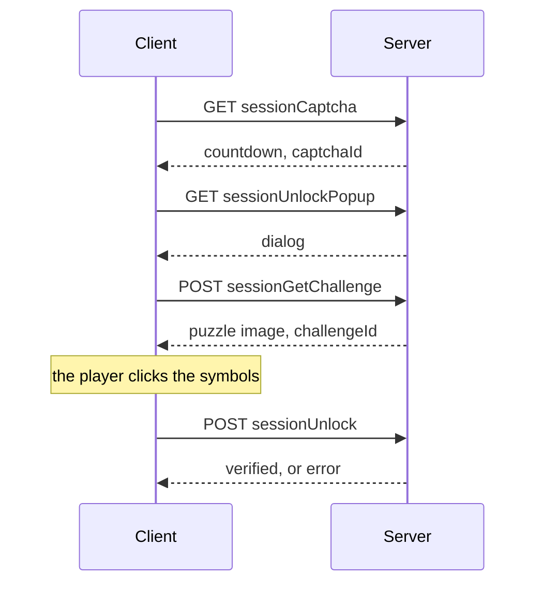

# Session CAPTCHA

[API docs](../README.md) › Basics › Session CAPTCHA

"Account verification": the game's check against automation. A countdown appears, and the player has to solve a click puzzle to keep playing.

> [!IMPORTANT]
> The check exists to keep the game fair. A tool that meets it should stop and hand it to the player. These pages describe the traffic so that clients can recognise it.



| Action | Method | Path | Status |
|--------|--------|------|--------|
| [Countdown](#countdown) | GET | `/en/main/sessionCaptcha` | 🔍 From code |
| [Dialog](#dialog) | GET | `/en/main/sessionUnlockPopup` | 🔍 From code |
| [Get a challenge](#get-a-challenge) | POST | `/en/main/sessionGetChallenge` | 🔍 From code |
| [Submit the solution](#submit-the-solution) | POST | `/en/main/sessionUnlock` | 🔍 From code |

Headers, cookie and `_token`: see [Making requests](../guides/requests.md#common-headers). Status labels are explained [there too](../guides/requests.md#status-labels). Earlier notes add `Origin: https://www.erepublik.com` to both `POST` requests and send the current page as `Referer`.

None of these requests was sent while writing this page.

---

## When it appears

- Pages that need verification carry `SERVER_DATA.sessionValidation`.
- An action can answer with `errorType: "captcha"`, or with a `captcha` or `data.captcha` object (`message`, `canVerifyLater`). The [deployment](../military/battlefield/deployment.md) client then loads the countdown; with `canVerifyLater` it leaves the dialog closed, otherwise it opens it.
- Some screens skip their requests while `Environment.hasSessionCaptcha` is set; some of them only when `remainingTime` is below 10.

| `SERVER_DATA.sessionValidation` | Type | Description |
|---------------------------------|------|-------------|
| `remainingTime` | number | Seconds left before the account is locked |
| `engine` | string | `clickCaptcha` or `sliderCaptcha` |
| `captchaId` | number | ID of this challenge, sent back in both `POST` requests |
| `captchaWidgetId` | number or null | `null` on the first call |
| `firstCall` | boolean | First time the countdown was requested |
| `scriptLoaded` | boolean | Whether the CAPTCHA script is loaded |

---

## Countdown

`GET /en/main/sessionCaptcha` · Auth required · 🔍 From code

Returns an HTML fragment with the countdown, a script that sets `SERVER_DATA.sessionValidation`, and the CAPTCHA stylesheets. The client appends it to the page.

```bash
curl 'https://www.erepublik.com/en/main/sessionCaptcha' \
  -H 'Cookie: erpk=YOUR_SESSION_TOKEN' \
  -H 'X-Requested-With: XMLHttpRequest'
```

### Response

<details>
<summary>Example response (earlier notes)</summary>

```html
<div id="verificationContainer" about="Pride and Prejudice and Zombies and Scripts" class="sessionVerify critical" data-remaining-time="107">
    <div id="verificationBox" class="animated">
        <div id="verificationIcon">
            <i class="fa fa-clock-o"></i>
        </div>
        <div class="verificationCountdown">
            <strong>01:47</strong>
        </div>
        <progress id="verificationProgress" value="107" max="300"></progress>
    </div>

    <div id="verificationPopup" class="">
        <h2>Account verification</h2>
        Please verify your account to ensure a fair gaming environment for all Citizens.
        <div id="verificationTime" class="yellowBox">
            <div class="verificationCountdown">
                Countdown: <strong>01:47</strong>
            </div>
        </div>
        <a id="startSessionVerify" href="javascript:" class="std_global_btn smallSize noFloat blueColor"><span>Verify</span></a>
        <div id="customerServiceLink">
            <a id="verifyLater" href="javascript:">Verify later</a>
            <a href="/en/main/tickets">Customer Service</a>
        </div>
    </div>
</div>
<script about="Hello there, General Kenobi.">
$j.extend(SERVER_DATA, {
  sessionValidation: {
    "remainingTime": 107,
    "engine": "clickCaptcha",
    "captchaId": 12345678,
    "captchaWidgetId": null,
    "firstCall": true,
    "scriptLoaded": false
  }
});
</script>
<link rel="stylesheet preload" as="style" type="text/css" href="//www.erepublik.net/css/sessionCaptcha/sessionCaptcha.1698060170.css"/>
<link rel="stylesheet preload" as="style" type="text/css" href="//www.erepublik.net/css/sessionCaptcha/sliderCaptcha.1698060170.css"/>
```

</details>

### Countdown behaviour

| Seconds left | The client |
|--------------|------------|
| 120 or more | Offers **Verify later** |
| 180 or less | Switches to the critical style |
| 60 or less | Opens the verification box |
| 0 | Locks the screen until verified |

The progress bar in the example has a maximum of 300 seconds.

**Source:** `erepublik.js` (version 1795779896), `sessionCaptcha.loadCaptcha` and `initVerification`; example from earlier notes.

---

## Dialog

`GET /en/main/sessionUnlockPopup` · Auth required · 🔍 From code

Returns the HTML of the dialog with the puzzle. The client requests it when the player presses **Verify**.

```bash
curl 'https://www.erepublik.com/en/main/sessionUnlockPopup' \
  -H 'Cookie: erpk=YOUR_SESSION_TOKEN' \
  -H 'X-Requested-With: XMLHttpRequest'
```

### Response

<details>
<summary>Example response (earlier notes)</summary>

```html
<div id="sessionUnlockModal" class="blueBorderPopup captchaEngine_sliderCaptcha captchaEngine_clickCaptcha loading" style="display: block;">
    <a href="javascript:" class="close closeButton" title="Close" id="cancelCaptcha">&#10006;</a>
    <h2>Account verification</h2>
    <p class="text">Please verify your account to ensure a fair gaming environment for all Citizens.</p>
    <div id="sessionUnlockCaptchaDiv">
        <div id="imageWrapper" class="imageWrapper" data-i18n="Click and select in this order (left to right)">
            
        </div>
        <i id="refreshIcon" class="refreshIcon fa fa-repeat"></i>
        <i id="helpIcon" class="helpIcon fa fa-question-circle"></i>
        <div id="clickCaptchaHelp" class="hide">
            <p class="up">
                <q class="up">&#11181;</q>
                Find these symbols in the above image.<br>
                Click on the symbols <b>in this order</b> (left to right)
            </p>
            <p class="down">
                <q class="down">&#11183;</q>
                Click <b>Verify</b>
            </p>
        </div>
    </div>
    <div id="sessionInfoMessages"></div>

    <div id="sessionUnlockButtons" class="blueBorderBottom">
        <a id="sessionUnlockSubmit" href="javascript:" title="Verify" class="std_global_btn mediumSize disabled right">
            <span>Continue</span>
        </a>
    </div>
    <br clear="all">
    <script>showSessionValidationCaptcha = sessionCaptcha.clickCaptcha.showValidationCaptcha;</script>
    <div id="sessionUnlockMessages"></div>
</div>
```

</details>

| Element ID | Purpose |
|------------|---------|
| `sessionUnlockModal` | Dialog container |
| `cancelCaptcha` | Close button |
| `sessionUnlockCaptchaDiv` | Puzzle container |
| `captchaImage` | Puzzle image |
| `refreshIcon` | New image |
| `helpIcon`, `clickCaptchaHelp` | Instructions |
| `sessionInfoMessages`, `sessionUnlockMessages` | Messages |
| `sessionUnlockSubmit` | Submit button, disabled until enough clicks |

**Source:** `erepublik.js` (version 1795779896), `initVerification`; HTML from earlier notes.

---

## Get a challenge

`POST /en/main/sessionGetChallenge` · Auth required · 🔍 From code

Returns the puzzle image and the identifiers of the challenge.

> [!WARNING]
> Part of the verification of your session. Leave it to the game client.

### Request

| Name | Type | Required | Description |
|------|------|----------|-------------|
| `_token` | string | Yes | [CSRF token](../guides/requests.md#csrf-token) |
| `captchaId` | number | Yes | `SERVER_DATA.sessionValidation.captchaId` |
| `env` | string | Yes | Opaque value the client builds from the state of the browser |
| `isRefresh` | number | No | `1` when a new image is requested |
| `imageId` | string | No | Identifier of the previous image |

```bash
curl 'https://www.erepublik.com/en/main/sessionGetChallenge' \
  -H 'Cookie: erpk=YOUR_SESSION_TOKEN' \
  -H 'X-Requested-With: XMLHttpRequest' \
  --data-urlencode '_token=YOUR_CSRF_TOKEN' \
  --data-urlencode 'captchaId=12345678' \
  --data-urlencode 'env=CLIENT_ENV_VALUE'
```

### Response

Earlier notes, hashes shortened:

```json
{
  "src": "data:image/webp;base64,...",
  "imageId": "IMAGE_ID",
  "challengeId": "CHALLENGE_ID",
  "onLoad": "JAVASCRIPT_RUN_BY_THE_CLIENT",
  "minCnt": 3,
  "srcsetId": "SRCSET_ID"
}
```

| Field | Type | Description |
|-------|------|-------------|
| `src` | string | Puzzle image as a data URI: WebP, PNG or AVIF |
| `imageId` | string | Image identifier (long hex string) |
| `challengeId` | string | Challenge identifier (long hex string) |
| `onLoad` | string | Script the game client runs |
| `minCnt` | number | Clicks needed, typically 3 |

**Source:** `erepublik.js` (version 1795779896), `sessionCaptcha.clickCaptcha.getChallenge`; response from earlier notes.

---

## Submit the solution

`POST /en/main/sessionUnlock` · Auth required · 🔍 From code

> [!WARNING]
> Answers the challenge. Earlier notes: repeated wrong answers may bring further restrictions.

### Request

| Name | Type | Required | Description |
|------|------|----------|-------------|
| `_token` | string | Yes | CSRF token |
| `captchaId` | number | Yes | As above |
| `imageId` | string | Yes | Image identifier held by the client |
| `challengeId` | string | Yes | From the challenge response |
| `clickMatrix` | string | Yes | JSON array of `{ "x", "y" }`, relative to the image, in click order |
| `isMobile` | boolean | Yes | Whether the browser is a mobile one |
| `env` | string | Yes | As above |
| `src` | string | Yes | The image data URI that was shown |

The puzzle is 400 × 230 pixels and asks for symbols to be clicked from left to right. The client enables the button after `minCnt` clicks.

No cURL example: the values come from the player's own clicks and the running game client.

### Response

```json
{ "error": true, "message": "The challenge solution was incorrect.", "verified": false, "mustReload": true }
```

<details>
<summary>Success (expected shape, earlier notes)</summary>

```json
{ "error": false, "message": "Session verified successfully", "verified": true, "mustReload": false }
```

</details>

| Field | Type | Description |
|-------|------|-------------|
| `error` | boolean | Verification failed |
| `message` | string | Text for the player |
| `verified` | boolean | The session is unlocked |
| `mustReload` | boolean | The client reloads the page; also honoured on challenge errors |
| `captchaErrorId` | — | Optional, shown with the error message (also on challenge errors) |
| `isPersistent` | boolean | Optional: keep the message on screen |

After success the client closes the dialog and, except on a battlefield page, reloads.

If the client believes third-party software interferes, it shows "Please disable third party software before continuing…" instead of the puzzle.

**Source:** `erepublik.js` (version 1795779896), `sessionCaptcha.clickCaptcha.verify`, `handleUnlockResponse`, `handleUnlockSuccess`; responses from earlier notes.

---

## Open questions

| Topic | Earlier notes | Game code | Page follows |
|-------|---------------|-----------|--------------|
| Slider puzzle | Two engines, click and slider; in the slider one the player slides a puzzle piece to complete an image | Only the click engine's flow was found; it reuses the slider texts | — |
| Optional request fields | Not mentioned | `isRefresh` and `imageId` on challenge requests | Code |
| Status check | An endpoint to check completion was expected | None found | — |
