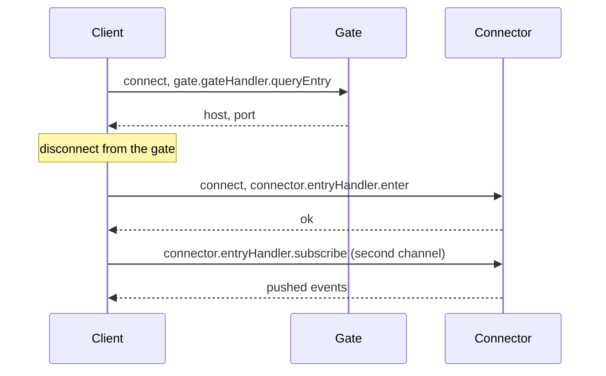

# Real-time WebSocket

[API docs](../README.md) › Basics › Real-time WebSocket

The game pushes live battle events and deployment progress over a WebSocket, using the [Pomelo](https://github.com/NetEase/pomelo) framework. 🔍 From code: no connection was opened while writing this page.



---

## Settings

From `erepublik.settings.pomelo` on game pages:

```json
{ "gate": "gate.erepublik.com", "port": 3050, "authToken": "YOUR_AUTH_TOKEN" }
```

> [!WARNING]
> `authToken` is a secret of your session; earlier notes say it equals the `erpk` cookie. Do not share saved pages that contain it.

The client library is `//www.erepublik.net/js/pomelo/lib/build/build.js` (earlier notes: with a build timestamp in the name). It connects to `wss://{host}:{port}` from an HTTPS page, `ws://` otherwise, with binary frames in the Pomelo protocol. A plain WebSocket client has to implement that protocol: handshake, heartbeat, data and kick packets.

---

## Connecting

| Step | Route | Request body |
|------|-------|--------------|
| 1. Ask the gate for a connector | `gate.gateHandler.queryEntry` | `userId` |
| 2. Join the first channel on the connector | `connector.entryHandler.enter` | Channel body |
| 3. Join another channel on the open connection | `connector.entryHandler.subscribe` | Channel body |

| Channel | Body | Used for |
|---------|------|----------|
| `userChannel` | `token` (`authToken`), `userId`, `log` | Your deployment progress |
| `battleChannel` | `battleId`, `userId`, `log` | Events of one battle |

- `userId` is your citizen ID. `log` is `true` only when `erepublik.settings.isLive` is false.
- The gate answers with `host` and `port`; the client keeps them for later connections.
- A response with `code: 500` is an error.
- Without an `authToken` the client does not join the user channel.
- The client waits about a second after the first channel is registered, then connects. It joins the user channel before the battle channel when it needs both.

---

## Events

| Event | Channel | Meaning |
|-------|---------|---------|
| `onMessage` | battle | A fighter's action in the battle |
| `onDeployProgress` | user | Progress of your [deployment](../military/battlefield/deployment.md#while-deployed) |
| `onDeployFinished` | user | Your deployment ended; payload described on the same page |

The client library emits `onKick`, `io-error` and `close`; the game also listens for `onError` and `error`.

### `onMessage`

Fields the game reads:

| Field | Description |
|-------|-------------|
| `side` | Country ID of the side; compared with the page's left and right side IDs |
| `division` | `1`–`4`, or `11` for aircraft |
| `msg.citizenId` | Fighter |
| `msg.type` | The battlefield draws `fight` and `fight_aircraft` |
| `msg.damage` | Damage dealt |
| `msg.health` | Fighter's remaining health in percent; below 25 is shown as low, above 50 as high |
| `msg.weaponQuality.weaponId` | Weapon quality; `-1` is treated as `0` |
| `msg.weaponQuality.skinId` | Vehicle skin |
| `msg.specialWeapon`, `msg.specialWeaponId` | Set for bombs |
| `objective` | Optional campaign objective update; `id` identifies it |

The message carries other players' activity, so treat captured traffic as personal data.

The player list joins the battle channel only when the graphics setting for showing other players is on. When it is off, the deployment code joins the channel itself, to follow your own damage.

---

## Without WebSocket

Poll the [battle console and live data](../military/battlefield/live-data.md) instead.

---

## Open questions

| Topic | Earlier notes | Game code | Page follows |
|-------|---------------|-----------|--------------|
| `authToken` | Same value as the `erpk` cookie | Only read from `erepublik.settings.pomelo` | Not settled |
| Other events | Domination, battle heroes, zone won or lost | Not seen in the scripts that were read; `battle_new.js` was not checked | — |
| Battle channel authentication | One token for the connection | `battleChannel` sends no token | Code |

**Source:** `erpk_angular_services.js` (version 1795779904), `ErpkPomeloService`; `erpk_angular_controllers.js` (version 1795779904), `BattlefieldPlayersController` and `DeploymentController`; the client library and `erepublik.settings.pomelo` (keys only), 2026-11-27.
