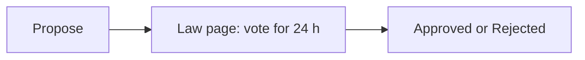

# Congress proposals and laws

[API docs](../README.md) › Country and politics › Congress proposals and laws

A law proposal is voted on for 24 hours by Congress members and the president. Proposals are listed on the [Administration](administration.md#law-proposals) tab; each has its own page.



| Action | Method | Path | Status |
|--------|--------|------|--------|
| [Law page](#law-page) | GET | `/en/main/law/{country}/{lawId}` | ✅ Verified 2026-11-27 |
| [Voting countdown](#voting-countdown) | GET | `/law_countdown/{countryId}/{lawId}` | ✅ Verified 2026-11-27 |
| [Vote on a law](#vote-on-a-law) | POST | `/vote-law` | 🔍 From code |
| [Propose a donation](#propose-a-donation) | POST | `/en/{country}/new-donation` | ❔ Unconfirmed |
| [Work tax form](#work-tax) | GET | `/en/{country}/country-income-tax` | ✅ Verified 2026-11-28 |
| [Propose: work tax](#work-tax) | POST | `/en/{country}/country-income-tax` | 🔍 From code |
| [Issue money form](#issue-money) | GET | `/en/{country}/issue-money` | ✅ Verified 2026-11-28 |
| [Propose: issue money](#issue-money) | POST | `/en/{country}/issue-money` | 🔍 From code |
| [Natural enemy form](#natural-enemy) | GET | `/en/{country}/natural-enemy` | ✅ Verified 2026-11-28 |
| [Propose: natural enemy](#natural-enemy) | POST | `/en/{country}/natural-enemy` | 🔍 From code |
| [President impeachment form](#president-impeachment) | GET | `/en/{country}/new-president-impeachment` | ✅ Verified 2026-11-28 |
| [Propose: president impeachment](#president-impeachment) | POST | `/en/{country}/new-president-impeachment` | 🔍 From code |
| [VAT and import taxes form](#vat-and-import-taxes) | GET | `/en/{country}/new-taxes` | ✅ Verified 2026-11-28 |
| [Propose: VAT and import taxes](#vat-and-import-taxes) | POST | `/en/{country}/new-taxes` | 🔍 From code |
| [Minimum wage form](#minimum-wage) | GET | `/en/{country}/new-minimum-wage` | ❔ Unconfirmed |
| [Current taxes](#current-taxes) | GET | `/en/list_country_taxes/{countryId}` | ✅ Verified 2026-11-28 |

Headers, cookie and `_token`: see [Making requests](../guides/requests.md#common-headers). Status labels are explained [there too](../guides/requests.md#status-labels). Note that two of these paths have **no** `/en` prefix.

Alliance proposals and votes use their own endpoints: see [Alliances](alliances.md).

---

## Law types

| `taxStyle` class | Page heading | Meaning |
|------------------|--------------|---------|
| `Donate` | Donate | Transfer from the treasury |
| `NaturalEnemy` | Natural Enemy | Choose a natural enemy (earlier notes: declare or remove) |
| `Airstrike` | Airstrike | Attack a country without a shared border |
| `DeclareWar` | Declare War | Declare war (earlier notes: on a bordering country) |
| `ResourceConcession` | Resource Concession | Lease a region's resource for a share of industry GDP |
| `MutualProtectionPact` | Alliance | Mutual protection pact |
| `MinimumWage` | Minimum Wage | Change the minimum salary |

More types probably exist (embargo, tax changes, impeachment).

---

## Law page

`GET /en/main/law/{country}/{lawId}` · Auth required · ✅ Verified 2026-11-27

| Name | In | Type | Required | Description |
|------|----|------|----------|-------------|
| `country` | path | string | Yes | Permalink |
| `lawId` | path | number | Yes | From the [law list](administration.md#law-proposals) |

```bash
curl -L 'https://www.erepublik.com/en/main/law/Poland/344511' \
  -H 'Cookie: erpk=YOUR_SESSION_TOKEN'
```

> [!IMPORTANT]
> Unlike the country tabs, this page needs a session: an anonymous request gets `302` to `/en` (earlier notes, 2026-07-23). A crawler should read that as an expired session, not a missing law.

### Content

```html
<h2 class="special padded">Donate</h2>
<p class="largepadded">Proposed by <a href="…/en/citizen/profile/{citizenId}">PlayerName</a><br>
  <span>Proposed: Day 6,946, 12:48 (21 hours ago)</span></p>
<p class="largepadded">Do you agree to transfer 400000 PLN from the country accounts to <a href="…/en/citizen/profile/{citizenId}">Recipient</a>?</p>

<div class="lawtimer">
  <input type="hidden" id="isFinished" value="no">
  <span class="countdown" id="law_countdown"></span>
  <p>The law voting process takes 24 hours.</p>
</div>
<div class="lawvote"><span id="numberOfVotesPro">33</span> <span class="voteyesdisable">Yes</span></div>
<div class="lawvote last"><span id="numberOfVotesAgainst">0</span> <span class="votenodisable">No</span></div>
<div id="info" class="infoicon"><p>Only congress members and country presidents have the right to vote.</p></div>

<table class="laws largepadded">
  <tr><td><a hovercard="1" href="/en/citizen/profile/{citizenId}">PlayerName</a></td>
      <td>Accepted</td></tr>
</table>
```

| Data | Selector | Notes |
|------|----------|-------|
| Law type | `h2.special` | |
| Proposer and time | `p.largepadded`, first | |
| Question | `p.largepadded`, second | Its links point to the subject |
| Finished | `#isFinished` | `no` or `yes` |
| Result | `.lawtimer span.accept` (`Approved`) or `span.reject` (`Rejected`) | Replaces the countdown |
| Votes | `#numberOfVotesPro`, `#numberOfVotesAgainst` | At page load |
| Extra rule | `#info p` | For Natural Enemy: `it needs 66% of the Congress votes` |
| Vote list | `table.laws.largepadded` | Not the same columns as the table with that class on the Administration tab |

Inline: `var countryId`, `var lawId`, `var canVote` (`0` or `1`), `var token`. Script: `law/showLaw.js`. A **Report law** link goes to `/en/main/tickets-report/{lawId}/law-proposal`.

No cost in gold is shown for any law, including a declaration of war.

### Question formats

| Type | Text |
|------|------|
| Donate | `Do you agree to transfer 400000 PLN from the country accounts to {recipient}?` |
| ResourceConcession | `Do you agree with the Resource Concession of Rubber from Lapland, Finland to Poland in exchange for 5% of Poland's daily Weapons industry GDP ?` |
| MutualProtectionPact | `President of Finland proposed a mutual protection pact with Poland` |
| DeclareWar | `Do you agree on declaring war to {country}` |
| NaturalEnemy | `{country} has been proposed as Natural Enemy.` |
| Airstrike | `{country} has been proposed as a target for an Airstrike.` |
| MinimumWage | `Minimum wage change from 1 LTL to 7 LTL` |

| Type | Link in the question |
|------|----------------------|
| Donate | Citizen or organization profile (often an organization such as a national bank) |
| ResourceConcession | The conceded region and the receiving country |
| MutualProtectionPact | Both countries |
| DeclareWar, NaturalEnemy, Airstrike | Target country (its politics tab) |
| MinimumWage | None |

The concession percentage is what produces the [`Resource Concession Fee`](economy.md#tax-revenue). Mind the space before its `?`.

> [!IMPORTANT]
> A law about another country's region can be rendered **in that country's language**, although the request used `/en/`: a Brazilian region gave `Cervo`, `Alimento`, `Polônia` and `/br/` links. Classify by the [list's class](#law-types), take subjects from link targets, and do not match English words.

**Source:** real requests, 2026-11-27; anonymous redirect — earlier notes.

---

## Voting countdown

`GET /law_countdown/{countryId}/{lawId}` · Auth not checked · ✅ Verified 2026-11-27

Called by the law page while `isFinished` is `no`. No `/en` prefix: with it the path returns `404`.

| Name | In | Type | Required | Description |
|------|----|------|----------|-------------|
| `countryId` | path | number | Yes | Numeric country ID |
| `lawId` | path | number | Yes | Law ID |

```bash
curl 'https://www.erepublik.com/law_countdown/35/344511' \
  -H 'Cookie: erpk=YOUR_SESSION_TOKEN' \
  -H 'X-Requested-With: XMLHttpRequest'
```

JSON, although the `Content-Type` says `text/html`:

```json
{
  "begin_date": "Thu, 26 Nov 2026 12:48:37 -0800",
  "server_time": "Fri, 27 Nov 2026 09:50:40 -0800"
}
```

Voting ends at `begin_date` plus one day.

**Source:** real request, 2026-11-27; `law/showLaw.js` (version 1698060179).

---

## Vote on a law

`POST /vote-law` · Auth required (Congress member or president) · 🔍 From code

> [!WARNING]
> Casts your vote.

| Name | Type | Required | Description |
|------|------|----------|-------------|
| `_token` | string | Yes | `token` from the law page |
| `c` | number | Yes | `countryId` |
| `l` | number | Yes | `lawId` |
| `a` | string | Yes | The vote; its values come from page buttons that were not seen |

The client sends it only when `canVote` is `1` and reads `yes` and `no` (new tallies) from the JSON response.

**Source:** `law/showLaw.js` (version 1698060179), `voteNow`.

---

## Propose a donation

`POST /en/{country}/new-donation` · Auth required (Congress member) · ❔ Unconfirmed

> [!WARNING]
> Creates a law proposal to send treasury money to a citizen or organization.

From earlier notes only. For a citizen who is not in Congress, `GET` on the same path redirected to `/en` (2026-11-27), as does an anonymous request.

| Name | Type | Required | Description |
|------|------|----------|-------------|
| `_token` | string | Yes | CSRF token, from the `GET` form |
| `requirments` | number | Yes | Observed `1`; the misspelling is the real field name |
| `currency` | number | Yes | `1` local currency; `0` possibly gold |
| `type_name` | string | Yes | Recipient's display name, not an ID |
| `value` | number | Yes | Amount |
| `debate` | string | No | Debate text |
| `commit` | string | Yes | `Propose` |

```bash
curl 'https://www.erepublik.com/en/Poland/new-donation' \
  -H 'Cookie: erpk=YOUR_SESSION_TOKEN' \
  -H 'Content-Type: application/x-www-form-urlencoded' \
  -H 'Origin: https://www.erepublik.com' \
  -H 'Referer: https://www.erepublik.com/en/Poland/new-donation' \
  --data-raw '_token=YOUR_CSRF_TOKEN&requirments=1&currency=1&type_name=RECIPIENT_NAME&value=1&debate=&commit=Propose'
```

### Response

A form post followed by a redirect (`302`), not JSON:

```html
<html><head><meta http-equiv="refresh" content="0;url=https://www.erepublik.com/en/country-administration/Poland/1"/></head></html>
```

Success leads to the Administration page, where the proposal appears first; a request without rights leads to `/en`.

**Source:** earlier notes. No call was found in the scripts read.

---

## Proposal forms

The Administration tab links to one page per law type. Each page holds a plain HTML form that posts back to the same path. On 2026-11-28 the pages below were read with `GET` on an account that sees the buttons; **no form was submitted**, so required fields, limits enforced by the server and responses are not verified. Percent limits are the ones printed on the pages. `debate` is the optional "Debate location" text.

### Work tax

`GET` ✅ Verified 2026-11-28 · `POST` 🔍 From code · `/en/{country}/country-income-tax` · Auth required

> [!WARNING]
> `POST` creates a law proposal for the whole country.

| Name | Type | Required | Description |
|------|------|----------|-------------|
| `_token` | string | Yes | CSRF token, from the form |
| `income_tax` | number | Yes | Work Tax in percent, `1`–`25`; the field is prefilled |
| `debate` | string | No | Debate location |
| `commit` | string | Yes | `Propose` |

```bash
curl 'https://www.erepublik.com/en/Poland/country-income-tax' \
  -H 'Cookie: erpk=YOUR_SESSION_TOKEN'
```

```bash
curl 'https://www.erepublik.com/en/Poland/country-income-tax' \
  -H 'Cookie: erpk=YOUR_SESSION_TOKEN' \
  --data-urlencode '_token=YOUR_CSRF_TOKEN' \
  --data-urlencode 'income_tax=10' \
  --data-urlencode 'debate=' \
  --data-urlencode 'commit=Propose'
```

**Source:** form on the page, real `GET` 2026-11-28.

### Issue money

`GET` ✅ Verified 2026-11-28 · `POST` 🔍 From code · `/en/{country}/issue-money` · Auth required

> [!WARNING]
> `POST` creates a law proposal for the whole country.

Form `id="congressLaws"`.

| Name | Type | Required | Description |
|------|------|----------|-------------|
| `_token` | string | Yes | CSRF token, from the form |
| `issue_money` | number | Yes | Amount of country currency to issue, at most 6 characters |
| `debate` | string | No | Debate location |
| `commit` | string | Yes | `Propose` |

```bash
curl 'https://www.erepublik.com/en/Poland/issue-money' \
  -H 'Cookie: erpk=YOUR_SESSION_TOKEN'
```

```bash
curl 'https://www.erepublik.com/en/Poland/issue-money' \
  -H 'Cookie: erpk=YOUR_SESSION_TOKEN' \
  --data-urlencode '_token=YOUR_CSRF_TOKEN' \
  --data-urlencode 'issue_money=1' \
  --data-urlencode 'debate=' \
  --data-urlencode 'commit=Propose'
```

**Source:** form on the page, real `GET` 2026-11-28.

### Natural enemy

`GET` ✅ Verified 2026-11-28 · `POST` 🔍 From code · `/en/{country}/natural-enemy` · Auth required

> [!WARNING]
> `POST` creates a law proposal for the whole country.

Form `id="propose_law_form"`; it has no `debate` or `commit` field. The page script asks the user to type the country name and compares it (ignoring case) before it fills `countryNameConfirm`. For the value `62` it asks only for a confirmation of a "no Natural Enemy" law and leaves the field empty; that option was not in the list read.

| Name | Type | Required | Description |
|------|------|----------|-------------|
| `_token` | string | Yes | CSRF token, from the form |
| `requirments` | number | Yes | Hidden, `1`; the misspelling is the real field name |
| `country_list` | number | Yes | Country ID from the select |
| `countryNameConfirm` | string | See text | Country name typed by the user |

```bash
curl 'https://www.erepublik.com/en/Poland/natural-enemy' \
  -H 'Cookie: erpk=YOUR_SESSION_TOKEN'
```

```bash
curl 'https://www.erepublik.com/en/Poland/natural-enemy' \
  -H 'Cookie: erpk=YOUR_SESSION_TOKEN' \
  --data-urlencode '_token=YOUR_CSRF_TOKEN' \
  --data-urlencode 'requirments=1' \
  --data-urlencode 'country_list=COUNTRY_ID' \
  --data-urlencode 'countryNameConfirm=COUNTRY_NAME'
```

**Source:** form on the page, real `GET` 2026-11-28 and its inline script.

### President impeachment

`GET` ✅ Verified 2026-11-28 · `POST` 🔍 From code · `/en/{country}/new-president-impeachment` · Auth required

> [!WARNING]
> `POST` creates a law proposal for the whole country.

The form has no other fields.

| Name | Type | Required | Description |
|------|------|----------|-------------|
| `_token` | string | Yes | CSRF token, from the form |
| `debate` | string | No | Debate location |
| `commit` | string | Yes | `Propose` |

```bash
curl 'https://www.erepublik.com/en/Poland/new-president-impeachment' \
  -H 'Cookie: erpk=YOUR_SESSION_TOKEN'
```

```bash
curl 'https://www.erepublik.com/en/Poland/new-president-impeachment' \
  -H 'Cookie: erpk=YOUR_SESSION_TOKEN' \
  --data-urlencode '_token=YOUR_CSRF_TOKEN' \
  --data-urlencode 'debate=' \
  --data-urlencode 'commit=Propose'
```

**Source:** form on the page, real `GET` 2026-11-28.

### VAT and import taxes

`GET` ✅ Verified 2026-11-28 · `POST` 🔍 From code · `/en/{country}/new-taxes` · Auth required

> [!WARNING]
> `POST` creates a law proposal for the whole country.

Industry IDs offered: `1` Food, `2` Weapons, `23` Aircraft Weapons, `3` Moving Tickets, `4` House, `7` Food Raw Materials, `12` Weapon Raw Materials, `24` Aircraft Weapons Raw Materials, `17` House Raw Materials. The page script fills the fields from [current taxes](#current-taxes). For raw materials it makes the VAT field read-only and shows `vat_raw_materials` with `0`.

| Name | Type | Required | Description |
|------|------|----------|-------------|
| `_token` | string | Yes | CSRF token, from the form |
| `industry_name` | number | Yes | Industry ID; `0` is the "Choose industry" placeholder |
| `vat` | number | Yes | Value Added Tax in percent, `1`–`25` |
| `vat_raw_materials` | number | See text | Shown instead of `vat` for raw materials |
| `import_tax` | number | Yes | Import Tax in percent, `1`–`99` |
| `debate` | string | No | Debate location |
| `commit` | string | Yes | `Propose` |

```bash
curl 'https://www.erepublik.com/en/Poland/new-taxes' \
  -H 'Cookie: erpk=YOUR_SESSION_TOKEN'
```

```bash
curl 'https://www.erepublik.com/en/Poland/new-taxes' \
  -H 'Cookie: erpk=YOUR_SESSION_TOKEN' \
  --data-urlencode '_token=YOUR_CSRF_TOKEN' \
  --data-urlencode 'industry_name=1' \
  --data-urlencode 'vat=1' \
  --data-urlencode 'vat_raw_materials=' \
  --data-urlencode 'import_tax=5' \
  --data-urlencode 'debate=' \
  --data-urlencode 'commit=Propose'
```

**Source:** form on the page, real `GET` 2026-11-28 and `/js/law/taxes.js`.

### Minimum wage

`GET /en/{country}/new-minimum-wage` · Auth required · ❔ Unconfirmed

The Administration tab links here, but on 2026-11-28 the `GET` redirected to `/en/country-administration/{country}/1`, as did [`new-donation`](#propose-a-donation). The form fields are therefore unknown. Why the account could not open it was not established.

```bash
curl 'https://www.erepublik.com/en/Poland/new-minimum-wage' \
  -H 'Cookie: erpk=YOUR_SESSION_TOKEN'
```

### Current taxes

`GET /en/list_country_taxes/{countryId}` · ✅ Verified 2026-11-28

The tax rates used to prefill the [taxes form](#vat-and-import-taxes). Read-only.

| Name | In | Type | Required | Description |
|------|----|------|----------|-------------|
| `countryId` | path | number | Yes | [Country ID](../basics/id-tables.md) |

```bash
curl 'https://www.erepublik.com/en/list_country_taxes/72' \
  -H 'Cookie: erpk=YOUR_SESSION_TOKEN'
```

The body is JSON served as `text/html`. Shortened:

```json
[{ "industry": "Food", "id": 1, "vat": 1, "income": 0, "import": 5, "isRawMaterial": false }]
```

| Field | Type | Description |
|-------|------|-------------|
| `industry` | string | Industry name; the client redirects to `/` on `redirect` and skips `not set` |
| `id` | number | Industry ID |
| `vat`, `income`, `import` | number | Rates in percent |
| `isRawMaterial` | boolean | Raw material industry |

A request without cookies returned `200` with `null`.

**Source:** `/js/law/taxes.js`; real requests 2026-11-28.

---

## Open questions

| Topic | Notes |
|-------|-------|
| `a` values of a vote | Not known; the buttons are shown only to voters |
| Other proposal forms | [Six pages](#proposal-forms) are linked besides the donation; how war, pact, airstrike and concession proposals are made from this tab is not covered |
| Proposal responses | No form was submitted |
| Wrong country with a valid `lawId` | Not tested |
| Concession wording | Earlier notes: `to Poland … of Poland's`; localized pages differ only in language |
| MPP wording | Earlier notes show the proposer as the viewed country; on law 343289 it was the partner |
