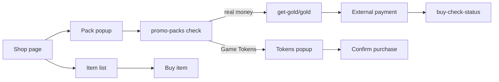

# Shop and pack purchases

[API docs](../README.md) › Economy › Shop

The shop (`/en/main/special-items`) sells two different things:

- **Packs**, paid with real money or Game Tokens, shown as large cards.
- **Items**, paid with in-game currency (Gold, Loyalty Points, VIP currencies).



| Action | Method | Path | Status |
|--------|--------|------|--------|
| [Shop page](#shop-page) | GET | `/en/main/special-items` | ✅ Verified 2026-11-27 |
| [Pack popup](#pack-popup) | GET | `/en/main/custom-pack` | ✅ Verified 2026-11-27 |
| [List items](#list-items) | GET | `/en/main/shopItemsJson` | ✅ Verified 2026-11-27 |
| [Buy item](#buy-item) | POST | `/en/main/buyGoldItems`, `/en/main/vip-shop-buy` | ✅ Verified 2026-11-28 |
| [Buy or claim a pack](#buy-or-claim-a-pack) | POST | `/en/get-gold/gold` | ✅ Verified 2026-11-27 (payment) |
| [Payment window](#payment-window) | GET | `/en/main/paymenthub-buy` | ✅ Verified 2026-11-27 |
| [Payment status](#payment-status) | GET | `/en/main/buy-check-status/{transactionId}` | ✅ Verified 2026-11-27 |
| [Check pending purchase](#check-pending-purchase) | POST | `/en/main/promo-packs` | ✅ Verified 2026-11-27 |
| [Game Tokens popup](#game-tokens-popup) | POST | `/en/main/buy-withGameTokensPopup` | ✅ Verified 2026-11-27 |
| [Confirm token purchase](#confirm-token-purchase) | POST | `/en/main/buy-withGameTokens` | ✅ Verified 2026-11-27 |

Headers and `_token`: see [Making requests](../guides/requests.md#common-headers).

---

## Shop page

`GET /en/main/special-items` · Auth required · ✅ Verified 2026-11-27

HTML page. Each pack is an element with class `packContainer`; its `id` is the **pack type** used by every pack endpoint.

| Class on the pack | Meaning |
|-------------------|---------|
| `section_black_friday`, `section_one_time`, `section_unlimited` | Shop section |
| `one_time_only`, `limited_amount` | Purchase limits |
| `progressive_pack` | Part of a "Chain Deal" |
| `already_bought` | Already bought or received |
| `freePack` | Costs nothing |

The buy button is `a.pop_custom_packs` with `data-type="{packType}"`. The client can also open the page at a section or pack with `?showType=…` or `?showPack=…` (🔍 From code).

---

## Pack popup

`GET /en/main/custom-pack?packType={packType}` · Auth required · ✅ Verified 2026-11-27

HTML fragment with the pack's contents, price and purchase scripts.

| Name | In | Required | Description |
|------|----|----------|-------------|
| `packType` | query | Yes | Pack element `id`, e.g. `goldPack_S` |
| `to_citizen_id` | query | No | Buy as a gift (🔍 From code) |

```bash
curl 'https://www.erepublik.com/en/main/custom-pack?packType=goldPack_S' \
  -H 'Cookie: erpk=YOUR_SESSION_TOKEN' \
  -H 'X-Requested-With: XMLHttpRequest'
```

The fragment contains a form `#goBuy` (action `/en/get-gold/gold`) and, for packs payable with tokens, a button `#buyWithGameTokens` with `data-pack-name`. Prices are shown in the account's local currency.

A pack that is not available to you (for example a locked tier, or a gift already received) returns only the message `"You cannot buy this pack"` with status 200.

---

## List items

`GET /en/main/shopItemsJson` · Auth required · ✅ Verified 2026-11-27

Returns `data.goldItems.items[]` and `data.vipShopItems.items[]`.

Fields relevant to buying and discounts:

| Field | Where | Meaning |
|-------|-------|---------|
| `id` | both | Sent as `itemId` |
| `goldPrice` | gold items | Regular price |
| `discountedGoldPrice` | gold items | Present when discounted; the client charges this price |
| `lpPrice` | gold items | Price in Loyalty Points, if offered |
| `itemPurchaseLimit`, `initialPurchaseLimit` | both | Remaining and original limit |
| `soldOut` | both | Sold out |
| `packClasses` | gold items | CSS classes; event items carry an event class |
| `price`, `currency`, `discount`, `discountClass` | VIP items | Price and discount badge |

---

### More fields and values (earlier notes)

| Field | Description |
|-------|-------------|
| `type` | `speed_booster_X`, `damage_booster_X`, `catchup_booster`, `deploy_size_booster`, `prestige_points`, `energy_bars`, `fuel`, `storage`, reset tokens, discharge documents and others; VIP items add a suffix (`catchup_booster_40_300_vip11`) |
| `quantity`, `maxQuantity`, `cost` | VIP item amount, limit and cost |
| `vipLevel`, `locked` | Minimum VIP level; `true` above your level |
| `currency` | `gold`, `currency`, `food_raw`, `weapon_raw`, `aircraft_raw`, `house_raw`, `loyalty_points`, `unavailable` (locked) |
| `currencyName`, `currencyIcon`, `lpCurrencyName`, `lpCurrencyIcon` | Display data of the currencies |
| `data` | `name`, `type`, `image`, `quality`, `tooltip`, `discount`, `duration` |
| `isKey`, `dotNotification` | Flags, `false` observed |
| `discountClass` | `green` 5–20%, `blue` 25–40%, `purple` 45–60%, `orange` 65–80%, `red` 85% and more |

Some prices rise with each purchase (for example Fuel).

## Buy item

`POST /en/main/buyGoldItems` (or `/en/main/vip-shop-buy` for VIP items) · Auth required · ✅ Verified 2026-11-28 (`buyGoldItems`; `vip-shop-buy` 🔍 From code)

> [!WARNING]
> Spends in-game currency immediately.

| Name | Type | Description |
|------|------|-------------|
| `_token` | string | CSRF token |
| `itemId` | string \| number | Item `id` |
| `amount` | number | Quantity |
| `currency` | string | `gold`, `lp`, a key type for boxes, or the VIP item's currency |
| `shownPrice` | number | Unit price shown to the player (the discounted one if present) |
| `vipShopItem` | boolean | Set for VIP items; selects the `vip-shop-buy` path |

### Request

```bash
curl 'https://www.erepublik.com/en/main/buyGoldItems' \
  -H 'Cookie: erpk=YOUR_SESSION_TOKEN' \
  -H 'X-Requested-With: XMLHttpRequest' \
  -H 'Referer: https://www.erepublik.com/en/main/gold-items' \
  --data-raw '_token=YOUR_CSRF_TOKEN&itemId=doubleEnergyBarPack2&vipShopItem=false&shownPrice=15.4&amount=100&currency=gold'
```

### Response

```json
{
  "error": false,
  "message": "Your purchase was successful.",
  "loyaltyPoints": 0,
  "gold": 0,
  "boxKeys": [],
  "health": 100,
  "canBuyMore": false,
  "itemPurchaseLimit": false,
  "initialPurchaseLimit": 100,
  "soldOut": true
}
```

| Field | Type | Description |
|-------|------|-------------|
| `error`, `message` | boolean, string | Result and text shown to the player |
| `gold`, `loyaltyPoints` | number | Your balances |
| `boxKeys` | array | Box keys; empty here |
| `health` | number | Your energy |
| `canBuyMore`, `soldOut` | boolean | `false` and `true` after buying up to the limit |
| `itemPurchaseLimit` | mixed | `false` observed with `soldOut: true`, although the item list gives a number |
| `initialPurchaseLimit` | number | Original purchase limit; `100` here, equal to the `amount` bought |

**Source:** real request, 2026-11-28 (double energy bars bought with Gold); client behaviour from `erpk_angular_controllers.js` (1795779904), shop controller `popupTriggerGold`, `purchase`; `ErpkShopFactory.purchase`.

---

## Buy or claim a pack

`POST /en/get-gold/gold` · Auth required · ✅ Verified 2026-11-27 (`paymenthub`); `free` 🔍 From code

> [!WARNING]
> Starts a **real-money** payment, or claims a free pack.

| Name | Description |
|------|-------------|
| `_token` | CSRF token |
| `buy_what` | Pack type |
| `payment_method` | `paymenthub` (payment) or `free` (free pack) |
| `force_pack` | From the popup form; `0` observed |
| `to_citizen_id` | Gift recipient, `0` for yourself |
| `buy_for_a_friend_check` | `on` or `off` |
| `gift_message`, `no_message_gift` | Gift options |

A `free` claim sends only `_token`, `buy_what` and `payment_method`; the client then reloads the page. The popup requires accepting the Terms of Service before a payment.

```bash
curl -L 'https://www.erepublik.com/en/get-gold/gold' \
  -H 'Cookie: erpk=YOUR_SESSION_TOKEN' \
  -H 'X-Requested-With: XMLHttpRequest' \
  --data-raw '_token=YOUR_CSRF_TOKEN&buy_what=bf2026Tokens_XS&payment_method=paymenthub&force_pack=0&buy_for_a_friend_check=off&gift_message=&no_message_gift=false&to_citizen_id=0'
```

For `paymenthub` the final response is the [payment window](#payment-window).

**Source:** live request and inline script of the [pack popup](#pack-popup), 2026-11-27.

---

## Payment window

`GET /en/main/paymenthub-buy?id={transactionId}` · Auth required · ✅ Verified 2026-11-27

HTML fragment shown while the payment is open. The browser's network log shows this request right after [Buy or claim a pack](#buy-or-claim-a-pack), whose own caller receives the fragment, so the `POST` evidently redirects here (the redirect status was not captured). The request was seen in the network log and was not sent on its own.

The fragment contains a form `#paymenthub-form` that opens the external payment provider in a new window (not documented here), and a script holding the numeric `transactionId`. The script polls [Payment status](#payment-status) every second. When processed, it shows a thank-you message and after 3 seconds opens `redirectURL`, or reloads the page if there is none.

---

## Payment status

`GET /en/main/buy-check-status/{transactionId}` · Auth required · ✅ Verified 2026-11-27

```bash
curl 'https://www.erepublik.com/en/main/buy-check-status/1234567' \
  -H 'Cookie: erpk=YOUR_SESSION_TOKEN' \
  -H 'X-Requested-With: XMLHttpRequest'
```

<details>
<summary>Responses: waiting and finished</summary>

```json
{"status": 1, "isProcessed": false, "description": "Started", "redirectURL": null}
```

```json
{"status": 4, "isProcessed": true, "description": "Finished", "redirectURL": "/en/main/special-items?thankYou=YmYyMDI2VG9rZW5zX1hT"}
```

</details>

| Field | Meaning |
|-------|---------|
| `status`, `description` | Only `1` Started and `4` Finished were observed |
| `isProcessed` | The client stops polling when `true` |
| `redirectURL` | `thankYou` is the Base64 pack type (`bf2026Tokens_XS` above) |

---

## Check pending purchase

`POST /en/main/promo-packs` · Auth required · ✅ Verified 2026-11-27

Sent before both a real-money and a Game Tokens purchase.

| Name | Description |
|------|-------------|
| `_token` | CSRF token |
| `check_pack` | Pack type |
| `force_pack` | From the popup form |
| `to_citizen_id` | Gift recipient or `0` |

```json
{"purchaseInProgress": false}
```

`purchaseInProgress: true` makes the client show a double-purchase warning (🔍 From code). The warning says a second purchase of the same pack is converted into Game Tokens.

**Source:** live request and inline script of the pack popup, `purchasePack.isPackAvailable`, 2026-11-27.

---

## Game Tokens popup

`POST /en/main/buy-withGameTokensPopup` · Auth required · ✅ Verified 2026-11-27

Returns the HTML confirmation popup for paying with Game Tokens. It does not buy anything.

| Name | Description |
|------|-------------|
| `_token` | CSRF token |
| `packName` | Pack type |
| `friendId` | Gift recipient, `0` for yourself |
| `buyForFriendCheck` | `on` or `off` |
| `giftMessage`, `noGiftMessage` | Gift options (`noGiftMessage`: `0` or `1`) |

```bash
curl 'https://www.erepublik.com/en/main/buy-withGameTokensPopup' \
  -H 'Cookie: erpk=YOUR_SESSION_TOKEN' \
  -H 'X-Requested-With: XMLHttpRequest' \
  --data-raw '_token=YOUR_CSRF_TOKEN&packName=bf2026ProgGold_XS&friendId=0&buyForFriendCheck=off&giftMessage=&noGiftMessage=0'
```

The popup states the token cost and your token balance, and warns that processing may take up to 5 minutes.

| Case | Popup content |
|------|---------------|
| Pack can be bought with tokens | Button `#confirmBuyWithTokens` |
| Pack cannot (seen on `bf2026Tokens_XS`) | "… cannot be bought", only a Close button |

Its inline script holds `packPrice`, which the [confirmation](#confirm-token-purchase) sends back.

---

## Confirm token purchase

`POST /en/main/buy-withGameTokens` · Auth required · ✅ Verified 2026-11-27

> [!WARNING]
> Spends Game Tokens. A pack can only be bought once.

| Name | Description |
|------|-------------|
| `_token` | CSRF token |
| `packName` | Pack type |
| `packPrice` | Value from the popup script, e.g. `4.99` (currency unconfirmed) |
| `friendId`, `buyForFriendCheck` | Gift recipient, `on`/`off` |
| `giftMessage`, `noGiftMessage` | Gift options |

```bash
curl 'https://www.erepublik.com/en/main/buy-withGameTokens' \
  -H 'Cookie: erpk=YOUR_SESSION_TOKEN' \
  -H 'X-Requested-With: XMLHttpRequest' \
  --data-raw '_token=YOUR_CSRF_TOKEN&packName=bf2026ProgEB_XS&packPrice=4.99&friendId=0&buyForFriendCheck=off&giftMessage=&noGiftMessage=0'
```

The response is HTML shown as the next popup. On success the root element has classes `buyResult buySuccess`:

<details>
<summary>Success response (shortened, balance replaced with 0)</summary>

```html
<div class="global_pack ... gameTokensPopup bf2026ProgEB buyResult buySuccess">
  <p class="gameTokensInfo success">You successfully used <b>49 Game Tokens</b> for the purchase of a <b>Black Energy XS</b>.</p>
  <p class="gameTokensInfo"><em>You currently have <b>0</b> Game Tokens in your inventory.</em></p>
  <a id="closeBuyWithTokens">Great</a>
</div>
```

</details>

A `buyError` class exists in the styles; no error response was observed.

Delivery is asynchronous (the popup warns of up to 5 minutes). Right after the purchase the [shop page](#shop-page) shows the pack with classes `already_bought pending` and the label "Processing". In the observed case it was delivered within about a minute: the next tier had replaced it on the shop page.

**Source:** live request and inline script of the [Game Tokens popup](#game-tokens-popup), 2026-11-27.
