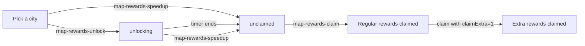

# An Amazing Journey

[API docs](../README.md) › Events › An Amazing Journey

The anniversary event: a world map of cities that the player unlocks one after another and claims rewards from. This page describes the **19th anniversary (2026)** edition, `eventId` 8, observed on 2026-11-27 (game day 6,947).

#erepublik #api #events #anniversary

> [!IMPORTANT]
> Everything here exists only during the event, and the map, costs and rewards change between editions.



## Endpoints

| Method | Path | Purpose | Status |
|--------|------|---------|--------|
| GET | `/en/main/anniversaryQuest` | [Map page](#map-page) | ✅ Verified 2026-11-27 |
| GET | `/en/main/anniversaryQuestData` | [Map and player state](#map-data) | ✅ Verified 2026-11-27 |
| GET | `/en/main/anniversaryQuestHelp` | [Help popup](#help-popup) | ✅ Verified 2026-11-27 |
| POST | `/en/main/map-rewards-unlock` | [Queue a city](#unlock-a-city) | 🔍 From code |
| POST | `/en/main/map-rewards-speedup` | [Instant unlock](#instant-unlock) | 🔍 From code |
| POST | `/en/main/map-rewards-claim` | [Claim a city](#claim-rewards) | 🔍 From code |
| POST | `/en/main/map-rewards-claim-all` | [Claim everything](#claim-all) | 🔍 From code |

Related endpoints described elsewhere:

- The event packs use the normal [shop endpoints](../economy/shop.md): see [Event packs](#event-packs).
- The event currency Amazing Coins comes from the [Weekly Challenge](#amazing-coins).

## Rules

From the in-game help and tooltips (✅ Verified 2026-11-27).

| Game day (end at 23:59) | What ends |
|-------------------------|-----------|
| 6,950 (2026-11-30) | Earning Distance and Amazing Coins (from day 6,937, 00:00), queueing, instant unlock |
| 6,951 (2026-12-01) | Claiming unlocked cities |

- The first city can be any node. After that, only cities linked to one already unlocked or queued.
- The queue has 3 slots; the Amazing Journey pack adds a 4th. Unlocks run one after another and take 1–12 h.
- Being in the city is not required.
- Claiming deducts the city's Distance and Amazing Coins.
- Each city has 2 regular and 2 extra rewards. Extra rewards need the pack and the regular rewards claimed first.

## Node states

| State | Field | Meaning | Seen in a response |
|-------|-------|---------|--------------------|
| `locked` | `nodeStatus` | Not reachable | No (computed by the client) |
| `unlocked` | `nodeStatus` | Can be queued | No (computed by the client) |
| `unlocking` | `nodeStatus` | Queued or running | Yes, also for waiting queue items |
| `unclaimed` | `nodeStatus` | Timer finished, regular rewards waiting | Yes |
| `claimed` | `nodeStatus` | Regular rewards taken | No |
| `e_unavailable` | `extraStatus` | No pack | Yes (2026-11-17) |
| `e_locked` | `extraStatus` | Claim regular rewards first | Yes |
| `e_unclaimed` | `extraStatus` | Extra rewards waiting | No |
| `e_claimed` | `extraStatus` | Extra rewards taken | No |

The client picks the state it displays like this:

1. If `rewards.canCollectExtra` is true and the node is not `unlocking`, it uses `extraStatus`; otherwise `nodeStatus`.
2. A city without progress is `unlocked` if `progress` is empty, or if a neighbour is queued, unclaimed or claimed. Otherwise it is `locked`.

## Map page

`GET /en/main/anniversaryQuest`

HTML page. Needs the [session cookie](../guides/requests.md#session-cookie). Its inline script defines:

| Global | Value on 2026-11-27 | Meaning |
|--------|---------------------|---------|
| `mapEventActive` | `true` | Allows picking a first city |
| `eventPackAvailable` | `false` (pack already owned) | Enables the pack popup button |
| `rewardTypes` | Object keyed by reward `type` | `name`, `shortName`, `icon`, `amount` for tooltips |
| `anniversaryMapSettings.maxQueueSpots` | `4` (pack owned) | Queue size |
| `anniversaryMapSettings.myLocation` | City object | The player's current city |
| `anniversaryMapSettings.baseMap` | `erepublik` | Tiles from `//map{1,2,3}.erepublik.com/simple/{z}/{x}/{y}.png` |

`anniversaryMapSettings` is declared inside the document-ready handler, so it is only readable from the page source. `maxQueueSpots` is not part of the [map data](#map-data).

**Source:** live page, 2026-11-27; `map.js` (1795080285).

## Map data

`GET /en/main/anniversaryQuestData`

The full state in one JSON document. No parameters. Needs the session cookie; it also answered JSON without `X-Requested-With`. The page calls it on load, after each action and when the running timer ends.

```bash
curl 'https://www.erepublik.com/en/main/anniversaryQuestData' \
  -H 'Cookie: erpk=YOUR_SESSION_TOKEN'
```

<details>
<summary>Example response (shortened; the full body is about 57 KB; balances set to 0)</summary>

```json
{
  "status": {
    "inventory": {
      "citizenId": 1234567,
      "eventId": 8,
      "miles": 0,
      "energy": 0,
      "tokens": 0,
      "currentTime": "2026-11-27 08:46:05",
      "distanceNeeded": 1568000,
      "tokensNeeded": 2300,
      "timeNeeded": 1202400
    },
    "queue": [
      {
        "nodeId": 80453,
        "startUnlockTime": "Thu, 26 Nov 2026 23:01:36 -0800",
        "finishUnlockTime": "Fri, 27 Nov 2026 11:01:36 -0800",
        "waitTime": 43200,
        "remainingTime": 8163,
        "progress": 18.9
      },
      {
        "nodeId": 80716,
        "startUnlockTime": "Fri, 27 Nov 2026 11:01:37 -0800",
        "finishUnlockTime": "Fri, 27 Nov 2026 13:01:37 -0800",
        "waitTime": 7200,
        "remainingTime": 15364,
        "progress": 0
      }
    ],
    "progress": {
      "80008": {
        "nodeId": 80008,
        "startUnlockTime": "Wed, 18 Nov 2026 23:00:38 -0800",
        "finishUnlockTime": "Thu, 19 Nov 2026 00:00:38 -0800",
        "claimedAt": null,
        "extraClaimedAt": null,
        "nodeStatus": "unclaimed",
        "extraStatus": "e_locked"
      }
    }
  },
  "cities": {
    "80008": {
      "id": 80008,
      "cityId": 8,
      "countryId": 9,
      "name": "Brasilia",
      "latitude": -15.7801482,
      "longitude": -47.9291698,
      "miles": 5000,
      "energy": 0,
      "tokens": 10,
      "waitTime": 3600,
      "skipCost": 40000,
      "rewards": [
        {"type": "speed_booster_2", "name": "x5 Damage Accelerator for 10 minutes", "amount": 6, "quality": 2, "minutes": 10, "ttl": 600},
        {"type": "ground_vehicle_blueprint", "name": "Blueprint", "amount": 1, "skinId": 44}
      ],
      "extraRewards": [
        {"type": "energy_house", "name": "Energy Center", "amount": 260, "ttl": 1641600},
        {"type": "overtime_points", "name": "Overtime Points", "amount": 76}
      ]
    }
  },
  "neighbors": [
    {"nodeId": 80010, "neighborId": 80011}
  ],
  "rewards": {"total": 368, "collected": 0, "hasExtra": true, "canCollectExtra": true}
}
```

</details>

### `status.inventory`

| Field | Type | Description |
|-------|------|-------------|
| `citizenId`, `eventId` | number | Player and edition |
| `miles` | number | Distance Traveled balance (km) |
| `tokens` | number | Amazing Coins balance |
| `energy` | number | Energy Consumed counter; no city costs energy in 2026 |
| `currentTime` | string | Game time, `YYYY-MM-DD HH:MM:SS` |
| `distanceNeeded`, `tokensNeeded`, `timeNeeded` | number | Totals for the **whole map**, not what remains |

### `status.queue[]` and `status.progress`

`queue` is ordered; the first item is the one running. `progress` is an object keyed by node ID with every node the player has touched.

| Field | Type | Description |
|-------|------|-------------|
| `nodeId` | number | Key in `cities` |
| `startUnlockTime`, `finishUnlockTime` | string | RFC 2822, game time. Each queued start is the previous finish + 1 s |
| `waitTime` | number | Queue only: unlock duration in seconds |
| `remainingTime` | number | Queue only: seconds until finished, including the items ahead |
| `progress` | number | Queue only: percent **remaining** for the running item, `0` for waiting ones |
| `nodeStatus`, `extraStatus` | string | Progress only: see [Node states](#node-states) |
| `claimedAt`, `extraClaimedAt` | string or null | Progress only; only `null` observed |

### `cities`, `neighbors`, `rewards`

| Field | Description |
|-------|-------------|
| `cities` | Object keyed by node ID. Node ID = 80000 + eRepublik city ID |
| `cities.*.miles`, `tokens`, `energy` | Claim cost |
| `cities.*.waitTime` | Unlock duration in seconds |
| `cities.*.skipCost` | Instant unlock price in local currency before any time has passed |
| `cities.*.rewards`, `extraRewards` | 2 items each: `type`, `name`, `amount`; some also `quality`, `minutes`, `ttl`, `skinId` |
| `neighbors[]` | Undirected links `nodeId` – `neighborId`; each pair once |
| `rewards.total`, `collected` | Reward items on the map and taken |
| `rewards.hasExtra` | The edition has extra rewards |
| `rewards.canCollectExtra` | `true` on an account that owns the pack |

**Source:** live requests, 2026-11-27 and 2026-11-17; `map.js` (1795080285).

## Help popup

`GET /en/main/anniversaryQuestHelp`

Returns an HTML fragment (`text/html`) with the event rules, opened by `generalPopup.renderPopup('anniversaryQuestHelp')`. No parameters.

**Source:** live request, 2026-11-27.

## Actions

All four are form `POST` requests with the [CSRF token](../guides/requests.md#csrf-token) and the [common headers](../guides/requests.md#common-headers), expecting JSON.

On a response with `error`, the page shows `error.message` (a generic message if empty). After any parsed response it reloads the [map data](#map-data). No response body has been captured.

### Unlock a city

`POST /en/main/map-rewards-unlock`

| Field | Required | Description |
|-------|----------|-------------|
| `nodeId` | Yes | City to add to the queue |
| `_token` | Yes | CSRF token |

```bash
curl 'https://www.erepublik.com/en/main/map-rewards-unlock' \
  -H 'Cookie: erpk=YOUR_SESSION_TOKEN' \
  -H 'X-Requested-With: XMLHttpRequest' \
  --data 'nodeId=80008&_token=YOUR_CSRF_TOKEN'
```

The page asks for confirmation, and disables the button when the queue already holds `maxQueueSpots` items.

**Source:** `mapRewards.js` (1698060179), inline page script.

### Instant unlock

`POST /en/main/map-rewards-speedup`

> [!WARNING]
> Spends local currency.

| Field | Required | Description |
|-------|----------|-------------|
| `nodeId` | Yes | City |
| `currencyCost` | Sent when not `0` | Price computed by the client |
| `_token` | Yes | CSRF token |

```bash
curl 'https://www.erepublik.com/en/main/map-rewards-speedup' \
  -H 'Cookie: erpk=YOUR_SESSION_TOKEN' \
  -H 'X-Requested-With: XMLHttpRequest' \
  --data 'nodeId=80008&currencyCost=40000&_token=YOUR_CSRF_TOKEN'
```

How the client computes `currencyCost`:

- Running city (first in the queue): `floor(remaining / waitTime × skipCost)`, where `remaining = min(queue[0].remainingTime, waitTime)` taken when the queue was last drawn.
- Any other city: the full `skipCost`.

The button is also active for a reachable city that is not queued, even with a full queue. The page checks the balance and asks for confirmation. How the server validates the price is unknown.

**Source:** `mapRewards.js` (1698060179), `map.js` (1795080285), inline page script.

### Claim rewards

`POST /en/main/map-rewards-claim`

> [!WARNING]
> Claiming deducts Distance and Amazing Coins.

| Field | Required | Description |
|-------|----------|-------------|
| `nodeId` | Yes | City |
| `claimExtra` | No | `1` claims the extra rewards; omitted for regular ones |
| `_token` | Yes | CSRF token |

```bash
curl 'https://www.erepublik.com/en/main/map-rewards-claim' \
  -H 'Cookie: erpk=YOUR_SESSION_TOKEN' \
  -H 'X-Requested-With: XMLHttpRequest' \
  --data 'nodeId=80008&claimExtra=1&_token=YOUR_CSRF_TOKEN'
```

On a shortage the page marks the cost red and sets a tooltip, but only adds the class `disabledX`, while the click handler excludes `disabled`. The request is therefore still sent and the server decides.

**Source:** `mapRewards.js` (1698060179), `map.js` (1795080285), inline page script.

### Claim all

`POST /en/main/map-rewards-claim-all`

> [!WARNING]
> Presumably deducts the cost of every claimed city.

The script defines `mapRewards.claimAllNodes()`, which sends only `_token` (`nodeId` is undefined). No button calling it was found on the 2026 map page.

**Source:** `mapRewards.js` (1698060179).

## Event packs

Both are one-time shop packs in the [shop](../economy/shop.md).

| Pack type | Name | Price | Contents |
|-----------|------|-------|----------|
| `amazingJourney2026` | Amazing Journey | 99 Game Tokens or 42.99 PLN | Extra rewards, 4th queue slot, 180,000 Distance, 240 Amazing Coins, 19 Gold, 999 VIP Points |
| `anniversary2026_Gift` | Anniversary Gift | Free | Not captured |

Contents and price come from an in-game screenshot. On the observed account both were already taken, so the [pack popup](../economy/shop.md#pack-popup) answered `"You cannot buy this pack"` (✅ Verified 2026-11-27). The map page opens the first one with `promoPopup.renderPopup("amazingJourney2026", false, 0, 'custom-pack')`.

`GET /en/main/anniversary-popup`, listed in older notes, returned 404 on 2026-11-27.

## Amazing Coins

Distance Traveled is earned by travelling. Amazing Coins come from the Weekly Challenge, which switches to an anniversary edition:

| Field of [`weekly-challenge-data`](../home/weekly-challenge.md) | Value on 2026-11-27 |
|-------|-------|
| `type.anniversary` | `true` |
| `weeklyId` | `685` |
| `nextReward.type` | `icon_amazing_coin` |
| `rewards.normal[].icon` | `amazing_coin` for coin rewards |
| `rewards.normal[].tooltip` | For example `+10 Amazing Coins` |

✅ Verified 2026-11-27.

## Map reference (2026)

92 cities, 119 links.

| Cities | Distance | Amazing Coins | `waitTime` | `skipCost` |
|-------:|---------:|--------------:|-----------:|-----------:|
| 28 | 5,000 | 10 | 1 h | 40,000 |
| 21 | 9,000 | 20 | 2 h | 100,000 |
| 28 | 19,000 | 30 | 4 h | 240,000 |
| 7 | 37,000 | 40 | 8 h | 560,000 |
| 8 | 56,000 | 60 | 12 h | 960,000 |

<details>
<summary>Reward types (cities offering each)</summary>

| `type` | Name | Cities |
|--------|------|-------:|
| `ground_deploy_influence_booster_30` | +30% Ground Influence | 32 |
| `overtime_points` | Overtime Points | 31 |
| `energy_house` | Energy Center (19 days) | 24 |
| `energy_bars` | Energy Bars | 24 |
| `air_deploy_influence_booster_30` | +30% Air Influence | 24 |
| `gold` | Gold | 24 |
| `winter_treat` | Treats | 22 |
| `stinger_missile` | Stingers | 18 |
| `d_gnd_bomb_q51` | SLG Peacemaker | 16 |
| `annihilator` | Annihilator | 16 |
| `damage_booster_150` | +150% Ground Damage | 14 |
| `ground_deploy_rank_points_booster_30` | +30% Ground Rank Points | 11 |
| `d_air_bomb_q51` | AIM-7 Grid-Lock | 11 |
| `ground_vehicle_blueprint` | Blueprint, skin 44 | 10 |
| `air_vehicle_blueprint` | Blueprint, skin 45 | 10 |
| `air_damage_booster_100` | +100% Air Damage | 10 |
| `air_damage_booster_50` | +50% Air Damage | 10 |
| `fuel` | Fuel | 10 |
| `air_deploy_rank_points_booster_30` | +30% Air Rank Points | 10 |
| `energy_booster` | +19 Energy recovery (19 days) | 10 |
| `house_booster` | Days of +100% house bonuses | 8 |
| `speed_booster_2` | x5 Damage Accelerator | 7 |
| `deploy_size_booster_500` | +500% Deploy Size | 6 |
| `deploy_size_booster_200` | +200% Deploy Size | 6 |
| `vehicle_discharge_document` | Vehicle discharge document | 2 |
| `anniversary_decoration` | Anniversary Decoration | 1 |
| `permanent_energy_house` | Permanent Energy Center | 1 |

</details>

## Open questions

- Response bodies and error messages of the four actions.
- Whether claiming extra rewards deducts the city cost again (the client checks the cost before both claims, but its extra button shows no deduction tooltip).
- Whether the server verifies `currencyCost`.
- Whether `claim-all` works and what it claims.
- Contents of the Anniversary Gift.
