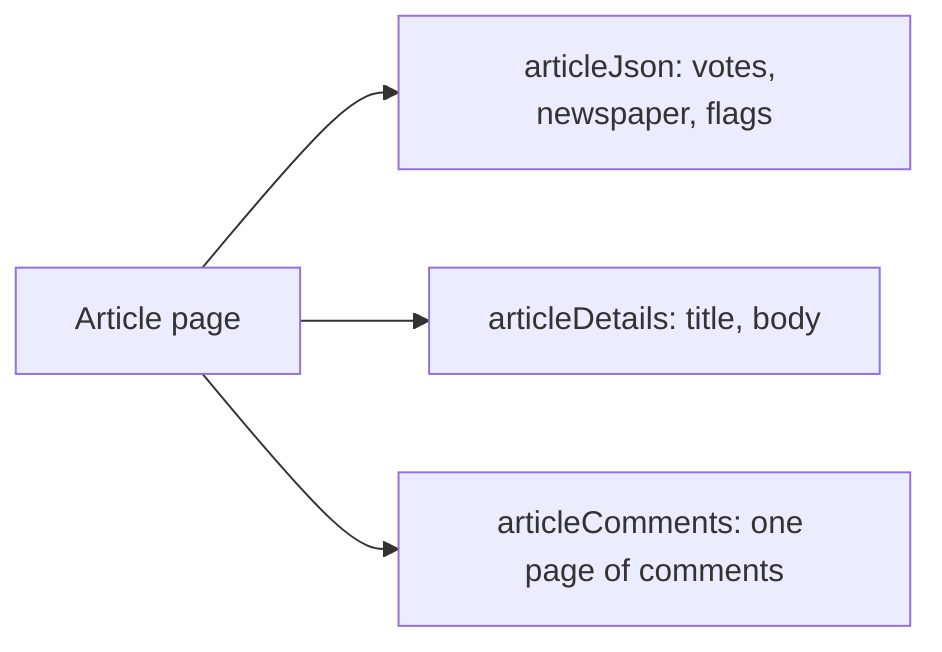

# Articles

[API docs](../README.md) › Media › Articles

The article screen of a newspaper: the text, votes, endorsements and comments. The HTML page is an AngularJS shell; the client fills it from two JSON endpoints and loads comments separately. Lists of articles are in [News lists and RSS](news.md); writing is in [Newspapers and writing](newspapers.md).

#erepublik #api #media #articles



| Action | Method | Path | Status |
|--------|--------|------|--------|
| [Article page](#article-page) | GET | `/en/article/{slug}-{articleId}/{page}/{perPage}` | ✅ Verified 2026-11-27 |
| [Article data](#article-data) | GET | `/en/main/articleJson/{articleId}` | ✅ Verified 2026-11-27 |
| [Article text](#article-text) | GET | `/en/main/articleDetails/{articleId}` | ✅ Verified 2026-11-27 |
| [Vote](#vote) | POST | `/en/main/vote-article` | 🔍 From code |
| [Endorse](#endorse) | POST | `/en/main/donate-article` | 🔍 From code |
| [List comments](#list-comments) | POST | `/en/main/articleComments` | 🔍 From code |
| [Post a comment](#post-a-comment) | POST | `/en/main/articleComments/create` | 🔍 From code |
| [Vote on a comment](#vote-on-a-comment) | POST | `/en/main/articleComments/vote` | 🔍 From code |
| [Delete a comment](#delete-a-comment) | POST | `/en/main/articleComments/delete` | 🔍 From code |

Headers, cookie and `_token`: see [Making requests](../guides/requests.md#common-headers). Status labels are explained [there too](../guides/requests.md#status-labels).

---

## Article page

`GET /en/article/{slug}-{articleId}/{page}/{perPage}` · Auth optional · ✅ Verified 2026-11-27

The HTML screen. It also opens without a session.

| Name | In | Type | Required | Description |
|------|----|------|----------|-------------|
| `articleId` | path | number | Yes | Article ID |
| `slug` | path | string | No | Title slug; a wrong one is corrected by a redirect |
| `page`, `perPage` | path | number | No | Links in the game use `1/20`. No effect was seen: comments come from [a separate call](#list-comments) |
| `commentId` | query | number | No | Comment to scroll to |

```bash
curl -L 'https://www.erepublik.com/en/article/YOUR_ARTICLE_ID'
```

| Requested | Result |
|-----------|--------|
| `/en/article/{articleId}` | Redirect to `/en/article/{slug}-{articleId}` |
| `/en/article/{articleId}/1/20`, wrong slug | Same redirect; the two trailing segments are dropped |
| Correct slug with `/2/20` | 200, same article |
| Unknown ID | 404 |

The page's inline script sets `SERVER_DATA.articleData`:

| Field | Type | Description |
|-------|------|-------------|
| `citizenId` | number | Appears to be the author |
| `articleId` | number | Article ID |
| `commentId` | number / `false` | Comment to highlight |
| `isOrganization` | number | `0` / `1` |
| `isContentBlocked` | boolean | Set for blocked content |
| `reportCommentURL` | string | Report link with `0` as the comment ID placeholder |
| `commentMaxLength` | number | `5000` |

The client reads the comment to highlight from `SERVER_DATA.articleData.commentId`, else `?commentId=`, else a `#comment{id}` hash.

**Source:** real requests, 2026-11-27; `ErpkCommentsController` in `erpk_angular_controllers.js` (version 1795779904).

---

## Article data

`GET /en/main/articleJson/{articleId}` · Auth required · ✅ Verified 2026-11-27

Everything about the article except its title and text: counters, what the current citizen may do, and the newspaper.

```bash
curl 'https://www.erepublik.com/en/main/articleJson/YOUR_ARTICLE_ID' \
  -H 'Cookie: erpk=YOUR_SESSION_TOKEN' \
  -H 'X-Requested-With: XMLHttpRequest'
```

### Response

Shortened; names and IDs are placeholders:

```json
{
  "articleData": {
    "articleId": 1000000,
    "category": { "id": 6, "name": "Social interactions and entertainment" },
    "countryId": 35,
    "createdAt": "5 days ago",
    "isEndorsed": 0,
    "canEndorse": true,
    "endorsers": [ { "citizenId": 1000001, "name": "Citizen name", "avatar": "https://cdnt.erepublik.net/...", "amount": 100 } ],
    "canVote": true,
    "isVoted": false,
    "numVotes": 72,
    "numComments": 78,
    "canComment": true,
    "canDelete": false,
    "canEdit": false
  },
  "newspaper": {
    "id": 200000,
    "name": "Newspaper name",
    "countryId": 35,
    "citizen": { "id": 1000002, "name": "Owner name", "avatar": "https://cdnt.erepublik.net/..." },
    "numArticles": 31,
    "subscribers": 126,
    "isSubscribed": false,
    "canSubscribe": true,
    "prevArticle": { "id": 999999, "title": "Previous title" },
    "nextArticle": false
  }
}
```

| Field | Type | Description |
|-------|------|-------------|
| `articleData.category` | object | `id` 1–6, `name`; see [categories](news.md#categories). The client allows it to be empty |
| `articleData.countryId` | number | Country the article is published in |
| `articleData.createdAt` | string | Relative text (`5 days ago`), not a timestamp |
| `articleData.endorsers` | array | `citizenId`, `name`, `avatar`, `amount`. The client shows the first 10 |
| `articleData.isEndorsed` | number | Amount you endorsed with, `0` if none |
| `articleData.canVote`, `isVoted` | boolean | Voting state |
| `articleData.canEndorse`, `canComment`, `canEdit`, `canDelete` | boolean | Allowed actions |
| `newspaper.citizen.id` | number | Owner; the client compares it with your ID |
| `newspaper.isSubscribed`, `canSubscribe` | boolean | [Subscription](newspapers.md#subscribe-or-unsubscribe) state |
| `newspaper.prevArticle`, `nextArticle` | object / `false` | `id`, `title` of the neighbouring article |

### Errors

Both come with status 200:

| Body | When |
|------|------|
| `{"error": "not_authorized"}` | No session |
| `{"error": true, "message": "CONTENT_NOT_FOUND"}` | Unknown ID |

**Source:** real requests, 2026-11-27; `ErpkArticleFactory.getData`.

---

## Article text

`GET /en/main/articleDetails/{articleId}` · Auth optional · ✅ Verified 2026-11-27

Title and body. The client calls it with the `/en` prefix hard-coded, first **without** cookies and, if that fails with anything but 404, again with them.

```bash
curl 'https://www.erepublik.com/en/main/articleDetails/YOUR_ARTICLE_ID'
```

### Response

```json
{
  "title": "Article title",
  "excerpt": "<p>First lines<br> ...",
  "body": "<p>Full text<br> ...</p>"
}
```

| Field | Type | Description |
|-------|------|-------------|
| `title` | string | Plain title |
| `excerpt` | string | Beginning of the text, HTML |
| `body` | string | Whole text, HTML |

> [!NOTE]
> `body` is user-written HTML. Sanitise it before rendering it elsewhere.

### Errors

Unknown ID: status 404 with `{"error": true, "message": "CONTENT_NOT_FOUND"}`.

**Source:** real requests, 2026-11-27; `ErpkArticleFactory`.

---

## Vote

`POST /en/main/vote-article` · Auth required · 🔍 From code

> [!WARNING]
> Casts your vote on the article. The client offers no way to take it back.

| Name | Type | Required | Description |
|------|------|----------|-------------|
| `_token` | string | Yes | [CSRF token](../guides/requests.md#csrf-token) |
| `articleId` | number | Yes | Article ID |

```bash
curl 'https://www.erepublik.com/en/main/vote-article' \
  -H 'Cookie: erpk=YOUR_SESSION_TOKEN' \
  -H 'X-Requested-With: XMLHttpRequest' \
  --data-raw 'articleId=YOUR_ARTICLE_ID&_token=YOUR_CSRF_TOKEN'
```

### Response

| Field | Type | Description |
|-------|------|-------------|
| `numberOfVotes` | number | New vote count |
| `error` | boolean | Truthy on failure |
| `message` | string | Error text |

Newspaper pages call the same endpoint, always under `/en`.

**Source:** `ErpkArticleController.vote` (1795779904); `voteArticle.js` (version 1698060179).

---

## Endorse

`POST /en/main/donate-article` · Auth required · 🔍 From code

> [!WARNING]
> **Spends money.** Endorsing pays the chosen amount from your account (Gold for the one special account below). The client asks for confirmation first.

| Name | Type | Required | Description |
|------|------|----------|-------------|
| `_token` | string | Yes | CSRF token |
| `articleId` | number | Yes | Article ID |
| `amount` | number | Yes | `5`, `50` or `100` in your currency. Citizen ID `2` is offered `25`, `50` or `100` Gold |

```bash
curl 'https://www.erepublik.com/en/main/donate-article' \
  -H 'Cookie: erpk=YOUR_SESSION_TOKEN' \
  -H 'X-Requested-With: XMLHttpRequest' \
  --data-raw 'articleId=YOUR_ARTICLE_ID&amount=5&_token=YOUR_CSRF_TOKEN'
```

### Response

| Field | Type | Description |
|-------|------|-------------|
| `endorsers` | array | Updated list, as in [article data](#article-data) |
| `error`, `message` | boolean, string | On failure |

### Errors

The page ships texts for: not enough currency, endorsing your own article, already endorsed, article too old to be endorsed. The exact response values are not known.

**Source:** `ErpkArticleController.endorse`; the article page's `erepublik.i18n.articleEndorsement` and template.

---

## List comments

`POST /en/main/articleComments` · Auth required · 🔍 From code

One page of comments with their replies. It only reads; further pages load as you scroll.

| Name | Type | Required | Description |
|------|------|----------|-------------|
| `_token` | string | Yes | CSRF token |
| `articleId` | number | Yes | Article ID |
| `page` | number | Yes | Starts at `1` |
| `commentId` | number | Yes | Comment to highlight on the first page, else `0` |

```bash
curl 'https://www.erepublik.com/en/main/articleComments' \
  -H 'Cookie: erpk=YOUR_SESSION_TOKEN' \
  -H 'X-Requested-With: XMLHttpRequest' \
  --data-raw 'articleId=YOUR_ARTICLE_ID&page=1&commentId=0&_token=YOUR_CSRF_TOKEN'
```

### Response

Shape reconstructed from the client code and templates:

```json
{
  "numberOfComments": 1,
  "pages": 1,
  "comments": {
    "30000000": {
      "id": 30000000,
      "authorId": 1000001,
      "message": "Comment text",
      "createdAtString": "...",
      "numVotes": 0,
      "votedBy": [],
      "isVoted": false,
      "isDeleted": false,
      "canRemove": false,
      "canReport": true,
      "replies": {}
    }
  },
  "citizenData": {
    "1000001": { "id": 1000001, "name": "Citizen name", "avatar": "https://cdnt.erepublik.net/...", "level": 50, "isDictator": false }
  }
}
```

| Field | Type | Description |
|-------|------|-------------|
| `comments` | object | Keyed by comment ID |
| `comments.{id}.replies` | object | Same structure; the client handles two levels of replies. An empty value may arrive as an array and is replaced with `{}` |
| `comments.{id}.votedBy` | array | Citizen IDs |
| `comments.{id}.isHighlight` | boolean | Marks the requested comment |
| `citizenData` | object | Authors and voters, keyed by citizen ID |
| `pages` | number | Number of pages |

**Source:** `ErpkCommentsFactory.getData`, `ErpkCommentsController` (1795779904); article page template.

---

## Post a comment

`POST /en/main/articleComments/create` · Auth required · 🔍 From code

> [!WARNING]
> Publishes a public comment under your name.

| Name | Type | Required | Description |
|------|------|----------|-------------|
| `_token` | string | Yes | CSRF token |
| `articleId` | number | Yes | Article ID |
| `parentId` | number | Yes | `0` for a new comment, else the comment you answer |
| `message` | string | Yes | Up to 5000 characters |

```bash
curl 'https://www.erepublik.com/en/main/articleComments/create' \
  -H 'Cookie: erpk=YOUR_SESSION_TOKEN' \
  -H 'X-Requested-With: XMLHttpRequest' \
  --data-urlencode 'message=YOUR_TEXT' \
  --data-raw 'articleId=YOUR_ARTICLE_ID&parentId=0&_token=YOUR_CSRF_TOKEN'
```

### Response

| Field | Type | Description |
|-------|------|-------------|
| `commentData` | object | The new comment, as in [the list](#list-comments) |
| `authorData` | object | Your `citizenData` entry |
| `error`, `message` | boolean, string | On failure |

**Source:** `ErpkCommentsFactory.create`.

---

## Vote on a comment

`POST /en/main/articleComments/vote` · Auth required · 🔍 From code

> [!WARNING]
> Adds or removes your public vote on a comment.

| Name | Type | Required | Description |
|------|------|----------|-------------|
| `_token` | string | Yes | CSRF token |
| `articleId` | number | Yes | Article ID |
| `commentId` | number | Yes | Comment ID |
| `likeStatus` | number | Yes | `1` vote, `0` withdraw |

The client ignores the response body: any successful status updates the screen.

**Source:** `ErpkCommentsFactory.vote`.

---

## Delete a comment

`POST /en/main/articleComments/delete` · Auth required · 🔍 From code

> [!WARNING]
> Deletes the comment. The client shows the button when `canRemove` is true.

| Name | Type | Required | Description |
|------|------|----------|-------------|
| `_token` | string | Yes | CSRF token |
| `articleId` | number | Yes | Article ID |
| `commentId` | number | Yes | Comment ID |

### Response

On failure `error` and `message`. On success `message` is the text that replaces the comment.

**Source:** `ErpkCommentsFactory.delete`.

---

## Open questions

| Topic | Question |
|-------|----------|
| `page`, `perPage` path segments | Whether they still do anything |
| `SERVER_DATA.articleData.citizenId` | Assumed to be the author; matched the owner on the page checked |
| Comments | Response fields were not compared with a real response |
| Reporting and moderation | Report links lead to `/en/main/tickets-report/{id}/article` and `/article-comment`; moderator actions are not covered here |
