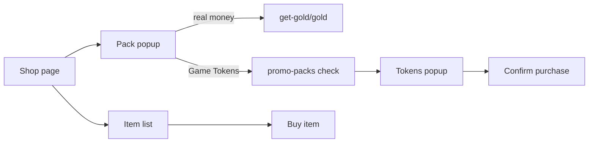

# Shop and pack purchases

[API docs](../README.md) › Economy › Shop

The shop (`/en/main/special-items`) sells two different things:

- **Packs**, paid with real money or Game Tokens, shown as large cards.
- **Items**, paid with in-game currency (Gold, Loyalty Points, VIP currencies).



| Action | Method | Path | Status |
|--------|--------|------|--------|
| [Shop page](#shop-page) | GET | `/en/main/special-items` | ✅ Verified 2026-11-27 |
| [Pack popup](#pack-popup) | GET | `/en/main/custom-pack` | ✅ Verified 2026-11-27 |
| [List items](#list-items) | GET | `/en/main/shopItemsJson` | ✅ Verified 2026-11-27 |
| [Buy item](#buy-item) | POST | `/en/main/buyGoldItems`, `/en/main/vip-shop-buy` | 🔍 From code |
| [Buy or claim a pack](#buy-or-claim-a-pack) | POST | `/en/get-gold/gold` | 🔍 From code |
| [Check pending purchase](#check-pending-purchase) | POST | `/en/main/promo-packs` | 🔍 From code |
| [Game Tokens popup](#game-tokens-popup) | POST | `/en/main/buy-withGameTokensPopup` | ✅ Verified 2026-11-27 |
| [Confirm token purchase](#confirm-token-purchase) | POST | `/en/main/buy-withGameTokens` | 🔍 From code |

Headers and `_token`: see [Making requests](../guides/requests.md#common-headers).

---

## Shop page

`GET /en/main/special-items` · Auth required · ✅ Verified 2026-11-27

HTML page. Each pack is an element with class `packContainer`; its `id` is the **pack type** used by every pack endpoint.

| Class on the pack | Meaning |
|-------------------|---------|
| `section_black_friday`, `section_one_time`, `section_unlimited` | Shop section |
| `one_time_only`, `limited_amount` | Purchase limits |
| `progressive_pack` | Part of a "Chain Deal" |
| `already_bought` | Already bought or received |
| `freePack` | Costs nothing |

The buy button is `a.pop_custom_packs` with `data-type="{packType}"`. The client can also open the page at a section or pack with `?showType=…` or `?showPack=…` (🔍 From code).

---

## Pack popup

`GET /en/main/custom-pack?packType={packType}` · Auth required · ✅ Verified 2026-11-27

HTML fragment with the pack's contents, price and purchase scripts.

| Name | In | Required | Description |
|------|----|----------|-------------|
| `packType` | query | Yes | Pack element `id`, e.g. `goldPack_S` |
| `to_citizen_id` | query | No | Buy as a gift (🔍 From code) |

```bash
curl 'https://www.erepublik.com/en/main/custom-pack?packType=goldPack_S' \
  -H 'Cookie: erpk=YOUR_SESSION_TOKEN' \
  -H 'X-Requested-With: XMLHttpRequest'
```

The fragment contains a form `#goBuy` (action `/en/get-gold/gold`) and, for packs payable with tokens, a button `#buyWithGameTokens` with `data-pack-name`. Prices are shown in the account's local currency.

A pack that is not available to you (for example a locked tier, or a gift already received) returns only the message `"You cannot buy this pack"` with status 200.

---

## List items

`GET /en/main/shopItemsJson` · Auth required · ✅ Verified 2026-11-27

Returns `data.goldItems.items[]` and `data.vipShopItems.items[]`. Full field description: [old shop page](../../economy/shop.md).

Fields relevant to buying and discounts:

| Field | Where | Meaning |
|-------|-------|---------|
| `id` | both | Sent as `itemId` |
| `goldPrice` | gold items | Regular price |
| `discountedGoldPrice` | gold items | Present when discounted; the client charges this price |
| `lpPrice` | gold items | Price in Loyalty Points, if offered |
| `itemPurchaseLimit`, `initialPurchaseLimit` | both | Remaining and original limit |
| `soldOut` | both | Sold out |
| `packClasses` | gold items | CSS classes; event items carry an event class |
| `price`, `currency`, `discount`, `discountClass` | VIP items | Price and discount badge |

---

## Buy item

`POST /en/main/buyGoldItems` (or `/en/main/vip-shop-buy` for VIP items) · 🔍 From code

> [!WARNING]
> Spends in-game currency immediately.

| Name | Type | Description |
|------|------|-------------|
| `_token` | string | CSRF token |
| `itemId` | string \| number | Item `id` |
| `amount` | number | Quantity |
| `currency` | string | `gold`, `lp`, a key type for boxes, or the VIP item's currency |
| `shownPrice` | number | Unit price shown to the player (the discounted one if present) |
| `vipShopItem` | boolean | Set for VIP items; selects the `vip-shop-buy` path |

The client reads `error`, `message`, and optionally `health`, `gold`, `loyaltyPoints`, `boxKeys`, `soldOut`, `canBuyMore`.

**Source:** `erpk_angular_controllers.js` (1795779904), shop controller `popupTriggerGold`, `purchase`; `ErpkShopFactory.purchase`.

---

## Buy or claim a pack

`POST /en/get-gold/gold` · 🔍 From code

> [!WARNING]
> Starts a **real-money** payment, or claims a free pack.

| Name | Description |
|------|-------------|
| `_token` | CSRF token |
| `buy_what` | Pack type |
| `payment_method` | `paymenthub` (payment) or `free` (free pack) |
| `force_pack` | From the popup form; `0` observed |
| `to_citizen_id` | Gift recipient, `0` for yourself |
| `buy_for_a_friend_check` | `on` or `off` |
| `gift_message`, `no_message_gift` | Gift options |

A `free` claim sends only `_token`, `buy_what` and `payment_method`; the client then reloads the page. For `paymenthub` the response is HTML that continues the payment. The popup requires accepting the Terms of Service first.

**Source:** inline script of the [pack popup](#pack-popup), 2026-11-27.

---

## Check pending purchase

`POST /en/main/promo-packs` · 🔍 From code

Sent before a Game Tokens purchase.

| Name | Description |
|------|-------------|
| `_token` | CSRF token |
| `check_pack` | Pack type |
| `force_pack` | From the popup form |
| `to_citizen_id` | Gift recipient or `0` |

JSON response; `purchaseInProgress: true` makes the client show a double-purchase warning.

**Source:** inline script of the pack popup, `purchasePack.isPackAvailable`.

---

## Game Tokens popup

`POST /en/main/buy-withGameTokensPopup` · Auth required · ✅ Verified 2026-11-27

Returns the HTML confirmation popup for paying with Game Tokens. It does not buy anything.

| Name | Description |
|------|-------------|
| `_token` | CSRF token |
| `packName` | Pack type |
| `friendId` | Gift recipient, `0` for yourself |
| `buyForFriendCheck` | `on` or `off` |
| `giftMessage`, `noGiftMessage` | Gift options (`noGiftMessage`: `0` or `1`) |

```bash
curl 'https://www.erepublik.com/en/main/buy-withGameTokensPopup' \
  -H 'Cookie: erpk=YOUR_SESSION_TOKEN' \
  -H 'X-Requested-With: XMLHttpRequest' \
  --data-raw '_token=YOUR_CSRF_TOKEN&packName=bf2026ProgGold_XS&friendId=0&buyForFriendCheck=off&giftMessage=&noGiftMessage=0'
```

The popup states the token cost and your token balance, and warns that processing may take up to 5 minutes.

| Case | Popup content |
|------|---------------|
| Pack can be bought with tokens | Button `#confirmBuyWithTokens` |
| Pack cannot (seen on `bf2026Tokens_XS`) | "… cannot be bought", only a Close button |

Its inline script holds `packPrice`, which the [confirmation](#confirm-token-purchase) sends back.

---

## Confirm token purchase

`POST /en/main/buy-withGameTokens` · 🔍 From code

> [!WARNING]
> Spends Game Tokens. A pack can only be bought once.

| Name | Description |
|------|-------------|
| `_token` | CSRF token |
| `packName` | Pack type |
| `packPrice` | Value from the popup script, e.g. `4.99` (currency unconfirmed) |
| `friendId`, `buyForFriendCheck` | Gift recipient, `on`/`off` |
| `giftMessage`, `noGiftMessage` | Gift options |

The response is HTML shown as the next popup; the client then marks the pack as pending.

**Source:** inline script of the [Game Tokens popup](#game-tokens-popup), 2026-11-27.
