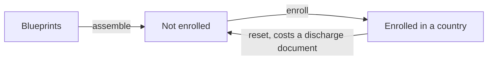

# Armory and protectors

[API docs](../README.md) › [Military](../../military/README.md) › Armory and protectors

The **Armory** screen manages vehicles (tanks and aircraft) and your protector levels. An enrolled vehicle gives a damage bonus when you [deploy](battlefield/deployment.md) for that country. The three tabs share one page; the data comes from the two `armory-data` endpoints.



| Action | Method | Path | Status |
|--------|--------|------|--------|
| [Armory page](#armory-page) | GET | `/en/military/armory` | ✅ Verified 2026-11-27 |
| [Protectors tab](#armory-page) | GET | `/en/military/armory/protectors` | ✅ Verified 2026-11-27 |
| [Help tab](#armory-page) | GET | `/en/military/armory/help` | ✅ Verified 2026-11-27 |
| [Vehicle overview](#vehicle-overview) | POST | `/en/military/armory-data/overview` | ✅ Verified 2026-11-27 |
| [Protector list](#protector-list) | POST | `/en/military/armory-data/protectors` | ✅ Verified 2026-11-27 |
| [Armory actions](#armory-actions) | POST | `/en/military/armory-actions` | 🔍 From code |

Headers, cookie and `_token`: see [Making requests](../guides/requests.md#common-headers). Status labels are explained [there too](../guides/requests.md#status-labels). The vehicle list used inside a battle is a separate endpoint: [Vehicles for this battle](battlefield/page.md#vehicles-for-this-battle).

---

## How protector levels work

Summary of the in-game **Help** tab (read 2026-11-27).

- A vehicle needs 10 blueprints of its own to be assembled.
- A vehicle is enrolled in one country at a time. To move it, discharge it first; this needs a vehicle discharge document.
- A country can hold up to three tanks and three aircraft. One vehicle of a type is enough for that type's bonus; more do not stack.
- Ground and air levels are independent. Bombs earn no protector points.

| Deploying for | Damage converted into protector points |
|---------------|-----------------------------------------|
| Your country of citizenship, with an enrolled vehicle | 10% |
| An allied country, with an enrolled vehicle | 4% |
| A non-allied country, with an enrolled vehicle | 2% |
| Without an enrolled vehicle | 1% |
| A country where you hold the top level | 1%, as universal points usable for another country |

### Damage bonus by level

| Type | Observed |
|------|----------|
| Aircraft | Bonus equals the level (levels 0–13) |
| Tanks | Equals the level up to 15; then 16 → 17, 19 → 23, 22 → 29, 25 → 35 (+2 per level); 26 → 38, 28 → 44 (+3); 33 → 65; 50 → 200 |

Level 50 is the maximum, with a 200% tank bonus. Earlier notes (May 2026) add 32 → 60, and say 200% is the cap for aircraft too (no level 50 aircraft observed).

---

## Armory page

`GET /en/military/armory` · `/protectors` · `/help` · Auth required · ✅ Verified 2026-11-27

The same HTML page; the path only selects the tab, passed to the script as `initialTab` (`"protectors"`, `"help"`, otherwise `null` and the overview opens). The client rewrites the URL to `/en/military/armory/{tab}` when you switch, using `overview`, `protectors` or `help`. Without a cookie the page redirects.

```bash
curl 'https://www.erepublik.com/en/military/armory/protectors' \
  -H 'Cookie: erpk=YOUR_SESSION_TOKEN'
```

**Source:** real requests, 2026-11-27; `ArmoryController` in `erpk_angular_controllers.js` (version 1795779904).

---

## Vehicle overview

`POST /en/military/armory-data/overview` · Auth required · ✅ Verified 2026-11-27

All vehicles, owned or not, with enrollment, protector level and blueprint progress.

| Name | Type | Required | Description |
|------|------|----------|-------------|
| `_token` | string | Yes | [CSRF token](../guides/requests.md#csrf-token) |

```bash
curl 'https://www.erepublik.com/en/military/armory-data/overview' \
  -H 'Cookie: erpk=YOUR_SESSION_TOKEN' \
  -H 'X-Requested-With: XMLHttpRequest' \
  --data-raw '_token=YOUR_CSRF_TOKEN'
```

### Response

Shortened to one vehicle:

```json
{
  "panelUrl": "/en/military/armory-data/overview",
  "vehicles": [
    {
      "id": 30, "type": "aircraft", "isActive": true, "name": "F8U-16 Gunslinger", "desc": "<p>…</p>",
      "status": "enrolled", "intStatus": 1, "isDefault": false, "blueprints": null,
      "countryId": 72,
      "countryData": { "id": 72, "level": 13, "maxLevel": 50, "xp": 20309840, "requiredXP": 43076000,
        "damageBonus": 13, "title": "Protector of Lithuania" },
      "title": "Protector of Lithuania",
      "attributes": [ { "type": "damageBonus", "value": 13 } ],
      "displayPriority": 12
    }
  ],
  "statuses": { "unavailable": "Unavailable", "blueprints": "Locked", "notAssembled": "Assemble",
    "notEnrolled": "Enroll", "enrolled": "Enrolled" },
  "settings": { "maxEnrollPerCountry": 3, "universalPoints": { "tanks": 0, "aircraft": 0 } }
}
```

<details>
<summary>Longer example response (earlier notes)</summary>

```json
{
  "panelUrl": "/en/military/armory-data/overview",
  "vehicles": [
    {
      "id": 9,
      "type": "tanks",
      "isActive": false,
      "name": "S-07 Sentinel",
      "desc": "<p>The <b>S-07 Sentinel</b> was obtained from the eRepublik <b>12 Years Anniversary Challenge</b>.</p>",
      "status": "enrolled",
      "intStatus": 1,
      "isDefault": false,
      "blueprints": null,
      "countryId": 40,
      "countryData": {
        "id": 40,
        "level": 50,
        "maxLevel": 50,
        "xp": null,
        "requiredXP": null,
        "damageBonus": 200,
        "title": "Protector of Ukraine"
      },
      "title": "Protector of Ukraine",
      "attributes": [
        {
          "type": "damageBonus",
          "value": 200
        }
      ],
      "displayPriority": 1
    },
    {
      "id": 17,
      "type": "tanks",
      "isActive": false,
      "name": "D4 Overlord",
      "desc": "<p>The D4 Overlord brings its own genre of drama to the battlefield.</p>",
      "status": "enrolled",
      "intStatus": 1,
      "isDefault": true,
      "blueprints": null,
      "countryId": 65,
      "countryData": {
        "id": 65,
        "level": 27,
        "maxLevel": 50,
        "xp": 1682228238,
        "requiredXP": 2000000000,
        "damageBonus": 41,
        "title": "Protector of Serbia"
      },
      "title": "Protector of Serbia",
      "attributes": [
        {
          "type": "damageBonus",
          "value": 41
        }
      ],
      "displayPriority": 5
    },
    {
      "id": 30,
      "type": "aircraft",
      "isActive": true,
      "name": "F8U-16 Gunslinger",
      "desc": "<p>The <b>F8U-16 Gunslinger</b> was obtained from the <b>Amazing Journey</b> 16th anniversary event.</p>",
      "status": "enrolled",
      "intStatus": 1,
      "isDefault": false,
      "blueprints": null,
      "countryId": 72,
      "countryData": {
        "id": 72,
        "level": 13,
        "maxLevel": 50,
        "xp": 20309840,
        "requiredXP": 43076000,
        "damageBonus": 13,
        "title": "Protector of Lithuania"
      },
      "title": "Protector of Lithuania",
      "attributes": [
        {
          "type": "damageBonus",
          "value": 13
        }
      ],
      "displayPriority": 12
    },
    {
      "id": 1,
      "type": "tanks",
      "isActive": false,
      "name": "Red Baron",
      "desc": "<p>The <i>Red Baron</i> tank skin was obtained during <b>Winner Takes it All Event</b>.</p>",
      "status": "notEnrolled",
      "intStatus": 2,
      "isDefault": false,
      "blueprints": null,
      "countryId": null,
      "countryData": null,
      "title": null,
      "attributes": [],
      "displayPriority": 18
    },
    {
      "id": 2,
      "type": "tanks",
      "isActive": false,
      "name": "Monster Grinder",
      "desc": "<p>The <i>Monster Grinder</i> tank skin was obtained during <b>Tales of the New World: Headless Horror Event</b>.</p>",
      "status": "blueprints",
      "intStatus": 4,
      "isDefault": false,
      "blueprints": {
        "current": 0,
        "required": 10
      },
      "countryId": null,
      "countryData": null,
      "title": null,
      "attributes": [],
      "displayPriority": 34
    }
  ],
  "statuses": {
    "unavailable": "Unavailable",
    "blueprints": "Locked",
    "notAssembled": "Assemble",
    "notEnrolled": "Enroll",
    "enrolled": "Enrolled"
  },
  "settings": {
    "maxEnrollPerCountry": 3,
    "universalPoints": {
      "tanks": 0,
      "aircraft": 0
    }
  }
}
```

</details>

| Field | Type | Description |
|-------|------|-------------|
| `panelUrl` | string | Path of this panel |
| `vehicles[].id` | number | Vehicle ID; sent as `skinId` |
| `vehicles[].type` | string | `tanks` or `aircraft` |
| `vehicles[].isActive` | boolean | Active vehicle; one tank and one aircraft |
| `vehicles[].name`, `desc` | string | Name; HTML description, including how it was obtained |
| `vehicles[].status`, `intStatus` | string, number | See below |
| `vehicles[].isDefault` | boolean | Default vehicle |
| `vehicles[].blueprints` | object \| null | `current`, `required` while locked |
| `vehicles[].countryId` | number \| null | [Country](../../reference/README.md) it is enrolled in |
| `vehicles[].countryData` | object \| null | Your protector level there |
| `vehicles[].countryData.level`, `maxLevel` | number | Current and maximum level |
| `vehicles[].countryData.xp` | number \| null | Points collected in this level; `null` at the maximum |
| `vehicles[].countryData.requiredXP` | number \| null | **Total** points of this level; `null` at the maximum |
| `vehicles[].countryData.damageBonus` | number | Bonus in percent |
| `vehicles[].countryData.title`, `vehicles[].title` | string \| null | `Protector of {Country}` |
| `vehicles[].attributes[]` | array | `type`, `value`; only `damageBonus` observed |
| `vehicles[].displayPriority` | number | Sort order, lower first |
| `statuses` | object | Status key → label |
| `settings.maxEnrollPerCountry` | number | Vehicles of one type per country (`3`) |
| `settings.universalPoints` | object | Your universal points, `tanks` and `aircraft` |

| `status` | `intStatus` | Meaning |
|----------|-------------|---------|
| `enrolled` | 1 | Enrolled in a country |
| `notEnrolled` | 2 | Owned, can be enrolled |
| `blueprints` | 4 | Locked, collecting blueprints |
| `notAssembled` | not observed | Ready to assemble |
| `unavailable` | 5 (earlier notes) | Cannot be obtained or used now |

**Source:** real request, 2026-11-27; longer example — earlier notes.

---

## Protector list

`POST /en/military/armory-data/protectors` · Auth required · ✅ Verified 2026-11-27

Your ground and air protector progress for every country (73 returned).

| Name | Type | Required | Description |
|------|------|----------|-------------|
| `_token` | string | Yes | CSRF token |

```bash
curl 'https://www.erepublik.com/en/military/armory-data/protectors' \
  -H 'Cookie: erpk=YOUR_SESSION_TOKEN' \
  -H 'X-Requested-With: XMLHttpRequest' \
  --data-raw '_token=YOUR_CSRF_TOKEN'
```

### Response

Shortened to one country:

```json
{
  "panelUrl": "/en/military/armory-data/protectors",
  "countries": [
    {
      "id": 72,
      "tanks": { "level": 50, "maxLevel": 50, "xp": null, "requiredXP": null, "levelProgress": "100%",
        "damageBonus": 200, "title": "Protector of Lithuania", "vehicles": [20] },
      "aircraft": { "level": 13, "maxLevel": 50, "xp": 20309840, "requiredXP": 22766160,
        "levelProgress": "47.1489%", "damageBonus": 13, "title": "Protector of Lithuania", "vehicles": [30] }
    }
  ],
  "settings": { "maxEnrollPerCountry": 3, "universalPoints": { "tanks": 0, "aircraft": 0 } }
}
```

<details>
<summary>Longer example response (earlier notes)</summary>

```json
{
  "panelUrl": "/en/military/armory-data/protectors",
  "countries": [
    {
      "id": 72,
      "tanks": {
        "level": 50,
        "maxLevel": 50,
        "xp": null,
        "requiredXP": null,
        "levelProgress": "100%",
        "damageBonus": 200,
        "title": "Protector of Lithuania",
        "vehicles": [20]
      },
      "aircraft": {
        "level": 13,
        "maxLevel": 50,
        "xp": 20309840,
        "requiredXP": 22766160,
        "levelProgress": "47.1489%",
        "damageBonus": 13,
        "title": "Protector of Lithuania",
        "vehicles": [30]
      }
    },
    {
      "id": 40,
      "tanks": {
        "level": 50,
        "maxLevel": 50,
        "xp": null,
        "requiredXP": null,
        "levelProgress": "100%",
        "damageBonus": 200,
        "title": "Protector of Ukraine",
        "vehicles": [9]
      },
      "aircraft": {
        "level": 11,
        "maxLevel": 50,
        "xp": 9785703,
        "requiredXP": 1258297,
        "levelProgress": "88.6065%",
        "damageBonus": 11,
        "title": "Protector of Ukraine",
        "vehicles": [10]
      }
    },
    {
      "id": 1,
      "tanks": {
        "level": 28,
        "maxLevel": 50,
        "xp": 2527825031,
        "requiredXP": 1472174969,
        "levelProgress": "63.1956%",
        "damageBonus": 44,
        "title": "Protector of Romania",
        "vehicles": [6]
      },
      "aircraft": {
        "level": 6,
        "maxLevel": 50,
        "xp": 397571,
        "requiredXP": 31429,
        "levelProgress": "92.6739%",
        "damageBonus": 6,
        "title": "Protector of Romania",
        "vehicles": [26]
      }
    },
    {
      "id": 57,
      "tanks": {
        "level": 0,
        "maxLevel": 50,
        "xp": 822183,
        "requiredXP": 127817,
        "levelProgress": "86.5456%",
        "damageBonus": 0,
        "title": "Protector of Pakistan",
        "vehicles": []
      },
      "aircraft": {
        "level": 0,
        "maxLevel": 50,
        "xp": 1350,
        "requiredXP": 7750,
        "levelProgress": "14.8352%",
        "damageBonus": 0,
        "title": "Protector of Pakistan",
        "vehicles": []
      }
    }
  ],
  "settings": {
    "maxEnrollPerCountry": 3,
    "universalPoints": {
      "tanks": 0,
      "aircraft": 0
    }
  }
}
```

</details>

| Field | Type | Description |
|-------|------|-------------|
| `countries[].id` | number | Country ID |
| `countries[].tanks`, `.aircraft` | object | Progress per vehicle type |
| `.level`, `.maxLevel` | number | `0`–`50` |
| `.xp` | number \| null | Points collected in this level; `null` at the maximum |
| `.requiredXP` | number \| null | Points **still missing** for the next level; `null` at the maximum |
| `.levelProgress` | string | `xp / (xp + requiredXP)`, e.g. `47.1489%`; `100%` at the maximum |
| `.damageBonus` | number | Bonus in percent; `0` at level 0, where points are still collected |
| `.title` | string | `Protector of {Country}` |
| `.vehicles` | number[] | IDs of your vehicles enrolled there; can be empty |
| `settings` | object | As in the [overview](#vehicle-overview) |

> [!IMPORTANT]
> `requiredXP` differs between the two endpoints: the level total in the overview, the remainder here. All 16 enrolled vehicles below the maximum level matched `overview.requiredXP - xp == protectors.requiredXP`.

Countries appear to be sorted by progress, highest first.

**Source:** real request, 2026-11-27; longer example — earlier notes.

---

## Armory actions

`POST /en/military/armory-actions` · Auth required · 🔍 From code

> [!WARNING]
> Changes your vehicles. `reset` spends a vehicle discharge document, `useWildcardPoints` spends universal points.

One endpoint for four actions.

| Name | Type | Required | Description |
|------|------|----------|-------------|
| `_token` | string | Yes | CSRF token |
| `action` | string | Yes | See below |
| `skinId` | number | Yes | [Vehicle ID](#vehicle-overview) |
| `countryId` | number | Except `assemble` | Country |
| `amount` | number | `useWildcardPoints` | Universal points to add |

| `action` | Sends | Effect | Client check before sending |
|----------|-------|--------|-----------------------------|
| `assemble` | `skinId` | Builds a locked vehicle | `blueprints.current >= required` |
| `enroll` | `skinId`, `countryId` | Enrolls the vehicle | A country is chosen |
| `reset` | `skinId`, `countryId` | Discharges it from the country | Confirmation popup |
| `useWildcardPoints` | `skinId`, `countryId`, `amount` | Adds universal points to that country's level | Below maximum level, points and amount above 0. The slider's limit is the smaller of your points and `requiredXP - xp` |

```bash
curl 'https://www.erepublik.com/en/military/armory-actions' \
  -H 'Cookie: erpk=YOUR_SESSION_TOKEN' \
  -H 'X-Requested-With: XMLHttpRequest' \
  --data-raw 'action=enroll&skinId=14&countryId=35&_token=YOUR_CSRF_TOKEN'
```

### Response

```json
{ "status": true, "message": "Vehicle successfully enrolled" }
```

The client treats a truthy `status` as success, then reloads the overview.

### Errors

```json
{ "status": false, "message": "Invalid parameters" }
```

Earlier notes: returned for an invalid vehicle or country ID, or a vehicle that cannot be enrolled (locked or unavailable). The client shows `message`, and ignores HTTP `403`.

**Source:** `erpk_angular_controllers.js` (version 1795779904), `ArmoryController` and `ArmoryFactory.armoryAction`; examples — earlier notes (`enroll`).

---

## Errors of the data endpoints

A wrong `_token` gives HTTP `200` with a bare JSON string:

```json
"CSRF attack detected."
```

**Source:** real request to the overview, 2026-11-27.

---

## Open questions

| Topic | Earlier notes | Observed or code | Page follows |
|-------|---------------|------------------|--------------|
| Method of `armory-data` | Old quick reference: `GET`; old page: `POST` | `POST` | `POST` |
| Default vehicles | Available to all players at certain division thresholds | Four default tanks enrolled, one default aircraft not enrolled | Unlock rule not settled |
| `armory-actions` actions | Only `enroll` | Four actions in the client | Code |
| Enroll limit | Three per country | Help: three tanks and three aircraft | Help |
| Protectors progress bar | Not described | The client computes `xp / requiredXP`, which differs from `levelProgress` | Response fields |
| Points per level | Grow sharply with level | No full table | — |
