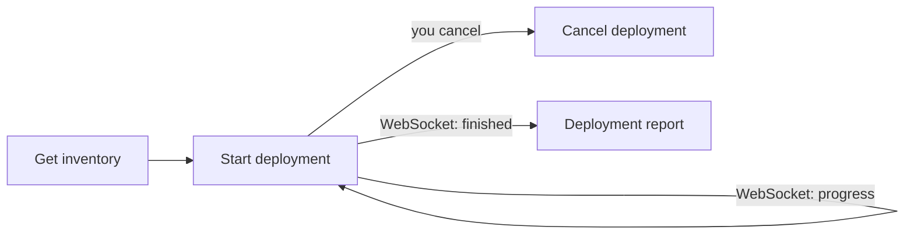

# Deployment

[API docs](../../README.md) › [Military](../../../military/README.md) › Battlefield › Deployment

A deployment is automated fighting: you pick a weapon, a vehicle and an amount of energy, and the game fights for you in one battle zone. These endpoints power the deploy panel at the bottom of the battlefield page.



| Action | Method | Path | Status |
|--------|--------|------|--------|
| [Get inventory](#get-inventory) | POST | `/en/military/fightDeploy-getInventory` | 🔍 From code |
| [Start deployment](#start-deployment) | POST | `/en/military/fightDeploy-startDeploy` | 🔍 From code |
| [Cancel deployment](#cancel-deployment) | POST | `/en/military/fightDeploy-cancelDeploy` | 🔍 From code |
| [Deployment report](#deployment-report) | GET | `/en/military/fightDeploy-deployReportPopup` | 🔍 From code |

Headers, cookie and `_token`: see [Making requests](../../guides/requests.md#common-headers). Status labels are explained [there too](../../guides/requests.md#status-labels).

Every deployment also needs [fuel](#fuel).

**Page state used by the game client:** the deploy panel does not initialise when `SERVER_DATA.battleFinished` or `SERVER_DATA.travelRequired` is set. `SERVER_DATA.deployment` (`id`, `battleId`, `sideCountryId`) describes the active deployment, if any.

---

## Get inventory

`POST /en/military/fightDeploy-getInventory` · Auth required · 🔍 From code

Returns what you can deploy with in a battle zone: weapons, energy sources and vehicles. The game calls it when the deploy panel opens.

### Request

| Name | Type | Required | Description |
|------|------|----------|-------------|
| `_token` | string | Yes | [CSRF token](../../guides/requests.md#csrf-token) |
| `battleId` | number | Yes | Battle ID |
| `battleZoneId` | number | Yes | Battle zone ID |
| `sideCountryId` | number | Yes | Country you fight for. Decides which vehicles are recommended. The client sends `SERVER_DATA.leftBattleId` |

```bash
curl 'https://www.erepublik.com/en/military/fightDeploy-getInventory' \
  -H 'Cookie: erpk=YOUR_SESSION_TOKEN' \
  -H 'X-Requested-With: XMLHttpRequest' \
  --data-raw '_token=YOUR_CSRF_TOKEN&battleId=863500&sideCountryId=72&battleZoneId=37861235'
```

### Response

Shortened:

```json
{
  "weapons": [
    { "industryId": 23, "quality": 5, "name": "Air-to-Air Missile Q5", "amount": 1169, "uses": 5844,
      "preselect": false, "attributes": { "firepower": "+100%", "maxEnergy": 58450 },
      "damageperHit": 286, "isBest": true }
  ],
  "energySources": [
    { "type": "pool", "energy": 6654 },
    { "type": "food", "tier": 1, "quality": 1, "amount": 284072, "energy": 568144 }
  ],
  "vehicles": [ { "id": 30, "type": "aircraft", "isRecommended": true } ],
  "poolEnergy": 6654,
  "maxEnergy": 16654,
  "recoverableEnergy": 0,
  "recoverableEnergyBuyFood": 0,
  "minEnergy": 10,
  "fuelConsumed": 1
}
```

<details>
<summary>Full example response</summary>

```json
{
  "weapons": [
    {
      "industryId": 23,
      "quality": -1,
      "name": "No weapon",
      "amount": null,
      "preselect": true,
      "attributes": {
        "firepower": null,
        "maxEnergy": null
      },
      "damageperHit": 143,
      "isBest": false
    },
    {
      "industryId": 23,
      "quality": 5,
      "name": "Air-to-Air Missile Q5",
      "amount": 1169,
      "uses": 5844,
      "preselect": false,
      "attributes": {
        "firepower": "+100%",
        "maxEnergy": 58450
      },
      "damageperHit": 286,
      "isBest": true
    }
  ],
  "energySources": [
    {
      "type": "pool",
      "energy": 6654
    },
    {
      "type": "food",
      "tier": 1,
      "quality": 1,
      "amount": 284072,
      "energy": 568144
    },
    {
      "type": "food",
      "tier": 2,
      "quality": 2,
      "amount": 5678,
      "energy": 22712
    },
    {
      "type": "food",
      "tier": 3,
      "quality": 3,
      "amount": 2332887,
      "energy": 13997322
    },
    {
      "type": "energy_bar",
      "tier": 11,
      "quality": 11,
      "amount": 50,
      "energy": 10000
    }
  ],
  "recoverableEnergy": 0,
  "minEnergy": 10,
  "fuelConsumed": 1,
  "vehicles": [
    {
      "id": 30,
      "type": "aircraft",
      "isActive": true,
      "name": "F8U-16 Gunslinger",
      "status": "enrolled",
      "intStatus": 1,
      "isDefault": false,
      "blueprints": null,
      "countryId": 72,
      "countryData": {
        "id": 72,
        "level": 13,
        "maxLevel": 50,
        "xp": 20309840,
        "requiredXP": 43076000,
        "damageBonus": 13,
        "title": "Protector of Lithuania"
      },
      "title": "Protector of Lithuania",
      "attributes": [
        {
          "type": "damageBonus",
          "value": 13
        }
      ],
      "isRecommended": true
    },
    {
      "id": 40,
      "type": "aircraft",
      "isActive": false,
      "name": "Ember Firefly SH-18",
      "status": "notEnrolled",
      "intStatus": 2,
      "isDefault": false,
      "blueprints": null,
      "countryId": null,
      "countryData": null,
      "title": null,
      "attributes": [],
      "isRecommended": false
    }
  ],
  "poolEnergy": 6654,
  "maxEnergy": 16654,
  "recoverableEnergyBuyFood": 0
}
```

</details>

#### Top level

| Field | Type | Description |
|-------|------|-------------|
| `weapons` | array | Weapons usable in this zone (air or ground) |
| `energySources` | array | Pool energy, food and energy bars |
| `vehicles` | array | All vehicles for this battle type |
| `poolEnergy` | number | Current pool energy |
| `maxEnergy` | number | Maximum energy capacity, including pool and storage |
| `recoverableEnergy` | number | Energy that can be recovered from previous battles |
| `recoverableEnergyBuyFood` | number | Energy recoverable by buying food |
| `minEnergy` | number | Energy cost per hit (typically 10) |
| `fuelConsumed` | number | Fuel cost of deploying to a new battle zone (typically 1) |

#### `weapons[]`

| Field | Type | Description |
|-------|------|-------------|
| `industryId` | number | `2` ground ammunition, `23` air-to-air missiles |
| `quality` | number | `-1` no weapon, `1`–`7` regular, `51` special |
| `name` | string | Display name |
| `amount` | number \| null | Units owned (`null` for "No weapon") |
| `uses` | number | Total hits available |
| `preselect` | boolean | Selected by default in the UI (usually "No weapon") |
| `attributes.firepower` | string \| null | Bonus such as `"+100%"` |
| `attributes.maxEnergy` | number \| null | Maximum energy usable with this weapon |
| `damageperHit` | number | Pre-calculated damage per hit |
| `isBest` | boolean | Best weapon available |

> [!NOTE]
> `attributes.firepower` may contain invisible U+2060 (word joiner) characters. Strip non-printable characters before comparing.

- `damageperHit` is calculated by the server from base damage, weapon firepower, vehicle protection and damage bonuses, and citizen level and attributes.
- `uses` is described as `floor(maxEnergy / minEnergy)`. Uses per unit: missiles = quality (Q5 → 5); ground ammunition Q1–Q6 = quality, Q7 = 10; special weapons = 1.
- Special weapons (`quality: 51`) are always `isBest: true` when present: **SLG Peacemaker** (ground) deals 50,000,000 per hit (`"50M"`), **AIM-7 Grid-Lock** (air) deals 50,000 per hit (`"50k"`).

#### `energySources[]`

| Field | Type | Description |
|-------|------|-------------|
| `type` | string | `pool`, `food` or `energy_bar` |
| `tier` | number | Food 1–7; energy bars e.g. 11 or 16 |
| `quality` | number | Matches `tier` |
| `amount` | number | Items owned (absent for `pool`) |
| `energy` | number | Total energy this source provides |

- The server returns a flat array. The game client then groups it by `type` and computes `energyPerItem = energy / amount`.
- Energy per unit: food Q1 = 2, Q2 = 4, Q3 = 6, higher tiers proportionally more; energy bars Q11 = 200, Q16 = 50.
- `pool` is your regenerating energy pool.

#### `vehicles[]`

| Field | Type | Description |
|-------|------|-------------|
| `id` | number | Vehicle ID, sent as `skinId` when starting |
| `type` | string | `aircraft` or `tanks` |
| `name` | string | Display name |
| `isActive` | boolean | Currently active vehicle |
| `isDefault` | boolean | Default vehicle |
| `isRecommended` | boolean | Enrolled for `sideCountryId`. The client preselects the first recommended one |
| `status` | string | `enrolled`, `notEnrolled`, … |
| `intStatus` | number | `1` enrolled, `2` not enrolled |
| `blueprints` | object \| null | Blueprint progress |
| `countryId` | number \| null | Country the vehicle is enrolled for |
| `countryData` | object \| null | Protection data for that country |
| `countryData.level` | number | Protection level, 1–50 |
| `countryData.xp`, `countryData.requiredXP` | number \| null | Progress to the next level; `null` at level 50 |
| `countryData.damageBonus` | number \| null | Damage bonus in percent; 200 at level 50 (see [open questions](#open-questions)) |
| `countryData.title` | string | e.g. "Protector of Lithuania" |
| `title` | string \| null | Current protection title |
| `attributes` | array | Vehicle attributes, usually the damage bonus |

Vehicles enrolled for other countries are listed but not recommended. Air zones (division 11) return aircraft and missiles; ground divisions (1–4) return tanks and ground weapons.

**Source:** request parameters and client processing — `erpk_angular_controllers.js` (version 1772186525), `DeploymentController.getInventory`, `DeploymentFactory.getInventory`. Response fields and examples — earlier notes, capture date unknown.

---

## Start deployment

`POST /en/military/fightDeploy-startDeploy` · Auth required · 🔍 From code

> [!WARNING]
> This spends real resources: energy, food, energy bars, weapons and possibly [fuel](#fuel).

Starts automated fighting with the chosen energy, weapon and vehicle. It runs until the energy is used up, the round ends or you [cancel](#cancel-deployment).

### Request

| Name | Type | Required | Description |
|------|------|----------|-------------|
| `_token` | string | Yes | [CSRF token](../../guides/requests.md#csrf-token) |
| `battleId` | number | Yes | Battle ID |
| `battleZoneId` | number | Yes | Battle zone ID |
| `sideCountryId` | number | Yes | Country you fight for (`SERVER_DATA.mySideCountryId`) |
| `weaponQuality` | number | Yes | `-1` no weapon, otherwise `weapons[].quality` |
| `totalEnergy` | number | Yes | Total energy to deploy, **including pool energy** |
| `energySources[n][quality]` | number | See below | Quality of a food or energy bar to consume |
| `energySources[n][amount]` | number | See below | **Number of items** of that quality (not energy) |
| `skinId` | number | Yes | `vehicles[].id` |

The client adds an `energySources` entry for each food or energy bar quality it needs beyond pool energy:

1. Energy above `poolEnergy` comes from food, highest quality first, up to `recoverableEnergy`.
2. Energy above `poolEnergy + recoverableEnergy` comes from energy bars, in the order the server lists them.
3. For the last quality used, `amount = ceil(energy still needed / energyPerItem)`.
4. With a weapon of quality 10 or higher, the client caps `totalEnergy` at `uses × 10` when the energy slider is recalculated.

When the pool covers `totalEnergy`, no items are needed. The client may still send an entry, as in the example below with `amount` 0.

```bash
curl 'https://www.erepublik.com/en/military/fightDeploy-startDeploy' \
  -H 'Cookie: erpk=YOUR_SESSION_TOKEN' \
  -H 'X-Requested-With: XMLHttpRequest' \
  --data-raw '_token=YOUR_CSRF_TOKEN&battleId=863657&battleZoneId=37861650&sideCountryId=29&weaponQuality=-1&totalEnergy=340&energySources%5B0%5D%5Bquality%5D=3&energySources%5B0%5D%5Bamount%5D=0&skinId=18'
```

### Response

```json
{
  "error": false,
  "message": "Successfully deployed",
  "deploymentId": 122127169,
  "data": {
    "energyItems": { "food": 0, "energyBars": [] },
    "energyTotal": 340,
    "weaponType": "aircraft",
    "chosenWeaponQuality": -1,
    "weaponQuality": -1,
    "battleId": 863657,
    "sideCountryId": 29,
    "battleZoneId": 37861650,
    "skinId": 18,
    "fuelLeft": 36
  }
}
```

| Field | Type | Description |
|-------|------|-------------|
| `error` | boolean | `false` on success |
| `message` | string | Status message |
| `deploymentId` | number | **Keep it**: needed to cancel and to open the report |
| `data.energyItems.food` | number | Food energy consumed |
| `data.energyItems.energyBars` | array | Energy bars consumed |
| `data.energyTotal` | number | Energy allocated |
| `data.weaponType` | string | `aircraft` or `tanks` |
| `data.chosenWeaponQuality` | number | Quality you selected |
| `data.weaponQuality` | number | Quality actually used |
| `data.battleId` | number | Battle ID |
| `data.sideCountryId` | number | Country you fight for |
| `data.battleZoneId` | number | Battle zone ID |
| `data.skinId` | number | Vehicle used |
| `data.fuelLeft` | number | Fuel remaining |

### Errors

A response with `error: true` is a failure. The client also reads:

| Field | Meaning |
|-------|---------|
| `message` | Text shown to the player |
| `errorType: "captcha"` | A [verification challenge](../../basics/captcha.md) is required |
| `captcha` or `data.captcha` | Challenge details (`message`, `canVerifyLater`) |

### While deployed

- Progress arrives over [WebSocket](../../basics/websocket.md): `onDeployProgress` (`progress`, `damage`) and `onDeployFinished` (`deploymentId`, `data` with totals, rank, XP and prestige gains).
- Only one deployment can be active at a time (`SERVER_DATA.deployment`).
- Earlier notes (❔ Unconfirmed): while deployed you cannot travel, eat, fight manually or use bombs, but you can activate boosters; level-up energy is added to the deployment; `deploy_size` boosters (+100%, +200%, +500%) increase its size.
- Damage, kills and duration shown before starting are estimates calculated in the browser.
- A vehicle enrolled for `sideCountryId` gives the best damage bonus; it must be a vehicle you own that fits the battle type.

**Source:** `erpk_angular_controllers.js` (version 1772186525), `DeploymentController.startDeploy`, `sliderChange`, `setFoodNeeded`, `setEnergyNeeded`. Response example — earlier notes, capture date unknown.

---

## Cancel deployment

`POST /en/military/fightDeploy-cancelDeploy` · Auth required · 🔍 From code

> [!WARNING]
> Stops your active deployment. What happens to unused resources is not known.

| Name | Type | Required | Description |
|------|------|----------|-------------|
| `_token` | string | Yes | [CSRF token](../../guides/requests.md#csrf-token) |
| `deploymentId` | number | Yes | From [Start deployment](#start-deployment) or `SERVER_DATA.deployment.id` |

```bash
curl 'https://www.erepublik.com/en/military/fightDeploy-cancelDeploy' \
  -H 'Cookie: erpk=YOUR_SESSION_TOKEN' \
  -H 'X-Requested-With: XMLHttpRequest' \
  --data-raw '_token=YOUR_CSRF_TOKEN&deploymentId=122127169'
```

The response body is not documented yet. The client treats a truthy `error` field as failure.

**Source:** `erpk_angular_controllers.js` (version 1772186525), `DeploymentController.cancelDeploy`, `DeploymentFactory.cancelDeploy`.

---

## Deployment report

`GET /en/military/fightDeploy-deployReportPopup?deploymentId={deploymentId}` · Auth required · 🔍 From code

Returns an HTML fragment with the results of a finished deployment: damage, kills, resources consumed and rewards. The game opens it when a deployment finishes, and from the `deployment_report` notification.

| Name | In | Type | Required | Description |
|------|----|------|----------|-------------|
| `deploymentId` | query | number | The client adds it when it has one | Deployment to show. Without it the server probably shows the latest one (❔ Unconfirmed) |

```bash
curl 'https://www.erepublik.com/en/military/fightDeploy-deployReportPopup?deploymentId=122127169' \
  -H 'Cookie: erpk=YOUR_SESSION_TOKEN' \
  -H 'X-Requested-With: XMLHttpRequest'
```

**Source:** `erepublik.js` (version 1772186520), `renderPopup` case `deployReportPopup`; `erpk_angular_controllers.js` (version 1772186525), `showDeploymentReport` and the notifications controller. Report contents — earlier notes.

---

## Fuel

❔ Unconfirmed (earlier notes)

Fuel is a **weekly limit** on deployments: fighting in a new battle zone costs 1 fuel (per zone, not per hit).

| Rule | Details |
|------|---------|
| Reset | Weekly; leftover fuel does not carry over |
| Recovery | `fuelPerInterval` fuel at each reset |
| Capacity | `maxFuel` can exceed `fuelPerInterval` after buying extra fuel; base capacity depends on citizen level or upgrades |
| Buying more | Gold Shop (`/en/main/gold-items/`); price starts at 1 Gold and rises with each purchase |
| In deployment responses | Cost: `fuelConsumed` (inventory). Remaining: `data.fuelLeft` (start) |

### Reading your fuel

`GET /en/military/campaigns` returns HTML, not JSON. Fuel is in the sidebar, which earlier notes found only on this page.

```bash
curl 'https://www.erepublik.com/en/military/campaigns' \
  -H 'Cookie: erpk=YOUR_SESSION_TOKEN; erpk_auth=1; cf_clearance=YOUR_CF_TOKEN' \
  -H 'User-Agent: Mozilla/5.0 ...'
```

| Element ID | Meaning |
|------------|---------|
| `fuelLeft` | Fuel remaining this week |
| `maxFuel` | Current capacity |
| `fuelPerInterval` | Fuel restored each week |

<details>
<summary>HTML structure and extraction example</summary>

```html
<div class="energyBg margin-25 fuel">
  <div id="citizenFuel" class="energyBar">
    
    <span class="currentEnergy">
      <q id="fuelLeft">68</q>&nbsp;/&nbsp;<q id="maxFuel">70</q>
    </span>
    <div class="currentEnergyBar fuel" style="width: 97%"><q></q></div>
    <a class="recoverEnergy" href="/en/main/gold-items/">
      <div class="recoverEnergyBtn"></div>
    </a>
  </div>
  <div id="fuelTooltip" class="fuelTooltip tooltip">
    <!-- Tooltip contains: -->
    <p class="title">Fuel</p>
    <p>You recover up to <big id="fuelPerInterval">70</big> Fuel every week</p>
    <p class="bullets">Fighting in a new Battle Zone consumes 1 Fuel</p>
    <p class="bullets">You can purchase more Fuel in the shop</p>
    <p class="bullets">Your Fuel tank resets weekly</p>
    <p class="bullets">Leftover Fuel does not carry over to the next week</p>
  </div>
</div>
```

```javascript
function extractTagValue(html, id) {
  const regex = new RegExp(`id="${id}"[^>]*>\\s*(\\d+)\\s*<`);
  const match = html.match(regex);
  return match ? parseInt(match[1], 10) : null;
}

const fuelLeft = extractTagValue(html, "fuelLeft");       // e.g. 68
const maxFuel = extractTagValue(html, "maxFuel");          // e.g. 70
const fuelPerInterval = extractTagValue(html, "fuelPerInterval"); // e.g. 70
```

The progress bar's `width` is the fill percentage. The tooltip is attached with `hoverTooltip('#citizenFuel', '#fuelTooltip')`.

</details>

---

## Open questions

Contradictions with earlier notes that only a real request can settle.

| Topic | Earlier notes | Game code | Page follows |
|-------|---------------|-----------|--------------|
| Start parameters | One section used `energyUsed` and optional `vehicleId`, weapon `0` = bare hands | Sends `totalEnergy`, `skinId`, `energySources`; no-weapon is `-1` | Code |
| `energySources[n][amount]` | Amount of energy | Number of items | Code |
| `totalEnergy` | Sum of `energySources` | Also includes pool and recoverable energy | Code |
| Cancel parameters | `battleId` | `deploymentId` | Code |
| `countryData.damageBonus` | "200 at level 50, `null` below it", yet the example shows 13 at level 13 | Used whenever non-zero | Not settled |
| Shape of `energySources` | Flat array | Client reads a flat array and groups it | Both agree; the grouped form exists only in the browser |
