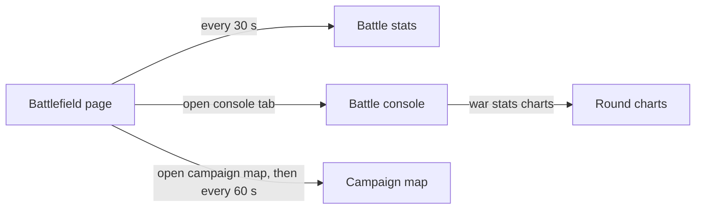

# Live data

[API docs](../../README.md) › [Military](../../../military/README.md) › Battlefield › Live data

What the battlefield page keeps reading while a battle runs: the domination bar, the battle console tabs, the campaign map, and two popups opened from the battlefield.



The 30-second timer also reloads the open console tab (current battle zone, fighter statistics or combat orders). When you stay idle, the client shows a sleep popup and stops both timers. Pushed events arrive over the [WebSocket](../../../military/websocket.md).

| Action | Method | Path | Status |
|--------|--------|------|--------|
| [Battle stats](#battle-stats) | GET | `/en/military/battle-stats/{battleId}/{division}/{battleZoneId}` | ✅ Verified 2026-11-27 |
| [Current battle zone](#current-battle-zone) | POST | `/en/military/battle-console` (`battleConsole`) | ✅ Verified 2026-11-27 |
| [Fighter statistics](#fighter-statistics) | POST | `/en/military/battle-console` (`battleStatistics`) | ✅ Verified 2026-11-27 |
| [War history](#war-history) | POST | `/en/military/battle-console` (`warList`) | ✅ Verified 2026-11-27 |
| [Combat orders](#combat-orders) | POST | `/en/military/battle-console` (`combatOrders`) | ✅ Verified 2026-11-27 |
| [Round charts](#round-charts) | POST | `/en/main/battle-console` (`charts`) | ✅ Verified 2026-11-27 |
| [Campaign map](#campaign-map) | GET | `/en/military/battle-map-status/{battleId}` | ✅ Verified 2026-11-27 |
| [Battle objectives](#battle-objectives) | GET | `/en/main/fight-listObjectives` | ✅ Verified 2026-11-27 (error response only) |
| [Terrain skills popup](#terrain-skills-popup) | GET | `/en/main/strength-popup` | ✅ Verified 2026-11-27 |
| [Save terrain skills](#save-terrain-skills) | POST | `/en/main/strength-save` | 🔍 From code |

Headers, cookie and `_token`: see [Making requests](../../guides/requests.md#common-headers). Status labels are explained [there too](../../guides/requests.md#status-labels). IDs such as `battleZoneId` come from the [battlefield page](page.md#battle).

Two console paths exist: `/military/battle-console` serves four console tabs, `/main/battle-console` serves only the charts.

---

## Battle stats

`GET /en/military/battle-stats/{battleId}/{division}/{battleZoneId}` · Auth required · ✅ Verified 2026-11-27

The main poll of the battlefield: domination, round points, top fighters of every division, PvP queue.

| Name | In | Type | Required | Description |
|------|----|------|----------|-------------|
| `battleId` | path | number | Yes | Battle ID |
| `division` | path | number | Yes | `1`–`4` ground, `11` air |
| `battleZoneId` | path | number | Yes | Zone of that division. `0` also returned `200` |

```bash
curl 'https://www.erepublik.com/en/military/battle-stats/958995/11/42911010' \
  -H 'Cookie: erpk=YOUR_SESSION_TOKEN' \
  -H 'X-Requested-With: XMLHttpRequest'
```

### Response

Shortened:

```json
{
  "zone_finished": false,
  "division": {
    "created_at": 1795799745,
    "bar": { "42911010": 56 },
    "domination": { "42911010": 76.7269 },
    "defence_shield": { "42911010": 0 },
    "56": { "42911010": { "domination": 750, "won": 0 }, "total": 54 },
    "57": { "42911010": { "domination": 10, "won": 0 }, "total": 0 }
  },
  "opponentsInQueue": 0,
  "isInQueue": false,
  "maxHit": 0
}
```

<details>
<summary>Full example response (one division of stats kept)</summary>

```json
{
  "stats": {
    "personal": [],
    "current": {
      "3": {
        "1": {
          "56": {
            "42909841": {
              "top_damage": [
                {
                  "battle_zone_id": 42909841,
                  "battle_id": 958995,
                  "zone_id": 3,
                  "division": 1,
                  "citizen_id": 1000001,
                  "damage": 22000,
                  "kills": 2,
                  "side_country_id": 56,
                  "type": "top_damage",
                  "level": 100,
                  "sector": ""
                }
              ]
            }
          }
        }
      }
    }
  },
  "zone_finished": false,
  "division": {
    "created_at": 1795799745,
    "bar": { "42911010": 56 },
    "domination": { "42911010": 76.7269 },
    "defence_shield": { "42911010": 0 },
    "56": { "42911010": { "domination": 750, "won": 0 }, "total": 54 },
    "57": { "42911010": { "domination": 10, "won": 0 }, "total": 0 }
  },
  "logs": { "attackers": [], "defenders": [] },
  "fightersData": {
    "1000001": { "id": 1000001, "name": "Citizen name", "avatar": "https://cdnt.erepublik.net/..." }
  },
  "opponentsInQueue": 0,
  "isInQueue": false,
  "campaigns": [],
  "epicBattle": 0,
  "activeEffects": [],
  "battleEffects": [],
  "maxHit": 0,
  "most_contested": [],
  "battle_zone_situation": { "42911006": 0, "42911010": 0 }
}
```

</details>

| Field | Type | Description |
|-------|------|-------------|
| `stats.current` | object | Round → division → country → battle zone → `top_damage[]`. Rounds differ between divisions |
| `stats.personal` | array | Empty in a battle you did not fight in |
| `zone_finished` | boolean | The requested round has ended |
| `division.created_at` | number | Round creation, Unix time |
| `division.bar` | object | Zone ID → country holding the wall |
| `division.domination` | object | Zone ID → that country's share of the wall, percent |
| `division.defence_shield` | object | Zone ID → shield value; earlier notes: `null` no shield, `0` inactive, positive active |
| `division.{countryId}.{zoneId}.domination` | number | Round points. The client treats `1800` as round won and `1400` as close to finish |
| `division.{countryId}.total` | number | Campaign points, compared with `campaignPointsThreshold` |
| `fightersData` | object | Citizen ID → `id`, `name`, `avatar` (30×30) |
| `opponentsInQueue`, `isInQueue` | number, boolean | Manual fight (PvP) queue |
| `epicBattle` | number | Epic status, `0` not epic |
| `battleEffects` | array \| object | Empty array when there are no effects, see [Battle effects](#battle-effects) |
| `maxHit` | number | Used for the catch-up booster damage preview |
| `most_contested` | array \| object | The client highlights the zone when `most_contested[battleZoneId]` is set |
| `battle_zone_situation` | object | Zone ID → `0` cold war, `1` full scale, `2` epic, see [Battle](page.md#battle) |
| `logs`, `campaigns`, `activeEffects` | array | Empty in the observed responses |

The client ignores a response with a truthy `error`.

<a id="battle-effects"></a>

### Battle effects

From earlier notes and the client; no active effect was observed.

| Key | Shape |
|-----|-------|
| `valentinesDay` | `is_active`, and when active `citizen_id`, `citizen_name`, `time_left` |
| `heroRewardEffect` | Keyed by side country ID, see below |

```json
"heroRewardEffect": {
  "71": {
    "country_id": 71,
    "cnt": 10,
    "effect": 1000,
    "created_at": "2026-06-02 00:05:22",
    "updated_at": "2026-06-02 00:22:02",
    "citizens": [ { "id": 1000001, "name": "Citizen name" } ]
  }
}
```

`heroRewardEffect` raises the Battle Hero / Sky Hero Gold reward of one side. It comes from **Funky Balloon Boosters** (Balloon Bonanza event, earned in the Weekly Challenge): one per citizen per battle zone and side, up to 10 citizens (`cnt`), `effect` = `100 × cnt` percent bonus Gold, at most +1000%. Not available in civil wars; only up to minute 60 of a round. The campaigns screen filters these battles with `#search/heroRewards`.

**Source:** real requests, 2026-11-27 (active and finished battles); `battle_new.js` (version 1795779886), `battleStats.getBattleStats` and `battleFX.setStatsInterval`; effects from earlier notes.

---

## Current battle zone

`POST /en/military/battle-console` · Auth required · ✅ Verified 2026-11-27

State of all five divisions and the campaign score.

| Name | Type | Required | Description |
|------|------|----------|-------------|
| `_token` | string | Yes | [CSRF token](../../guides/requests.md#csrf-token) |
| `action` | string | Yes | `battleConsole` |
| `battleId` | number | Yes | Battle ID |
| `zoneId` | number | Yes | Round number |
| `battleZoneId` | number | Yes | Zone being viewed; `0` was accepted |

```bash
curl 'https://www.erepublik.com/en/military/battle-console' \
  -H 'Cookie: erpk=YOUR_SESSION_TOKEN' \
  -H 'X-Requested-With: XMLHttpRequest' \
  --data-raw '_token=YOUR_CSRF_TOKEN&action=battleConsole&battleId=958995&zoneId=4&battleZoneId=42911010'
```

### Response

Shortened to one division:

```json
{
  "division": [
    {
      "id": 42911006,
      "division": 1,
      "type": "tank",
      "countries": {
        "56": { "roundDominationPoints": 750, "defenceShield": null, "totalPointsWonByDivision": 0, "wall": 93, "combatOrders": [] },
        "57": { "roundDominationPoints": 10, "defenceShield": 0, "totalPointsWonByDivision": 0, "wall": 7, "combatOrders": [] },
        "dominatingCountry": 56
      },
      "divisionWinner": false,
      "isEpic": false,
      "epicState": 0,
      "epicBattleProgress": 0,
      "campaignPoints": 1
    }
  ],
  "totalPointsByDivision": { "1": { "56": 3, "57": 0 }, "11": { "56": 21, "57": 0 } },
  "totalPoints": { "56": 54, "57": 0 },
  "isResistance": false,
  "isRevolution": false,
  "isDictatorship": false,
  "allies": { "56": [], "57": [] },
  "battle_time": 3225,
  "serverTime": 1795799751
}
```

| Field | Type | Description |
|-------|------|-------------|
| `division[]` | array | `1`–`4` (`type: "tank"`) and `11` (`airforce`, per earlier notes) |
| `division[].countries.{countryId}.roundDominationPoints` | number | Round points; the round is won at 1800 |
| `division[].countries.{countryId}.wall` | number | Wall share, `0`–`100` |
| `division[].countries.{countryId}.defenceShield` | number \| null | Defence shield |
| `division[].countries.{countryId}.totalPointsWonByDivision` | number | Rounds' campaign points won in this division |
| `division[].countries.{countryId}.combatOrders` | array | Active combat orders |
| `division[].countries.dominatingCountry` | number | Leading country |
| `division[].countries.divisionWinner` | number | Present once the round is won |
| `division[].divisionWinner` | boolean \| number | `false` while running and also in the observed finished battle; the client compares it with a country ID |
| `division[].isEpic`, `epicState` | boolean, number | The client reads `epicState` `0` as cold war and `1` as full scale |
| `division[].epicBattleProgress` | number | Progress toward epic |
| `division[].campaignPoints` | number | Campaign points the round is worth |
| `division[].winnerInfo` | object | Only for finished rounds, see below |
| `totalPointsByDivision`, `totalPoints` | object | Campaign points per division and in total, by country |
| `allies` | object | Country ID → allied countries |
| `battle_time` | number | Seconds since the campaign started; earlier notes: keeps growing after the battle ends |
| `serverTime` | number | Unix time |

The client also reads `terrainHistory`, which was not in the observed responses.

<details>
<summary>winnerInfo</summary>

Finished campaign:

```json
{
  "message": "Pakistan won this campaign",
  "countryName": "Pakistan",
  "countryPermalink": "Pakistan",
  "isConquered": false,
  "waiting": false,
  "timeUntil": 0,
  "campaignFinished": true
}
```

Earlier notes, finished round in a running campaign: `waiting: true`, `campaignFinished: false`, message such as `Division 1 of USA won this battle`, without `isConquered` and `timeUntil`. The client counts down `timeUntil - serverTime` when `timeUntil` is set.

</details>

**Source:** real requests, 2026-11-27; `erpk_angular_controllers.js` (version 1795779904), `BattleStatsFactory.getCurrentBattleZone`.

---

## Fighter statistics

`POST /en/military/battle-console` · Auth required · ✅ Verified 2026-11-27

Leaderboard of both sides for one round and division, with the list of rounds.

| Name | Type | Required | Description |
|------|------|----------|-------------|
| `_token` | string | Yes | CSRF token |
| `action` | string | Yes | `battleStatistics` |
| `battleId` | number | Yes | Battle ID |
| `zoneId` | number | Yes | Current round number |
| `round` | number | Yes | Round to show; `0` for the whole campaign |
| `division` | number \| string | Yes | Division; `overall` together with `round=0` |
| `battleZoneId` | number | Yes | Zone of that round and division |
| `type` | string | Yes | `damage` (client default) or `kills` |
| `leftPage`, `rightPage` | number | Yes | Page per side, from `1`. The client offers at most 5 pages of 10 |

```bash
curl 'https://www.erepublik.com/en/military/battle-console' \
  -H 'Cookie: erpk=YOUR_SESSION_TOKEN' \
  -H 'X-Requested-With: XMLHttpRequest' \
  --data-raw '_token=YOUR_CSRF_TOKEN&action=battleStatistics&battleId=958995&zoneId=4&round=4&division=11&battleZoneId=42911010&type=damage&leftPage=1&rightPage=1'
```

### Response

Shortened:

```json
{
  "rounds": {
    "42907486": { "id": 42907486, "zone": 1, "round": 1, "division": 1, "created_at": 1795779024, "type": "tanks", "terrain_type_id": 3, "started": 1, "finished": 1 }
  },
  "56": {
    "fighterData": {
      "1": {
        "citizenId": 1000001,
        "citizenName": "Citizen name",
        "citizenAvatar": "https://cdnt.erepublik.net/...",
        "country_name": "Iran",
        "country_permalink": "Iran",
        "for_country_id": 56,
        "value": "101,703",
        "raw_value": 101703,
        "reward": false
      }
    },
    "pages": 0
  },
  "57": { "fighterData": {}, "pages": 0 }
}
```

| Field | Type | Description |
|-------|------|-------------|
| `rounds` | object | Zone ID → round details, all rounds and divisions |
| `{countryId}.fighterData` | object | Rank → fighter |
| `…value` | string \| number | Formatted string for `damage`, plain number for `kills` |
| `…raw_value` | number | The number behind `value` |
| `…reward` | boolean | Reward flag |
| `{countryId}.pages` | number | `0` was returned with a single entry |

**Source:** real requests, 2026-11-27; `BattleStatsController.getFighterStatistics`, `setType`, `setRound`.

---

## War history

`POST /en/military/battle-console` · Auth required · ✅ Verified 2026-11-27

Earlier battles shown on the console's war history tab.

| Name | Type | Required | Description |
|------|------|----------|-------------|
| `_token` | string | Yes | CSRF token |
| `action` | string | Yes | `warList` |
| `battleId` | number | Yes | Battle ID |
| `page` | number | Yes | From `1` |

```bash
curl 'https://www.erepublik.com/en/military/battle-console' \
  -H 'Cookie: erpk=YOUR_SESSION_TOKEN' \
  -H 'X-Requested-With: XMLHttpRequest' \
  --data-raw '_token=YOUR_CSRF_TOKEN&action=warList&battleId=958995&page=1'
```

### Response

Shortened:

```json
{
  "list": [
    {
      "region": { "id": 492, "name": "Balochistan", "link": "Balochistan", "owner": "Pakistan", "flag": "Pakistan" },
      "result": { "id": 958419, "day": "6,946", "end": "2026-11-26 03:29:04", "winner": "Pakistan", "flag": "Pakistan", "outcome": "defense" }
    }
  ],
  "pages": 11
}
```

| Field | Type | Description |
|-------|------|-------------|
| `list[].region` | object | Region fought over and its owner |
| `list[].result.id` | number | Battle ID |
| `list[].result.day` | string | Game day, with a thousands separator |
| `list[].result.end` | string | End time |
| `list[].result.winner`, `outcome` | string | Winning country; `defense` observed |
| `pages` | number | Number of pages |

**Source:** real request, 2026-11-27; `BattleStatsController.getWarHistory`.

---

## Combat orders

`POST /en/military/battle-console` · Auth required · ✅ Verified 2026-11-27

Combat orders (bounties) of the battle. Setting or subscribing to an order is a different action.

| Name | Type | Required | Description |
|------|------|----------|-------------|
| `_token` | string | Yes | CSRF token |
| `action` | string | Yes | `combatOrders` |
| `battleZoneId` | number | Yes | Zone being viewed |
| `sideCountryId` | number | Yes | Left side country |
| `leftPage`, `rightPage` | number | Yes | Page per side |
| `campaignFinished` | boolean | No | Sent as `true` for finished battles |

`battleId` is not sent.

```bash
curl 'https://www.erepublik.com/en/military/battle-console' \
  -H 'Cookie: erpk=YOUR_SESSION_TOKEN' \
  -H 'X-Requested-With: XMLHttpRequest' \
  --data-raw '_token=YOUR_CSRF_TOKEN&action=combatOrders&battleZoneId=42911010&sideCountryId=65&leftPage=1&rightPage=1'
```

### Response

Shortened; `data` and `pages` cover all divisions:

```json
{
  "data": {
    "1": [], "2": [], "3": [], "4": [],
    "11": [
      {
        "combat_order_id": 475485,
        "side_country_id": 65,
        "military_unit_id": 1628,
        "military_unit_name": "Unit name",
        "military_unit_country_id": 65,
        "military_unit_avatar": "//cdnt.erepublik.net/...",
        "reward": 20000,
        "wall_percentage": 53,
        "budget_rating": 3,
        "is_subscribed": 0,
        "is_available": 1
      }
    ]
  },
  "pages": { "11": { "65": 1, "166": 0 } },
  "total_earned": 0
}
```

| Field | Type | Description |
|-------|------|-------------|
| `data.{division}[]` | array | Orders of both sides |
| `…reward` | number | Offered reward |
| `…wall_percentage` | number | Wall threshold of the order |
| `…budget_rating` | number | Budget indicator |
| `…is_subscribed`, `is_available` | number | Your state, `0`/`1` |
| `pages.{division}.{countryId}` | number | Pages per side; the client offers at most 5 |
| `total_earned` | number | Your earnings from orders |

**Source:** real requests, 2026-11-27; `BattleStatsController.getCombatOrders`.

---

## Round charts

`POST /en/main/battle-console` · Auth required · ✅ Verified 2026-11-27

Minute-by-minute damage and points of a round, drawn as the console's war statistics charts.

| Name | Type | Required | Description |
|------|------|----------|-------------|
| `_token` | string | Yes | CSRF token |
| `action` | string | Yes | `charts` |
| `battleId` | number | Yes | Battle ID |
| `zoneId` | number | Yes | Round to show |
| `division` | number | Yes | Division |
| `battleZoneId` | number | Yes | Zone of that round and division |
| `page` | number | Yes | The war history page number the client holds, normally `1` |

```bash
curl 'https://www.erepublik.com/en/main/battle-console' \
  -H 'Cookie: erpk=YOUR_SESSION_TOKEN' \
  -H 'X-Requested-With: XMLHttpRequest' \
  --data-raw '_token=YOUR_CSRF_TOKEN&action=charts&battleId=958995&zoneId=4&division=11&battleZoneId=42911010&page=1'
```

### Response

An array, one item per minute. Values are cumulative.

```json
[
  { "minute": 1, "invader_overall_damage": 22498, "defender_overall_damage": 15778, "invader_overall_points": 10, "defender_overall_points": 0 },
  { "minute": 2, "invader_overall_damage": 30849, "defender_overall_damage": 52687, "invader_overall_points": 10, "defender_overall_points": 10 }
]
```

The client adds `invader_wall` and `defender_wall` itself from the damage totals (50/50 when both are zero).

**Source:** real request, 2026-11-27; `BattleStatsFactory.getBattleZoneStatistics`.

---

## Campaign map

`GET /en/military/battle-map-status/{battleId}` · Auth required · ✅ Verified 2026-11-27

All zones of all rounds with their result, and whether you can travel to them. The client reloads it every 60 seconds while the map is open.

| Name | In | Type | Required | Description |
|------|----|------|----------|-------------|
| `battleId` | path | number | Yes | Battle ID |

```bash
curl 'https://www.erepublik.com/en/military/battle-map-status/958995' \
  -H 'Cookie: erpk=YOUR_SESSION_TOKEN' \
  -H 'X-Requested-With: XMLHttpRequest'
```

### Response

Shortened:

```json
{
  "battleZoneData": [
    {
      "battleId": 959046,
      "battleZoneId": 42911656,
      "zoneId": 2,
      "division": 1,
      "displayName": "Division I",
      "mapPosition": 2,
      "invaderCountryId": 166,
      "victimCountryId": 65,
      "invaderDomination": 50,
      "defenderDomination": 50,
      "winner": 0,
      "determination": 1,
      "isEpic": 0,
      "epicType": 0,
      "aircraftRound": 0,
      "createdAt": 1795799828,
      "processing": null
    }
  ],
  "battleZoneTravel": {
    "42911006": { "selected": false, "disabled": false, "travelRequired": true, "chooseSideRequired": false }
  }
}
```

| Field | Type | Description |
|-------|------|-------------|
| `battleZoneData[].zoneId` | number | Round number |
| `…mapPosition` | number | Position on the map; the client keeps the last zone listed for each position |
| `…winner` | number | `0` while running, else the winning country |
| `…invaderDomination`, `defenderDomination` | number | Wall share, percent |
| `…processing` | number \| null | Unix time on finished zones, `null` on a running one |
| `battleZoneTravel` | object | Zone ID → travel flags; used for zones without a winner |

An unknown battle (`1`) returned HTTP `500` with `{"error": true, "message": "500 Internal Server Error", "status": false, "code": 500}`.

The map geometry is static: `/images/modules/maps/tiles/default.geo.json`, or `multiZone.geo.json` for multi-zone battles. The client also reads `terrain` and `terrainStrength` of a zone, absent in the observed responses.

**Source:** real requests, 2026-11-27; `CampaignMapFactory.getBattleZoneData`, `CampaignMapController`.

---

## Battle objectives

`GET /en/main/fight-listObjectives` · Auth required · ✅ Verified 2026-11-27 (error response only)

Destructible objectives that regiments can deploy, listed in the "manage objectives" popup.

No parameters.

```bash
curl 'https://www.erepublik.com/en/main/fight-listObjectives' \
  -H 'Cookie: erpk=YOUR_SESSION_TOKEN' \
  -H 'X-Requested-With: XMLHttpRequest'
```

### Response

Observed outside an objectives event (HTTP `200`, JSON sent as `text/html`):

```json
{ "error": true, "message": "Objectives cannot be deployed at this time" }
```

On success, from the client: `request_time` and `message`, a list of objectives.

| Field of an objective | Description |
|-----------------------|-------------|
| `type` | String: `1` Power Plant, `2` Refinery, `3` Ammo Depot, `4` Cloning Facility, `5` Alchemy Lab, `6` Haunted Gold Mine, `7` Haunted Graveyard, `8` Horseman's Keep, `9` Mausoleum |
| `spawns_at`, `started_at`, `finished_at` | Compared with `request_time`: waiting, ready or deployed |
| `regiment_id` | Regiment that deployed it |
| `battle_id`, `side_country_id` | Used for the [choose side link](page.md#choose-side-link) |

**Source:** real request, 2026-11-27; `erpk_angular_controllers.js` (version 1795779904), `ObjectivesController`.

---

## Terrain skills popup

`GET /en/main/strength-popup` · Auth required · ✅ Verified 2026-11-27

The popup where strength is distributed over terrain skills, opened from the campaign map and the campaigns screen. An HTML fragment of about 44 KB.

```bash
curl 'https://www.erepublik.com/en/main/strength-popup' \
  -H 'Cookie: erpk=YOUR_SESSION_TOKEN' \
  -H 'X-Requested-With: XMLHttpRequest'
```

### Response

The data is in an inline script (example values):

```javascript
var strengthEnhancement = {
    division: 4,
    strengthTotal: 100000,
    strengthDistribution: { "1": { "terrain_id": 1, "skill_points": 40000 } },
    divisionLimits: { "1": 20000, "2": 25000, "3": 30000, "4": 40000 },
    myDivisionLimit: 40000,
    availableStrength: 60000
};
```

| Field | Description |
|-------|-------------|
| `strengthTotal` | Your strength |
| `strengthDistribution` | Terrain ID (`1`–`14`) → assigned skill points |
| `divisionLimits`, `myDivisionLimit` | Highest skill usable per division |
| `availableStrength` | Points not yet assigned |

**Source:** real request, 2026-11-27; `erepublik.js` (version 1795779896), popup `strengthEvent`.

---

## Save terrain skills

`POST /en/main/strength-save` · Auth required · 🔍 From code

> [!WARNING]
> Assigns your strength permanently. Resetting costs a Skill Reset Token.

| Name | Type | Required | Description |
|------|------|----------|-------------|
| `_token` | string | Yes | CSRF token |
| `skills` | array | To assign | One `{ terrain_id, points }` per terrain, sent as `skills[0][terrain_id]=1&skills[0][points]=…` |
| `reset` | boolean | To reset | `true` resets all skills |

The client asks for confirmation first. A truthy `error` is a failure; the text is in `msg`.

**Source:** `strengthEnhancement/script.js` (version 1698060180), `getSkills`, `updateSkills`.

---

## Open questions

| Topic | Earlier notes | Observed or code | Page follows |
|-------|---------------|------------------|--------------|
| Fighter statistics action | `fighterStatistics` | Client sends `battleStatistics` | Code, real request |
| War history action | `warHistory`, returns the same data as `battleConsole` and ignores `zoneId` | Client sends `warList`; `warHistory` not retested | Code, real request |
| `type` of fighter statistics | `damage`, `kills`, `overall` | Client sends `damage` or `kills`; "overall" is `division=overall` | Code |
| `POST /en/military/battle-stats/{battleId}` | Returns battle statistics | Not found in the current client; not requested | Left out |
| Campaign map method | POST | GET | Code, real request |
| `division.domination` | Can exceed 100 | `76.7` observed, a wall share | Not settled |
| Round points limit | At most 1800 typically | `1820` and `1830` seen | Both |
| `battleEffects` | Object | Empty array when there are none | Both |
