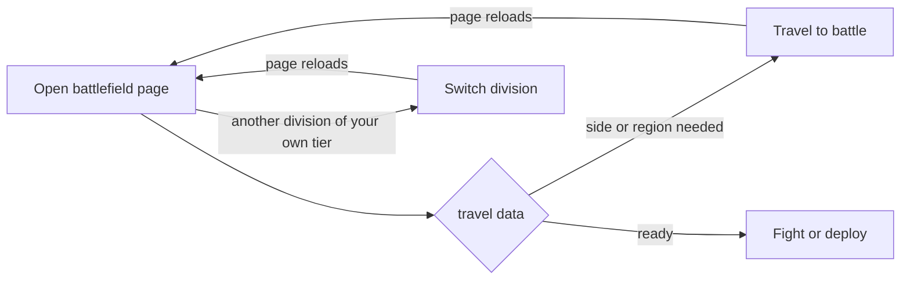

# Page and entry

[API docs](../../README.md) › [Military](../../../military/README.md) › Battlefield › Page and entry

The battlefield page of one battle, and the steps needed before you can fight in it: choosing a side, travelling, picking a division.



| Action | Method | Path | Status |
|--------|--------|------|--------|
| [Battlefield page](#battlefield-page) | GET | `/en/military/battlefield/{battleId}` | ✅ Verified 2026-11-27 |
| [Choose side link](#choose-side-link) | GET | `/en/military/battlefield-choose-side/{battleId}/{countryId}` | 🔍 From code |
| [Travel to battle](#travel-to-battle) | POST | `/en/main/battlefieldTravel` | 🔍 From code |
| [Switch division](#switch-division) | POST | `/en/main/switch-division` | 🔍 From code |
| [Vehicles for this battle](#vehicles-for-this-battle) | POST | `/en/military/get-skins` | 🔍 From code |

Headers, cookie and `_token`: see [Making requests](../../guides/requests.md#common-headers). Status labels are explained [there too](../../guides/requests.md#status-labels).

---

## Battlefield page

`GET /en/military/battlefield/{battleId}` · Auth required · ✅ Verified 2026-11-27

An HTML page of about 200–240 KB. It is not a JSON API: the battle state is embedded in a script.

| Name | In | Type | Required | Description |
|------|----|------|----------|-------------|
| `battleId` | path | number | Yes | Battle ID, see [Campaigns](../campaigns.md#list-battles) |
| `battleZoneId` | path | number | No | `/en/military/battlefield/{battleId}/{battleZoneId}` opens that zone |

```bash
curl 'https://www.erepublik.com/en/military/battlefield/958801' \
  -H 'Cookie: erpk=YOUR_SESSION_TOKEN' \
  -H 'User-Agent: Mozilla/5.0 ...'
```

Earlier notes sent a full browser cookie set (`erpk_mid`, `erpk_plang`, `erpk_auth`, `erpk_rm`, `cf_clearance`) and navigation headers.

You can open a battle you are not allowed to fight in yet: the response is `200` with `spectatorOnly` and the [travel data](#travel-data). An unknown battle ID returns `404`.

> [!CAUTION]
> The page contains your CSRF token and the [WebSocket](../../../military/websocket.md) token. Do not share saved copies.

### Extracting the battle state

`<script id="BATTLE_SERVER_DATA">` extends the global `SERVER_DATA` (which an earlier script already filled with `csrfToken`, `isLoggedIn`, `serverTime`):

```javascript
SERVER_DATA = $j.extend(SERVER_DATA, { /* battle state */ });
```

`battle_start_at`, `battle_critical_at` and `server_time` are written as `new Date('...')`, so replace those before parsing.

<details>
<summary>Python example</summary>

```python
import re, json

start = html.index('$j.extend(SERVER_DATA', html.index('id="BATTLE_SERVER_DATA"'))
text = html[html.index('{', start):]
text = re.sub(r"""new Date\(['"]([^'"]*)['"]\)""", r'"\1"', text)
data, _ = json.JSONDecoder().raw_decode(text)  # stops at the closing brace
```

</details>

### Battle

| Field | Type | Description |
|-------|------|-------------|
| `battleId` | number | Battle ID |
| `battleZoneId` | number | Zone being viewed |
| `zoneId`, `currentRoundNumber` | number | Round number |
| `invaderId`, `defenderId` | number | Attacking and defending country |
| `realInvaderId`, `realDefenderId` | number | Actual countries; differ in liberation wars |
| `leftBattleId`, `rightBattleId` | number | Countries on the left and right of the screen |
| `mustInvert` | boolean | Invert left and right |
| `isResistance`, `isCivilWar`, `isLiberation`, `isDictatorship` | boolean | War kind |
| `isMultiZone` | boolean | Several divisions |
| `battleFinished` | number | `1` finished, `0` active |
| `zoneStarted` | boolean | The round has started |
| `battle_close_to_finish`, `battleDetermination` | number | `0`/`1` flags; determination affects campaign points |
| `activeBattleZones` | object \| array | Zone ID → `{ battleZoneId, zoneId, division, type, terrainTypeId, sector }`; empty array when finished |
| `battleZoneSituation` | object | Zone ID → `0` cold war, `1` full scale, `2` epic |
| `points` | object | Campaign points: `attacker`, `defender` |
| `campaignPointsThreshold` | number | Points needed to win (83 or 150 typically) |
| `campaignHeroId` | object | Country ID → citizen ID of the campaign hero |
| `battle_start_at`, `battle_critical_at`, `server_time` | date | See [extraction](#extracting-the-battle-state) |
| `zoneElapsedTime` | string | `hours:minutes:seconds` |
| `rounds` | object | Zone ID → `{ id, zone, round, division, created_at, type, terrain_type_id, started, finished }`, all rounds |
| `countries` | object | Country ID → name |
| `texts` | object | Localised UI strings with `%%1%%`, `%%2%%` placeholders |

Divisions are `1`–`4` (ground, `type: "tanks"`) and `11` (air, `type: "aircraft"`). Earlier notes saw `terrain_type_id` `3` or `4` on ground zones and `0` on air in round 1, `null` later.

### You

| Field | Type | Description |
|-------|------|-------------|
| `citizenId`, `militaryUnitId`, `regimentId` | number | Your IDs |
| `countryId` | number | Country the client sends when [switching division](#switch-division) |
| `mySideCountryId` | number | Side shown as yours; set even before you chose one |
| `fighterCountryId` | number | Country you fight for; absent when you have not joined and in finished battles |
| `naturalDivision` | number | Your division by rank, `1`–`4` |
| `division`, `currentDivision` | number | Division being viewed |
| `canSwitchDivisions` | boolean | Division switching available |
| `onAirforceBattlefield` | boolean | Viewing the air zone |
| `spectatorOnly` | boolean | You cannot fight (finished, or side/travel needed) |
| `travelRequired`, `showTravelPopup` | boolean | Travel needed before fighting |
| `fightAgainstBrothers`, `isDeployOnly` | boolean | Restriction flags |
| `health`, `level` | number | Energy and level |
| `currentWeaponId` | number | Selected weapon, `-1` none |
| `hasBazookaAmmo` | boolean \| number | `false` observed; earlier notes `-1` |
| `weaponSkinId`, `opponentSkinId` | number | Vehicle skins |
| `fightSessionKey` | string | Fight session key, empty when not fighting |
| `oldEnemyHealth`, `remainingHospitals`, `pvpKillCount`, `pvpShowLock` | mixed | Manual fight state |
| `deployment` | object \| null | Active [deployment](deployment.md) |
| `webDeployEnabled` | boolean | Deployment available on the web |
| `has_jid`, `initialLoad` | mixed | Client flags |
| `tutorial`, `mission1Completed` … `mission3Completed`, `hasActiveObjective`, `hasDestroyedObjective`, `canDeployObjective` | mixed | Tutorial and objective state |

### Equipment and effects

| Field | Description |
|-------|-------------|
| `legendData` | Country ID → `tanks` and `aircraft`: `level`, `maxLevel`, `xp`, `requiredXP` (`null` at the top level), `levelProgress`, `damageBonus`, `title`, `vehicles` (active skin IDs) |
| `specialWeapons` | Bombs and missiles keyed `{industryId}_{quality}`; empty **array** when you own none |
| `rocket_damage`, `bomb_damage` | Damage values of special weapons |
| `specialWeaponsDisabled`, `bigBombsDisabled`, `cruiseMissilesDisabled` | Restriction flags |
| `boosters` | `active`, `inactive` (by category), `events`, `canUseCatchupBooster`, `catchupBoosterTextDetails` |
| `canUseCatchupBooster`, `regimentBoosters`, `regimentBooster`, `eventDamageBoosters`, `eventDamageBooster` | Further booster state |
| `aoe_effects`, `aoeMyDivision`, `aoeOtherDivisionData` | Area effects |
| `battle_effects` | `valentinesDay`, `snowFight`, `heroRewardEffect` |
| `fightersData`, `historyStats` | Filled during active rounds (empty in the observed responses) |

Item structure and the booster list: see [Boosters, bombs and PvP](boosters-bombs-pvp.md).

Session-level fields also present: `culture`, `csrfToken`, `isLoggedIn`, `ERPK_ECONOMY_HOST`, `ERPK_MAIN_HOST`, `extras`.

### Travel data

`SERVER_DATA.travel`, shortened:

```json
{
  "travelData": {
    "travelRequired": true,
    "chooseSideRequired": true,
    "sideCountryId": null,
    "defender": {
      "id": 65, "toCountryId": 65, "inRegionId": 111,
      "travelRequired": true, "selected": false, "disabled": false, "editDisabled": false,
      "availableDestinations": { "65": [111, 635] }
    },
    "invader": { "id": 13, "toCountryId": 65, "inRegionId": 111, "travelRequired": true },
    "allDestinations": {
      "countries": { "65": { "id": 65, "name": "Serbia", "regions": [111, 635] } },
      "regions": {
        "111": { "id": 111, "name": "Central Hungary", "countryId": 65, "cityId": 12,
                 "distanceInKm": 969, "distanceInZones": 1, "canMove": true, "ticket": 5 }
      }
    }
  },
  "battleZones": [
    { "battleZoneId": 42910540, "division": 11, "zoneId": 11, "label": "aircraft", "name": "Aircraft",
      "selected": true, "disabled": false, "terrain": { "id": 0, "codename": "aircraft", "name": "Aircraft" } }
  ],
  "travelMethod": "preferCurrency"
}
```

| Field | Description |
|-------|-------------|
| `travelData.defender`, `.invader` | Each side with the destination chosen for it (`toCountryId`, `inRegionId`) |
| `travelData.civilWarData.allowedSide` | When present, only that side can be chosen |
| `travelData.battleFinished` | In finished battles `travelData` is reduced to this flag and empty lists |
| `allDestinations.regions.*` | Also `cost` (currency), `ticketAmount`, `isFree`, `isDiscounted`, `isAlly`, `isConquered`, `isConqueredBy`, `isConqueredFrom`, `zoneName`, `cityName`, `permalink` |
| `battleZones[]` | Zones you can pick |
| `travelMethod` | `preferCurrency` or `currencyOnly` are named in the client |

With `preferCurrency` the client uses a travel ticket when your currency is not above `cost`; with `currencyOnly` it never does.

### Other data on the page

| Item | Content |
|------|---------|
| `erepublik.citizen` | Your identity, location, residence, party, daily orders, terrain skills, balances; also on other pages ([old description](../../../military/battlefield.md#erepublikcitizen-line-47)) |
| `energyData` | `energy`, `energyPoolLimit`, `recoverableEnergy`, `energyPerInterval`, `energyStatus` |
| `globalNS.userInfo` | `wellness`, `specialFoodAmount`, `specialFoodValue`, `energyPerInterval` |
| Deploy rank block | `myTotalDamage`, `isMaxLevel`, `rankText`, `rankIcon`, `currentRankPoints`, `nextRankPoints`, `rankPercentProgress` |
| `erepublik.settings.pomelo` | WebSocket gate (`gate.erepublik.com:3050`) and `authToken` |

**Source:** real requests, 2026-11-27 (active and finished battles); meanings of `battleZoneSituation` and the travel logic from `erpk_angular_controllers.js` (version 1795779904), `BattleSetupController`; remaining meanings from earlier notes.

---

## Choose side link

`GET /en/military/battlefield-choose-side/{battleId}/{countryId}` · Auth required · 🔍 From code

> [!WARNING]
> Not requested: judging by its name it sets your side in the battle.

| Name | In | Type | Required | Description |
|------|----|------|----------|-------------|
| `battleId` | path | number | Yes | Battle ID |
| `countryId` | path | number | Yes | Side to fight for |

The client uses it as a plain link: military unit regiment orders, and `battleLink` of your daily orders.

**Source:** `erpk_angular_controllers.js` (version 1795779904); `erepublik.citizen.dailyOrders[].battleLink` (earlier notes). Response and behaviour unknown.

---

## Travel to battle

`POST /en/main/battlefieldTravel` · Auth required · 🔍 From code

> [!WARNING]
> Moves your citizen and may spend currency or a travel ticket.

Confirms the battle setup panel: side, zone and, if needed, travel.

| Name | Type | Required | Description |
|------|------|----------|-------------|
| `_token` | string | Yes | [CSRF token](../../guides/requests.md#csrf-token) |
| `battleId` | number | Yes | Battle ID |
| `battleZoneId` | number | Yes | Target zone |
| `sideCountryId` | number | When changing side | Country to fight for |
| `toCountryId` | number | When that side needs travel | `travelData.{side}.toCountryId` |
| `inRegionId` | number | When that side needs travel | `travelData.{side}.inRegionId` |

"Join" on another zone of the map sends only `_token`, `battleId` and `battleZoneId`.

```bash
curl 'https://www.erepublik.com/en/main/battlefieldTravel' \
  -H 'Cookie: erpk=YOUR_SESSION_TOKEN' \
  -H 'X-Requested-With: XMLHttpRequest' \
  --data-raw '_token=YOUR_CSRF_TOKEN&battleId=958793&battleZoneId=42910540&sideCountryId=65&toCountryId=65&inRegionId=111'
```

The client treats a truthy `error` as failure and shows `message`; otherwise it reloads the battlefield page.

**Source:** `erpk_angular_controllers.js` (version 1795779904), `BattleSetupController.setupBattle`, `BattleSetupFactory.switch`.

---

## Switch division

`POST /en/main/switch-division` · Auth required · 🔍 From code

> [!WARNING]
> `unlock` may cost currency or gold, and `activate` changes your division in the battle.

| Name | Type | Required | Description |
|------|------|----------|-------------|
| `_token` | string | Yes | [CSRF token](../../guides/requests.md#csrf-token) |
| `action` | string | Yes | `activate`, `check` or `unlock` |
| `battleId` | number | Yes | `SERVER_DATA.battleId` |
| `countryId` | number | Yes | `SERVER_DATA.countryId` |
| `zoneId` | number | Yes | `SERVER_DATA.zoneId` (round number) |
| `division` | number | Yes | Target division |

| Button state | Calls |
|--------------|-------|
| Unlocked division | `activate`, then reload |
| Unlockable division | `check`; you confirm; `unlock`, then reload |

```bash
curl 'https://www.erepublik.com/en/main/switch-division' \
  -H 'Cookie: erpk=YOUR_SESSION_TOKEN' \
  -H 'X-Requested-With: XMLHttpRequest' \
  --data-raw '_token=YOUR_CSRF_TOKEN&action=check&battleId=958801&countryId=72&zoneId=11&division=3'
```

| Field | Type | Description |
|-------|------|-------------|
| `error` | boolean | Failure flag |
| `msg` | string | Error text (not `message`) |
| `cost` | number | With `check`: price shown to you; missing or falsy means free |

**Source:** `battle_new.js` (version 1795779886), `#switch_division_list` click handler.

---

## Vehicles for this battle

`POST /en/military/get-skins` · Auth required · 🔍 From code

Lists vehicles of the battle's type. Vehicle management is in [Armory](../../../military/armory.md).

| Name | Type | Required | Description |
|------|------|----------|-------------|
| `_token` | string | Yes | [CSRF token](../../guides/requests.md#csrf-token) |
| `type` | string | Yes | `aircraft` on the air battlefield, else `tanks` |

```bash
curl 'https://www.erepublik.com/en/military/get-skins' \
  -H 'Cookie: erpk=YOUR_SESSION_TOKEN' \
  -H 'X-Requested-With: XMLHttpRequest' \
  --data-raw '_token=YOUR_CSRF_TOKEN&type=aircraft'
```

The response is not documented.

**Source:** `erpk_angular_controllers.js` (version 1795779904), `ArmoryFactory.getVehicles`.

---

## Open questions

| Topic | Earlier notes | Observed or code | Page follows |
|-------|---------------|------------------|--------------|
| `battleZoneSituation` | `0` = finished or inactive | `0`/`1`/`2` are intensity; `0` also in active battles | Code |
| `travelData` fields of finished battles | `fighterCountryId`, `fightSessionKey`, `remainingHospitals` always present | Absent in a finished battle | Real request |
| `countryId` | Your citizenship | In a battle you had not joined it held the invader | Not settled |
| Travel parameters | `sideCountryId` always | Sent only when the side changes | Code |
| `activeBattleZones` | Array of objects | Object keyed by zone ID | Real request |
| Player strength | `erepublik.promos.April1st2017.playerStrength` | Not found in the page source | Not settled |
| Does `get-skins` still get called? | Not described | Defined in the client; caller not found | Not settled |
