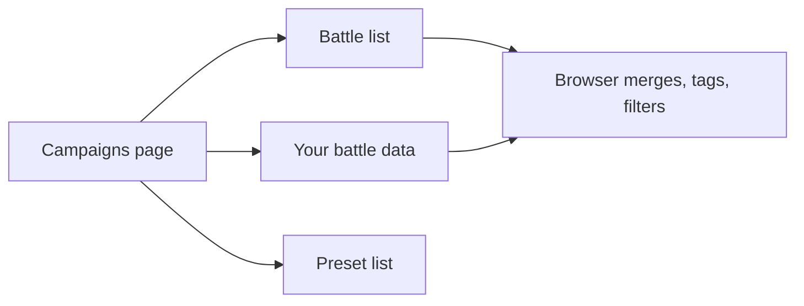

# Campaigns

[API docs](../README.md) › [Military](../../military/README.md) › Campaigns

The **Wars** screen (`/en/military/campaigns`) lists every active battle. It combines a public battle list with data about you, then filters and sorts in the browser. Filter sets can be saved as presets.



| Action | Method | Path | Status |
|--------|--------|------|--------|
| [Campaigns page](#campaigns-page) | GET | `/en/military/campaigns` | ✅ Verified 2026-11-27 |
| [List battles](#list-battles) | GET | `/en/military/campaignsJson/list` | ✅ Verified 2026-11-27 |
| [List battles of a country](#list-battles-of-a-country) | GET | `/en/military/campaignsJson/countryId/{countryId}` | ✅ Verified 2026-11-27 |
| [Your battle data](#your-battle-data) | GET | `/en/military/campaignsJson/citizen` | ✅ Verified 2026-11-27 |
| [List presets](#list-presets) | GET | `/en/main/preset-list` | ✅ Verified 2026-11-27 |
| [Preset popup](#preset-popup) | GET | `/en/main/preset-popup` | ✅ Verified 2026-11-27 |
| [Save preset](#save-preset) | POST | `/en/main/preset-save` | 🔍 From code |
| [Terrain priorities popup](#terrain-priorities-popup) | GET | `/en/main/terrain-priorities-popup` | 🔍 From code |

Headers, cookie and `_token`: see [Making requests](../guides/requests.md#common-headers). Status labels are explained [there too](../guides/requests.md#status-labels).

---

## Campaigns page

`GET /en/military/campaigns` · Auth required · ✅ Verified 2026-11-27

The HTML page itself. The battles are not in it; scripts load them from the endpoints below. Useful server-rendered data:

| Item | Description |
|------|-------------|
| `SERVER_DATA.csrfToken` | [CSRF token](../guides/requests.md#csrf-token) |
| `SERVER_DATA.listCampaigns.displayLimitEnabled`, `.displayLimit` | "Show less" setting of the list (limit was 9) |
| `SERVER_DATA.allianceData` | Alliances and their members, used by filters |
| `SERVER_DATA.terrainTypes` | Terrain definitions |
| `#fuelLeft`, `#maxFuel`, `#fuelPerInterval` | [Your fuel](battlefield/deployment.md#reading-your-fuel) |

**Source:** real request, 2026-11-27.

---

## List battles

`GET /en/military/campaignsJson/list` · Public · ✅ Verified 2026-11-27

All active battles, with the countries and the current round of every division. Works without a cookie. The game's client always requests the `en` path; another language segment (`ro`) also answered.

### Request

No parameters.

```bash
curl 'https://www.erepublik.com/en/military/campaignsJson/list'
```

### Response

Shortened to one battle and one division:

```json
{
  "battles": {
    "959046": {
      "id": 959046, "war_id": 229742, "zone_id": 1,
      "type": "tanks", "war_type": "direct", "start": 1795793121, "det": 1,
      "is_rw": false, "is_as": false, "is_dict": false, "is_lib": false,
      "region": { "id": 537, "name": "North Caucasus" },
      "city": { "id": 576, "name": "Rostov on Don" },
      "inv": { "id": 166, "allies": [], "ally_list": [], "points": 2 },
      "def": { "id": 65, "allies": [], "ally_list": [], "points": 5 },
      "div": {
        "42910365": {
          "id": 42910365, "div": 11, "end": null, "division_end": false,
          "epic": 2, "epic_type": 1, "intensity_scale": "epic_battle", "terrain": 0,
          "wall": { "for": 166, "dom": 51.23 },
          "co": {
            "inv": [],
            "def": [
              { "co_id": 475484, "group_id": 71, "reward": 10000, "budget": 0,
                "threshold": 52, "sub_country": 0, "sub_mu": 0 }
            ]
          }
        }
      },
      "terrainTypes": [7, 0],
      "effects": null,
      "hasMultipleTerrains": false,
      "isMultiZone": true
    }
  },
  "countries": {
    "23": { "id": 23, "name": "Canada", "allies": [70], "is_empire": false, "cotd": 0 }
  },
  "last_updated": 1795799150,
  "time": 1795799165
}
```

<details>
<summary>Full battle with all five divisions (earlier notes)</summary>

```json
{
  "battles": {
    "863509": {
      "id": 863509,
      "war_id": 204121,
      "zone_id": 5,
      "is_rw": false,
      "is_as": false,
      "type": "tanks",
      "start": 1769337065,
      "det": 1,
      "region": { "id": 91, "name": "Northern Basarabia" },
      "city": { "id": 271, "name": "Balti" },
      "is_dict": false,
      "is_lib": false,
      "war_type": "direct",
      "inv": { "id": 40, "allies": [], "ally_list": [], "points": 15 },
      "def": { "id": 52, "allies": [], "ally_list": [], "points": 74 },
      "div": {
        "37857731": { "id": 37857731, "div": 1, "end": 1769344144, "division_end": true, "epic": 0, "epic_type": 0, "intensity_scale": "cold_war", "co": { "inv": [], "def": [] }, "wall": { "for": 40, "dom": 99.83 }, "terrain": 0 },
        "37857732": { "id": 37857732, "div": 2, "end": 1769342524, "division_end": true, "epic": 0, "epic_type": 0, "intensity_scale": "cold_war", "co": { "inv": [], "def": [] }, "wall": { "for": 52, "dom": 50 }, "terrain": 0 },
        "37857733": { "id": 37857733, "div": 3, "end": 1769342524, "division_end": true, "epic": 0, "epic_type": 0, "intensity_scale": "cold_war", "co": { "inv": [], "def": [] }, "wall": { "for": 52, "dom": 71.43 }, "terrain": 0 },
        "37857734": { "id": 37857734, "div": 4, "end": 1769342645, "division_end": true, "epic": 0, "epic_type": 0, "intensity_scale": "cold_war", "co": { "inv": [], "def": [] }, "wall": { "for": 52, "dom": 68.25 }, "terrain": 0 },
        "37857735": { "id": 37857735, "div": 11, "end": 1769342645, "division_end": true, "epic": 0, "epic_type": 0, "intensity_scale": "cold_war", "co": { "inv": [], "def": [] }, "wall": { "for": 52, "dom": 62.59 }, "terrain": 0 }
      },
      "terrainTypes": [0],
      "effects": null,
      "hasMultipleTerrains": false,
      "isMultiZone": true
    }
  },
  "countries": {
    "167": { "id": 167, "name": "Albania", "allies": [], "is_empire": false, "cotd": 0 },
    "27": { "id": 27, "name": "Argentina", "allies": [], "is_empire": false, "cotd": 863489 }
  },
  "last_updated": 1769344252,
  "time": 1769344632
}
```

</details>

#### Top level

| Field | Type | Description |
|-------|------|-------------|
| `battles` | object | Battle ID → battle |
| `countries` | object | Country ID → country; `inv.id` and `def.id` point here |
| `last_updated` | number | Unix time of the last data update |
| `time` | number | Server Unix time |

#### `battles.*`

| Field | Type | Description |
|-------|------|-------------|
| `id`, `war_id` | number | Battle and [war](../../military/wars.md) IDs |
| `zone_id` | number | Round number (the client builds the `round{n}` filter tag from it) |
| `type` | string | `tanks` in every observed battle, including those with an air division |
| `war_type` | string | `direct`, `resistance` or `dictatorship` |
| `is_rw` | boolean | Resistance war |
| `is_as` | boolean | Airstrike |
| `is_dict`, `is_lib` | boolean | Dictatorship / liberation war |
| `start` | number | Unix time the round started |
| `det` | number | Unknown, `1` or higher (see [open questions](#open-questions)) |
| `region`, `city` | object | `id` and `name` |
| `inv`, `def` | object | Invader and defender: `id`, `points`, `allies` (country IDs), `ally_list` (`{ "id", "deployed" }`) |
| `div` | object | Battle zone ID → division |
| `terrainTypes` | array | Terrain IDs used in the battle |
| `effects` | object \| null | Event effects; the client reads `effects.heroRewards` |
| `hasMultipleTerrains`, `isMultiZone` | boolean | Terrain and zone layout flags |

#### `battles.*.div.*`

| Field | Type | Description |
|-------|------|-------------|
| `id` | number | Battle zone ID |
| `div` | number | `1`–`4` ground, `11` air |
| `end` | number \| null | Unix time the division round ended; `null` while active |
| `division_end` | boolean | `true` once `end` is set |
| `epic` | number | `0` cold war, `1` full scale, `2` epic |
| `epic_type` | number | `0`, or `1` on observed epic battles |
| `intensity_scale` | string | `cold_war`, `full_scale` or `epic_battle` |
| `wall.for` | number | Country holding the wall; `255` in dictatorship battles (see [open questions](#open-questions)) |
| `wall.dom` | number | Wall domination in percent, 0–100 |
| `co.inv`, `co.def` | array | Combat orders for each side |
| `terrain` | number | Terrain ID; `0` is the default |

#### Combat order

| Field | Type | Description |
|-------|------|-------------|
| `co_id` | number | Combat order ID |
| `group_id` | number | Group that placed it (meaning of the ID not confirmed) |
| `reward` | number | Offered reward (unit not confirmed) |
| `budget` | number | Remaining or total budget (set to `0` in the example) |
| `threshold` | number | Probably the wall percentage up to which it pays (❔ Unconfirmed) |
| `sub_country`, `sub_mu` | number | `0` in the observed orders |

Only active battles are listed: a finished battle disappears, so capture division `end` times while it is still there. See [Determining battle finish time](../../military/wars.md#determining-battle-finish-time).

**Source:** real requests, 2026-11-27; `zone_id`, `full_scale` and `effects.heroRewards` from `erpk_angular_services.js` (version 1795779904), `ListCampaignsFilterService.addCampaignTags`.

---

## List battles of a country

`GET /en/military/campaignsJson/countryId/{countryId}` · Public · ✅ Verified 2026-11-27

The same structure as [List battles](#list-battles), limited to one country. The homepage widget calls it with the country you are located in.

| Name | In | Type | Required | Description |
|------|----|------|----------|-------------|
| `countryId` | path | number | Yes | [Country ID](../../reference/README.md), e.g. `29` United Kingdom, `1` Romania, `10` Italy, `13` Hungary, `72` Lithuania |

```bash
curl 'https://www.erepublik.com/en/military/campaignsJson/countryId/29'
```

`countries` holds only the countries of the returned battles. An unknown ID is not an error: the response is `200`, and the two maps become empty **arrays**.

```json
{ "battles": [], "countries": [], "last_updated": 1795799196, "time": 1795799209 }
```

**Source:** real requests, 2026-11-27; caller — `erpk_angular_controllers.js` (version 1795779904), `ListCampaignsFactory.getHomepageCampaigns`.

---

## Your battle data

`GET /en/military/campaignsJson/citizen` · Auth required · ✅ Verified 2026-11-27

What the battle list means for you: your zones, eligibility and damage. Battle IDs match [List battles](#list-battles).

```bash
curl 'https://www.erepublik.com/en/military/campaignsJson/citizen' \
  -H 'Cookie: erpk=YOUR_SESSION_TOKEN' \
  -H 'X-Requested-With: XMLHttpRequest'
```

### Response

```json
{
  "battles": {
    "863498": {
      "citizenStats": {
        "72": { "zones": 1, "current": 0, "damage": 24536, "kills": 51, "activeZones": [] }
      },
      "selectedBattleZoneId": 37858205,
      "aircraftZoneId": 37858205,
      "groundZoneId": 37858204,
      "isMercenary": false,
      "isFreedomFighter": false
    },
    "863565": {
      "citizenStats": null,
      "selectedBattleZoneId": 37858095,
      "aircraftZoneId": 37858095,
      "groundZoneId": 37858094,
      "isMercenary": true,
      "isFreedomFighter": false
    }
  },
  "contributions": null,
  "deployment": null,
  "time": 1769345424
}
```

| Field | Type | Description |
|-------|------|-------------|
| `battles` | object | Battle ID → your data |
| `battles.*.citizenStats` | object \| null | Country ID you fought for → stats; `null` if you have not fought |
| `battles.*.citizenStats.*.zones` | number | Zones you took part in |
| `battles.*.citizenStats.*.current` | number | `0` when not fighting now, `1` observed with an active zone |
| `battles.*.citizenStats.*.damage`, `.kills` | number | Totals in this battle |
| `battles.*.citizenStats.*.activeZones` | array | Battle zone IDs currently active |
| `battles.*.selectedBattleZoneId` | number | Zone preselected for you |
| `battles.*.groundZoneId`, `.aircraftZoneId` | number | Your ground and air zones; keys of `div` in the list |
| `battles.*.isMercenary` | boolean | You can fight as a mercenary (not a citizen of the countries involved) |
| `battles.*.isFreedomFighter` | boolean | You can support the resistance |
| `contributions` | array \| null | Your contributions; the client reads `battle_id` from each item |
| `deployment` | object \| null | Your active [deployment](battlefield/deployment.md); the client reads `battleId` |
| `time` | number | Server Unix time |

### Errors

Without a valid cookie: HTTP `404`.

```json
{ "error": true, "message": "404 Not Found", "status": false, "code": 404 }
```

**Source:** real requests, 2026-11-27; example response — earlier notes; `contributions[].battle_id` and `deployment.battleId` from `erpk_angular_services.js` (version 1795779904).

---

## How the client combines and filters

- It requests the list and your data together, deep-merges them by battle ID and drops battles of yours that are not in the list.
- Every battle gets **filter tags**. The active tags are kept in `localStorage.campaignsFilters` and in the URL as `/en/military/campaigns#search/tag1+tag2`. Presets store the same tags.
- A refresh button repeats both requests.

| Group | Tags |
|-------|------|
| War | `directWar`, `airstrikeWar`, `resistanceWar`, `civilWar` |
| Zone | `aircraftBattle`, `groundBattle` |
| Intensity | `coldBattle`, `fullScaleBattle`, `epicBattle`, `groundEpicBattle`, `aircraftEpicBattle` |
| Progress | `waitingBattle` (a division round ended), `justStarted` (under 60 s), `freshBattle` (under 30 min), `earlyBattle` (under 60 min), `lateBattle` (60 min or more), `overtimeBattle` (90 min or more), `undisputed` |
| Country | `myLocation`, `myLocationAllies`, `myCountry`, `myCountryAllies`, `myCountryCotd`, `country-{id}`, `country-{id}-ALLIES`, `alliance-{id}` |
| You | `myContributions`, `dailyOrder`, `campaignOfTheDay`, `noTravel`, `recommended`, `combatOrders`, `mercenary`, `freedomFighter`, `truePatriot` |
| Events and other | `leagueOfAllies`, `myTerrains`, `heroRewards`, `terrain-{id}`, `round{n}` |

The tag list is 🔍 From code (`ListCampaignsFilterService`, version 1795779904); some tags appear only during events.

---

## List presets

`GET /en/main/preset-list` · Auth required · ✅ Verified 2026-11-27

Your saved filter presets.

```bash
curl 'https://www.erepublik.com/en/main/preset-list' \
  -H 'Cookie: erpk=YOUR_SESSION_TOKEN' \
  -H 'X-Requested-With: XMLHttpRequest'
```

```json
[
  {
    "id": 1912,
    "citizen_id": 1234567,
    "name": "My preset",
    "preset": "[\"myLocation\",\"aircraftBattle\",\"country-40\"]",
    "created_at": "2020-07-15 11:57:54",
    "updated_at": "2024-09-23 03:03:18"
  }
]
```

| Field | Type | Description |
|-------|------|-------------|
| `id` | number | Preset ID |
| `citizen_id` | number | Owner |
| `name` | string | Display name |
| `preset` | string | JSON-encoded array of [filter tags](#how-the-client-combines-and-filters); parse it a second time |
| `created_at`, `updated_at` | string | `YYYY-MM-DD HH:MM:SS` |

**Source:** real request, 2026-11-27.

---

## Preset popup

`GET /en/main/preset-popup` · Auth required · ✅ Verified 2026-11-27

HTML fragment of the "save preset" dialog (`#presetPopup`, popup names `presetPopup` and `filtersPresetPopup`). It contains only the form; the data comes from the page.

```bash
curl 'https://www.erepublik.com/en/main/preset-popup' \
  -H 'Cookie: erpk=YOUR_SESSION_TOKEN' \
  -H 'X-Requested-With: XMLHttpRequest'
```

**Source:** real request, 2026-11-27; popup names — `erepublik.js` (version 1795779896), `renderPopup`.

---

## Save preset

`POST /en/main/preset-save` · Auth required · 🔍 From code

> [!WARNING]
> Changes your account: creates a preset or overwrites one.

| Name | Type | Required | Description |
|------|------|----------|-------------|
| `_token` | string | Yes | [CSRF token](../guides/requests.md#csrf-token) |
| `action` | string | Yes | `create` or `replace` |
| `name` | string | Yes | 1–25 characters (checked by the client) |
| `preset[]` | string, repeated | Yes | [Filter tags](#how-the-client-combines-and-filters) |
| `presetId` | number | For `replace` | Preset to overwrite; empty for `create` |

```bash
curl 'https://www.erepublik.com/en/main/preset-save' \
  -H 'Cookie: erpk=YOUR_SESSION_TOKEN' \
  -H 'X-Requested-With: XMLHttpRequest' \
  --data-raw '_token=YOUR_CSRF_TOKEN&action=create&name=Air&preset%5B%5D=aircraftBattle&preset%5B%5D=myLocation'
```

The client treats a truthy `error` as failure and shows `message`. No way to delete a preset was found in the client scripts.

**Source:** `erpk_angular_controllers.js` (version 1795779904), `PresetPopupController.savePreset`, `PresetPopupFactory.savePreset`.

---

## Terrain priorities popup

`GET /en/main/terrain-priorities-popup` · Auth required · 🔍 From code

HTML popup for setting preferred terrain skills. The game shows its button only when `erepublik.citizen.canChangeTerrainPriorities` is set.

| Name | In | Type | Required | Description |
|------|----|------|----------|-------------|
| `battle_id` | query | number | No | Sent when opened from a battlefield; not from this screen |

```bash
curl 'https://www.erepublik.com/en/main/terrain-priorities-popup' \
  -H 'Cookie: erpk=YOUR_SESSION_TOKEN' \
  -H 'X-Requested-With: XMLHttpRequest'
```

For an account without that permission the request returned HTTP `404` (2026-11-27). The popup contents and how it saves are unknown.

**Source:** `erepublik.js` (version 1795779896), `renderPopup` case `terrainPriorities`; `erpk_angular_controllers.js` (version 1795779904).

---

## Open questions

| Topic | What is known | Missing |
|-------|---------------|---------|
| `det` | Values from `1` to `3.78` observed | Meaning |
| `wall.for = 255` | Seen in a dictatorship battle where `inv.id` equals `def.id`, in ended (`dom` 0) and active divisions | Probably marks the side that is not the country (❔ Unconfirmed) |
| Combat order fields | Names and values | Units of `reward`, `budget`, `threshold`; what `group_id` refers to |
| `is_as`, `is_lib` | In the response | No `true` example observed on 2026-11-27 |
| `recommended` tag | The client reads `isRecommended` | The field was not in the observed responses |
