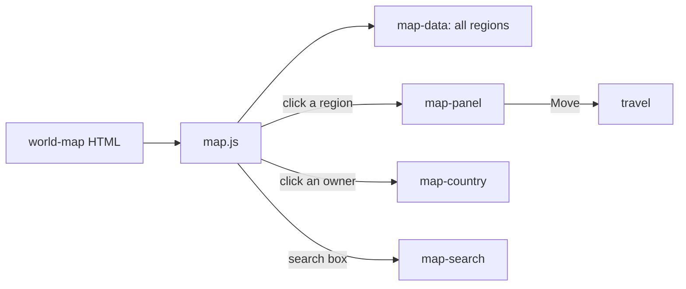

# Map and regions

[API docs](../README.md) › World and travel › Map and regions

The world map (a popup, loaded by `js/cmp/map.js`) and the page of a single region.



| Action | Method | Path | Status |
|--------|--------|------|--------|
| [World map](#world-map) | GET | `/en/main/world-map` | ✅ Verified 2026-11-27 |
| [Map data](#map-data) | GET | `/en/main/map-data` | ✅ Verified 2026-11-27 |
| [Side panel](#side-panel) | POST | `/en/main/map-panel` | ✅ Verified 2026-11-27 |
| [Country popup](#country-popup) | GET | `/en/main/map-country/{countryId}` | ✅ Verified 2026-11-27 |
| [Map search](#map-search) | GET | `/en/main/map-search` | ✅ Verified 2026-11-27 |
| [Map statistics](#map-statistics) | POST | `/en/main/map-stats` | 🔍 From code |
| [Region page](#region-page) | GET | `/en/main/region/{permalink}` | ✅ Verified 2026-11-27 |

"Move" on the map posts to [travel](travel.md#move). Map tiles come from a third-party map host and are not described here.

Headers, cookie and `_token`: see [Making requests](../guides/requests.md#common-headers). Status labels are explained [there too](../guides/requests.md#status-labels).

---

## World map

`GET /en/main/world-map` · Auth required · ✅ Verified 2026-11-27

HTML of the map popup (about 13 KB): panels, search box and inline scripts. Without a session the request is redirected to the front page.

```bash
curl 'https://www.erepublik.com/en/main/world-map' \
  -H 'Cookie: erpk=YOUR_SESSION_TOKEN' \
  -H 'X-Requested-With: XMLHttpRequest'
```

| Variable in the page | Holds |
|----------------------|-------|
| `mapSettings` | `carto_time_cache` (last map update), `mapbox_time_cache`, `layer_*_enabled`, `map_enabled` |
| `options` | Zoom and projection settings |
| `boundingBox` | Initial view: your region |
| `my_location` | Your city: `id`, `region_id`, `name`, `latitude`, `longitude`, `my_level` |
| `mapDailyOrder` | Daily order: `do_mission_id`, `do_region_id`, `do_battle_id`, `do_progress`, `do_target`, `do_reward_on` |
| `statsEnabled` | Enables [map statistics](#map-statistics); `false` on 2026-11-27 |

> [!CAUTION]
> The page contains your location and avatar. Do not share saved copies.

**Source:** real request, 2026-11-27; `generalPopup.mapPopup` in `erepublik.js` (version 1795779896).

---

## Map data

`GET /en/main/map-data` · Auth required · ✅ Verified 2026-11-27

Every region (574): owners, resources, city, coordinates and battles. About 640 KB of JSON, served with `Content-Type: text/html`.

| Name | In | Type | Required | Description |
|------|----|------|----------|-------------|
| `updated_at` | query | string | No | The client sends `mapSettings.carto_time_cache` (ISO 8601 with offset) |

```bash
curl 'https://www.erepublik.com/en/main/map-data?updated_at=2026-11-27T09%3A45%3A47-08%3A00' \
  -H 'Cookie: erpk=YOUR_SESSION_TOKEN' \
  -H 'X-Requested-With: XMLHttpRequest'
```

On 2026-11-27 a request with `updated_at` one hour old returned exactly the same body as a request without it. Expect the full map. Without a session the request is redirected to the front page.

### Response

An object keyed by region ID. One region with an active battle:

```json
{
  "3": {
    "resources": [
      { "id": "17", "image": "/images/resources/17.png", "name": "Magnesium", "industry": "aircraft", "bonus": "10" }
    ],
    "original_country": { "id": "1", "permalink": "Romania", "name": "Romania", "flag": "//www.erepublik.net/images/flags_png/M/Romania.png" },
    "current_country": { "id": "43", "permalink": "Turkey", "name": "Turkey", "flag": "//www.erepublik.net/images/flags_png/M/Turkey.png" },
    "city": { "name": "Constanta", "latitude": 44.1733333, "longitude": 28.6383333, "is_capital": false },
    "region": {
      "id": "3", "name": "Dobrogea", "population": "89",
      "centroid_lat": 44.67274, "centroid_lon": 28.55972,
      "bbox_min_lat": 43.73557, "bbox_max_lat": 45.45247,
      "bbox_min_lon": 27.25279, "bbox_max_lon": 29.69987,
      "area": 14929.57822
    },
    "active_battle_info": {
      "invader": { "id": "72", "name": "Lithuania", "flag": "//www.erepublik.net/images/flags_png/M/Lithuania.png" },
      "war_id": "228091",
      "is_resistance": "0",
      "status": null,
      "id": "959040"
    },
    "past_battle_info": {
      "invader": { "id": "43", "name": "Turkey", "flag": "//www.erepublik.net/images/flags_png/M/Turkey.png" },
      "victim": { "id": "164", "name": "Saudi Arabia", "flag": "//www.erepublik.net/images/flags_png/M/Saudi-Arabia.png" },
      "war_id": "227470",
      "is_resistance": false,
      "status": "3",
      "id": "949452",
      "finished": "6,914"
    }
  }
}
```

| Field | Type | Description |
|-------|------|-------------|
| `resources[]` | array | `id`, `name`, `industry` (`food`, `weapon`, `house`, `aircraft`), `bonus` (percent), `image`; all strings. Empty for 353 of 574 regions |
| `original_country`, `current_country` | object | `id` (string), `name`, `permalink`, `flag` (protocol-relative). Different IDs mean the region is occupied |
| `city` | object | `name`, `latitude`, `longitude`, `is_capital` |
| `region` | object | `id`, `name`, `population` (strings); centroid, bounding box, `area` (km²) as numbers |
| `active_battle_info` | object | Optional (248 regions): `invader`, `war_id`, `id` (battle), `is_resistance` (`"0"` / `"1"`), `status` (`null`). No `victim` |
| `past_battle_info` | object | Present for every region: also `victim`; `is_resistance` is a boolean; `status` was always `"3"`; `finished` is a formatted game day |

The map reads `past_battle_info.finished` as the day of "Under Occupation since" or "Liberated on". It also reads an optional `gold_mine.status`, not present on 2026-11-27.

**Source:** real requests, 2026-11-27; `MapApp.LoadData`, `City` in `js/cmp/map.js`.

---

## Side panel

`POST /en/main/map-panel` · Auth required · ✅ Verified 2026-11-27

HTML fragment of one map side panel. Read-only.

| Name | Type | Required | Description |
|------|------|----------|-------------|
| `_token` | string | Yes | [CSRF token](../guides/requests.md#csrf-token) |
| `panel` | string | Yes | Panel name, see below |
| `id` | number | Yes | Region ID or country ID |
| `back` | boolean | Yes* | Sent by the client when navigating back; `false` here |

| `panel` | `id` | Shows |
|---------|------|-------|
| `general_view` | region | City, region, owner, liberation, zone, travel cost and Move button |
| `region_view` | region | Resources, capital status |
| `region_details_view` | region | Current, conquered and historical region counts |
| `neighbours_view` | region | Neighbouring regions |
| `country_view` | country | Name, population, capital, campaign of the day |
| `country_details_view` | country | Production bonuses and resources |
| `political_view` | country | President and congress parties |
| `military_view` | country | Allies |

```bash
curl 'https://www.erepublik.com/en/main/map-panel' \
  -H 'Cookie: erpk=YOUR_SESSION_TOKEN' \
  -H 'X-Requested-With: XMLHttpRequest' \
  --data-raw '_token=YOUR_CSRF_TOKEN&panel=general_view&id=424&back=false'
```

The response is HTML (about 1–7 KB). `general_view` contains `mapTravel(424, 35)` behind its Move button.

**Source:** real requests (all eight panels), 2026-11-27; `MapPanels` in `js/cmp/map.js`.

---

## Country popup

`GET /en/main/map-country/{countryId}` · Auth required · ✅ Verified 2026-11-27

Summary of a country, opened from a region's owner on the map. JSON, served with `Content-Type: text/html`.

```bash
curl 'https://www.erepublik.com/en/main/map-country/35' \
  -H 'Cookie: erpk=YOUR_SESSION_TOKEN' \
  -H 'X-Requested-With: XMLHttpRequest'
```

### Response

Shortened, president replaced with placeholders:

```json
{
  "current_country_name": "Poland",
  "current_country_flag": "//www.erepublik.net/images/flags_png/M/Poland.png",
  "current_country_rank": 10,
  "current_country_population": 700,
  "current_country_capital": "Gdansk",
  "current_country_president": { "name": "CITIZEN_NAME", "id": "1234567", "avatar": "AVATAR_URL" },
  "current_country_nb_regions": 20,
  "current_country_conquered_regions": 15,
  "natural_enemy": { "name": "Estonia", "id": "70", "avatar": "//www.erepublik.net/images/flags_png/M/Estonia.png" },
  "area": "1.844.237",
  "resources": [
    {
      "resource": { "id": "1", "name": "Grain", "rarity": "rare", "bonus": "25", "manufacturing_industry": "food" },
      "regions_connected": {
        "307": {
          "id": "307", "name": "Silesia", "permalink": "Silesia",
          "current_owner_country_id": "35", "original_owner_country_id": "35",
          "zone": "31", "terrain": "default", "determination": "1.00",
          "under_occupation_since": "1674182584", "liberated_since": "1674338587"
        }
      },
      "regions_concession_active": [],
      "regions_disconnected": [],
      "regions_concession_inactive": [],
      "bonus": "25"
    }
  ],
  "battle": {
    "war_id": "145972",
    "id": "958886",
    "is_resistence": "0",
    "region": { "id": "96", "name": "Prince Edward Island", "permalink": "Prince-Edward-Island", "...": "..." },
    "invader_country": { "name": "Poland", "permalink": "Poland", "avatar": "//www.erepublik.net/images/flags_png/M/Poland.png" },
    "victim_country": { "name": "Canada", "permalink": "Canada", "avatar": "//www.erepublik.net/images/flags_png/M/Canada.png" }
  }
}
```

The response also has `food_bonus`, `weapon_bonus` and `bbox_*` coordinates. `is_resistence` is spelled that way. The four `regions_*` lists group regions by how they give the resource; an empty one is `[]`.

An unknown country returns an HTML `404` page.

**Source:** real request, 2026-11-27; `City.registerCountryPopUp` in `js/cmp/map.js`.

---

## Map search

`GET /en/main/map-search` · Auth required · ✅ Verified 2026-11-27

Suggestions for the map search box: countries, regions and cities. The client asks for at least 2 characters and shows up to 5.

| Name | In | Type | Required | Description |
|------|----|------|----------|-------------|
| `q` | query | string | Yes | Search text |

```bash
curl 'https://www.erepublik.com/en/main/map-search?q=warsa' \
  -H 'Cookie: erpk=YOUR_SESSION_TOKEN' \
  -H 'X-Requested-With: XMLHttpRequest'
```

```json
[
  {
    "type": "City",
    "name": "Warsaw",
    "avatar": "//www.erepublik.net/images/flags_png/M/Poland.png",
    "bounds": {
      "centroid_lat": "52.19662", "centroid_lon": "21.13861",
      "bbox_min_lon": "18.05485", "bbox_max_lon": "23.92198",
      "bbox_min_lat": "50.17441", "bbox_max_lat": "54.40118"
    }
  }
]
```

No match returns `[]`. A `type=region` parameter did not change the result: the search-type menu of the map does not filter this request.

**Source:** real requests, 2026-11-27; `MapSearch` (`tokenInput`) in `js/cmp/map.js`.

---

## Map statistics

`POST /en/main/map-stats` · Auth required · 🔍 From code

Usage tracking of map actions. Sent only when tracking is enabled (`statsEnabled`).

| Name | Type | Description |
|------|------|-------------|
| `_token` | string | CSRF token |
| `event_type` | string | `joinfight`, `travel`, `search`, `opencountrypopup`, and map events |
| `battle`, `country`, `region`, `country_id`, `value`, `search_type` | | Depend on the event |

```bash
curl 'https://www.erepublik.com/en/main/map-stats' \
  -H 'Cookie: erpk=YOUR_SESSION_TOKEN' \
  -H 'X-Requested-With: XMLHttpRequest' \
  --data-raw '_token=YOUR_CSRF_TOKEN&event_type=travel&country=35&region=424'
```

"Fight" on the map posts `joinfight` and opens the battlefield when this request answers.

**Source:** `joinFight`, `mapTravel`, `Map.ajaxStats` in `js/cmp/map.js`.

---

## Region page

`GET /en/main/region/{permalink}` · Auth not required · ✅ Verified 2026-11-27

A server-rendered HTML page with everything about a region. It answers without a session. Data sits in elements, `data-` attributes and inline scripts, so you need an HTML parser.

| Name | In | Type | Required | Description |
|------|----|------|----------|-------------|
| `permalink` | path | string | Yes | Region permalink, for example `Mazovia` or `Rhineland-Westphalia`. Take it from [travel data](travel.md#region-object) |

```bash
curl 'https://www.erepublik.com/en/main/region/Mazovia'
```

An unknown permalink returns `404`.

### Country and city

| Selector | Data |
|----------|------|
| `#countrySelectorDropdown option[selected]` | Current owner (the occupier in an occupied region): ID (`value`), `data-permalink` |
| `a.country_rank` | Country rank, for example "Rank 10" |
| `a.alliance_name` | Alliance and link; only when the country is in one |
| `span.dictatorship_flag_icon_l` | Present only under a dictatorship |
| `div#cityId_{id}.holder.city` | City block; the ID is the city ID |
| `a.cityLink`, `img.cityEmblem` | City page link and emblem |
| `h2.cityName small` | Role, for example "(Capital City of Mazovia)" |
| `span.cityResidents`, `span.cityVisitors` | Counters, as text |
| `span.cityVoters small` | Voter note, for example "No registered voters" or "No residents with the citizenship of this country" |

<details>
<summary>City block (structure from earlier notes; Warsaw and counts are placeholders)</summary>

```html
<div class="holder city" id="cityId_231">
    <h2 class="section">Population</h2>
    <a href="/en/main/city/Warsaw" class="cityLink">
        
    </a>
    <h2 class="largepadded special cityName">
        <a class="cityLink" href="/en/main/city/Warsaw">Warsaw</a>
        <br><small>(Capital City of Mazovia)</small>
    </h2>
    <p class="special">
        <span class="cityResidents">78 residents</span>
        <span class="cityVoters"><small>(No registered voters)</small></span>
    </p>
    <p class="special">
        <span class="cityVisitors">1 visitors</span>
        <span class="cityVoters"><small>(No residents with the citizenship of this country)</small></span>
    </p>
</div>
```

</details>

### Constructions

`.construction_listing` holds the building slots (earlier notes: always 15; empty slots have no building `<span>`).

| Selector | Data |
|----------|------|
| `.construction_listing strong` | Slot number |
| `span.product_tooltip` | Building: `industry`, `quality`, `id="building_{slot}{quality}"` |

Building industry IDs: 1 Food, 2 Weapons, 4 House, 6 Defense System, 23 Aircraft Weapons.

```html
<span id="building_11" class="product_tooltip" industry="6" quality="5">
    
</span>
```

### Determination

Two inline arrays: `regionDeterminations` (resistance wars) and `defensiveDeterminations` (when attacked).

```javascript
var regionDeterminations = [
    { "countryId": 43, "countryName": "Turkey", "permalink": "Turkey", "determination": 1.05, "active": true },
    { "countryId": 65, "countryName": "Serbia", "permalink": "Serbia", "determination": 1.01, "active": false }
];
var defensiveDeterminations = [];
```

| Field | Type | Description |
|-------|------|-------------|
| `countryId`, `countryName`, `permalink` | | Country |
| `determination` | number | Influence multiplier. Earlier notes: may carry float artifacts, round to 2 decimals |
| `active` | boolean | The current occupier |

A liberated region can list several countries, all with `active: false`. The blocks `.indent.productivity.regionDetermination` carry `hasDetermination` or `noDetermination`; the latter shows a text such as "This region has not been conquered in the past 250 days." The heading may add "(Liberated: 142 days ago)".

Earlier notes: the current occupier's `.item` has the class `active`, and another possible text is "This region has no determination when attacked."

### Productivity and resources

Country bonuses, `.area.bonus .item p.amount`:

| Attribute | Data |
|-----------|------|
| `data-industryId` | Industry ID |
| `data-bonus` | Percent, may be decimal |
| class | `full-bonus` (100), `partial-bonus`, `noBonus` (text "No bonus") |

Region resources, `.area.resource .item`; the list is empty for regions without resources:

| Attribute | Data |
|-----------|------|
| `data-resourceId` | Resource ID |
| `data-bonus` | Contribution to the country's industry bonus, percent |
| class `type-{industry}` | `food`, `weapon`, `house`, `aircraft` |
| class `rarity-{level}` | See below |
| `p.name`, `div.icon.{name}` | Name and icon |
| `title` | Description, for example "+2% to House production" |

```html
<div data-resourceId="11" data-bonus="2" class="item type-house rarity-verycommon" title="+2% to House production">
    <p class="name">Sand</p>
    <div class="icon sand" title="+2% to House production"></div>
    <p class="amount">+2%</p>
</div>
```

| Rarity class | Page bonus | `map-data` bonus |
|--------------|------------|------------------|
| `rarity-verycommon` | 2 | 10 |
| `rarity-common` | 3 | 15 |
| `rarity-uncommon` | 4 | 20 |
| `rarity-rare` | 5 | 25 |
| `rarity-veryrare` | 6 | 30 |
| `rarity-epic`, `rarity-legendary` | not seen | not seen |

### Resource IDs

Rarity and page bonus come from earlier notes on the region page; the `map-data` bonus is as returned by [map data](#map-data) on 2026-11-27. Where they disagree, see [Open questions](#open-questions).

| ID | Name | Industry | Page rarity | Page bonus | `map-data` bonus |
|----|------|----------|-------------|------------|------------------|
| 1 | Grain | Food | rare | +5% | 25 |
| 2 | Fish | Food | very common | +2% | 10 |
| 3 | Fruits | Food | common | +3% | 15 |
| 4 | Cattle | Food | uncommon | +4% | 20 |
| 5 | Deer | Food | very rare | +6% | 30 |
| 6 | Iron | Weapon | very common | +2% | 10 |
| 7 | Saltpeter | Weapon | uncommon | +4% | 25 |
| 8 | Aluminum | Weapon | common | +3% | 15 |
| 9 | Oil | Weapon | uncommon | +4% | 20 |
| 10 | Rubber | Weapon | rare | +5% | 30 |
| 11 | Sand | House | very common | +2% | 10 |
| 12 | Clay | House | uncommon | +4% | 20 |
| 13 | Wood | House | common | +3% | 15 |
| 14 | Limestone | House | rare | +5% | 25 |
| 15 | Granite | House | very rare | +6% | 30 |
| 16 | Neodymium | Aircraft | very rare | +6% | 30 |
| 17 | Magnesium | Aircraft | very common | +2% | 10 |
| 18 | Cobalt | Aircraft | rare | +5% | 25 |
| 19 | Titanium | Aircraft | common | +3% | 15 |
| 20 | Wolfram | Aircraft | uncommon | +4% | 20 |

### Pollution

`regionPollutionDetails` is keyed by industry ID (1, 2, 4, 23). Each value has 8 entries: index 0 is raw material, 1–7 are Q1–Q7. Earlier notes: House and Aircraft stop at Q5, so indices 6–7 are `N/A`.

```javascript
var regionPollutionDetails = {
    "1": [ { "has_pollution": true, "pollution": "10.68%" }, { "has_pollution": true, "pollution": "14.93%" } ],
    "4": [ { "has_pollution": false, "pollution": "0%" }, { "has_pollution": 0, "pollution": "N/A" } ]
};
```

`has_pollution` is `true`, `false`, or `0` for not applicable. `table.pollution` shows the same, with classes `pollution-status-high`, `pollution-status-none`, `industry-{id}` and `quality-{q}`.

### Neighbours

Each row of `table.neighbours` after the header: the owner's flag and country link, then the region link.

```html
<td>
  <a href="//www.erepublik.com/en/main/country-society/Poland" class="dotted">Poland</a>,
  <a href="//www.erepublik.com/en/main/region/Mazuria" class="dotted">Mazuria</a></td>
```

### Other variables

| Variable | Description |
|----------|-------------|
| `SERVER_DATA.csrfToken`, `.isLoggedIn` | Session data |
| `SERVER_DATA.serverTime` | `rfc`, `dateTime`, `timezone`, `offset`, `hour`, `unix`, `unixMs` |
| `erepublik.settings.eDay`, `.culture` | Game day and language |
| `countrySelector` | Country dropdown configuration |

**Source:** real requests, 2026-11-27 (an unoccupied and an occupied region); selectors and variables not listed in that check come from earlier notes.

---

## Open questions

| Topic | Earlier notes | Observed | Page follows |
|-------|---------------|----------|--------------|
| `updated_at` of map data | Required; returns only changed regions | Optional; same full body | Live response |
| Region page auth | None | Confirmed, 41 KB logged out and 92 KB logged in | Live response |
| Food resource IDs | `map-data` differed from the region page: Cattle 3 (page: 4) and Fish 11 (page: 2) | `map-data` now uses 2 for Fish and 4 for Cattle, as the page does | Live response |
| Weapon resource rarity | Region page: Saltpeter uncommon (+4), Rubber rare (+5) | `map-data` bonuses 25 and 30 match rare and very rare | Not settled |
| `status` of past battles | Outcome code | Always `"3"` | Not settled |
| `active_battle_info` | Not verified | Documented above | Live response |
