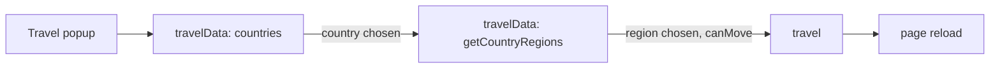

# Travel

[API docs](../README.md) › World and travel › Travel

The travel popup ("Change location"): pick a country and a region, see distance and price, move. It opens from the main menu, the [world map](map.md), a [city page](cities.md) and holdings. Travelling from a battlefield also has its own endpoint, [Travel to battle](../military/battlefield/page.md#travel-to-battle).



| Action | Method | Path | Status |
|--------|--------|------|--------|
| [Travel popup](#travel-popup) | GET | `/en/main/travelPopup` | ✅ Verified 2026-11-27 |
| [Travel data](#travel-data) | POST | `/en/main/travelData` | ✅ Verified 2026-11-27 |
| [Regions of a country](#regions-of-a-country) | POST | `/en/main/travelData` | ✅ Verified 2026-11-27 |
| [Move](#move) | POST | `/en/main/travel` | 🔍 From code |

Headers, cookie and `_token`: see [Making requests](../guides/requests.md#common-headers). Status labels are explained [there too](../guides/requests.md#status-labels).

---

## Travel popup

`GET /en/main/travelPopup` · Auth required · ✅ Verified 2026-11-27

The HTML of the popup (an Angular template for `ErpkTravelController`). It carries no travel data; the controller loads that with [travelData](#travel-data).

| Name | In | Type | Required | Description |
|------|----|------|----------|-------------|
| `regionId` | query | number | No | Preselected region |
| `holdingId` | query | number | No | Travel to a holding |
| `battleId` | query | number | No | Travel to a battle; the popup then shows both sides |

```bash
curl 'https://www.erepublik.com/en/main/travelPopup?regionId=424' \
  -H 'Cookie: erpk=YOUR_SESSION_TOKEN' \
  -H 'X-Requested-With: XMLHttpRequest'
```

The parameters are written back into an inline script, which the controller reads:

```javascript
$j.extend(erepublik.settings, { travelIds: { 'holding': 0, 'region': 424, 'battle': 0 } });
```

The same script defines the texts of the four travel methods: `ticketOnly`, `currencyOnly`, `preferCurrency`, `preferTicket`. Without a session the request is redirected to the front page.

**Source:** real request with `regionId`, 2026-11-27; `launchTravelPopup` in `erepublik.js` (version 1795779896). Only `regionId` was sent live.

---

## Travel data

`POST /en/main/travelData` · Auth required · ✅ Verified 2026-11-27

All countries, your location and residence, and, when a region or holding is targeted, the travel price to every other region. Read-only.

| Name | Type | Required | Description |
|------|------|----------|-------------|
| `_token` | string | Yes | [CSRF token](../guides/requests.md#csrf-token) |
| `holdingId` | number | Yes* | `0` when not travelling to a holding |
| `battleId` | number | Yes* | `0` when not travelling to a battle |
| `regionId` | number | Yes* | `0` for no target region |

\* The client always sends all three.

```bash
curl 'https://www.erepublik.com/en/main/travelData' \
  -H 'Cookie: erpk=YOUR_SESSION_TOKEN' \
  -H 'X-Requested-With: XMLHttpRequest' \
  --data-raw '_token=YOUR_CSRF_TOKEN&holdingId=0&battleId=0&regionId=424'
```

### Variants

| Request | `regions` | Size | `preselect*` | `alreadyInRegion` |
|---------|-----------|------|--------------|-------------------|
| `regionId=0` | Empty array | ~20 KB | `false`, `false` | `""` |
| `regionId` = another region | Object with all regions except your current one (573) | ~205 KB | IDs of the target | `false` |
| `regionId` = your current region | Same as above | | Numbers | `"You are already in <region>."` |

With `regionId=0` each country also has `currentRegions` and `regionsOccupiedByOthers` (see [Country object](#country-object)).

When `alreadyInRegion` is set, the client shows the text, resets the targets to `0` and requests the data again.

### Response

Shortened (`regionId=424`):

```json
{
  "countries": {
    "35": {
      "id": 35, "name": "Poland", "permalink": "Poland",
      "hasRegionsFromOthers": true, "hasRegionsOccupiedByOthers": true,
      "regions": [424, 423, 425]
    }
  },
  "regions": {
    "424": {
      "id": 424, "name": "Mazovia", "permalink": "Mazovia",
      "zoneName": "A3", "distanceInZones": 1, "distanceInKm": 100,
      "isConquered": false, "isConqueredFrom": 0, "isConqueredBy": 0,
      "countryId": 35, "cityId": 231, "cityName": "Warsaw",
      "cost": 100, "ticket": 5, "ticketAmount": 1,
      "canMove": true, "isAlly": false, "isDiscounted": false, "isFree": false
    }
  },
  "preselectCountryId": 35,
  "preselectRegionId": 424,
  "alreadyInRegion": false,
  "battleInfo": { "battleInfoText": "", "travelRequired": false, "travelData": false },
  "citizen": { "...": "see below" }
}
```

<details>
<summary>The citizen object (edited)</summary>

Citizenship, location and timers are placeholders; the residence city is only an example. Distance and price in the example above are made up too.

```json
{
  "country": { "id": 1, "name": "COUNTRY_NAME", "permalink": "COUNTRY_PERMALINK" },
  "region": { "id": 1, "name": "REGION_NAME", "permalink": "REGION_PERMALINK" },
  "city": { "id": 0, "name": "CITY_NAME" },
  "residence": {
    "hasResidence": 1,
    "cityId": 231,
    "regionId": 424,
    "countryId": 35,
    "bonuses": {
      "hasResidence": 1,
      "isInResidence": 0,
      "validUntil": 2000000000,
      "timeRemaining": 1000,
      "numHouses": 1,
      "energyBonus": 100,
      "recoveryBonus": 4,
      "description": "Residence bonuses partially available. Energy Pool bonus expires in:"
    },
    "cityInfo": {
      "id": 231, "name": "Warsaw", "permalink": "Warsaw", "cityTypeId": 2,
      "regionId": 424, "regionName": "Mazovia", "regionPermalink": "Mazovia",
      "countryId": 35, "countryName": "Poland", "countryPermalink": "Poland"
    }
  },
  "travelMethod": "preferCurrency"
}
```

</details>

| Field | Type | Description |
|-------|------|-------------|
| `countries` | object | Keyed by country ID; 74 countries |
| `regions` | object or `[]` | Keyed by region ID; see [Region object](#region-object) |
| `preselectCountryId`, `preselectRegionId` | number or `false` | What the popup selects |
| `alreadyInRegion` | string or `false` | A message when the target is your current region |
| `battleInfo` | object | `battleInfoText`, `travelRequired`, `travelData`. The popup also reads `popupTitle`, `infoText`, and `travelData.{countryId}.inRegionId` for each battle side |
| `citizen.country`, `.region`, `.city` | object | Citizenship and current location |
| `citizen.residence` | object | `hasResidence`, `cityId`, `regionId`, `countryId`, `bonuses`, `cityInfo` |
| `citizen.travelMethod` | string | Your preferred method, see [Payment](#payment) |

### Country object

| Field | Type | Description |
|-------|------|-------------|
| `id`, `name`, `permalink` | | Country |
| `regions` | number[] | Region IDs listed under this country: the ones it holds and its own regions held by others |
| `hasRegionsFromOthers` | boolean | Holds regions of other countries |
| `hasRegionsOccupiedByOthers` | boolean | Has regions held by others |
| `currentRegions` | string | Only with `regionId=0`: comma-separated IDs it currently holds |
| `regionsOccupiedByOthers` | | Only with `regionId=0`. In the observed countries a single region ID; the format with several regions is not confirmed |

### Region object

| Field | Type | Description |
|-------|------|-------------|
| `id`, `name`, `permalink` | | Region; `permalink` works in the [region page](map.md#region-page) URL |
| `countryId` | number | Current owner |
| `cityId`, `cityName` | | The region's [city](cities.md) |
| `zoneName` | string | Zone code, for example `A3` or `C5` |
| `distanceInZones` | number | `1`–`5` seen |
| `distanceInKm` | number | Distance from your location |
| `cost` | number | Price in local currency |
| `ticket` | number | Travel ticket quality; always `5` on 2026-11-27 |
| `ticketAmount` | number | Tickets needed; `1`–`4` seen |
| `canMove` | boolean | Travel is possible; when `false` the client says you do not have enough money |
| `isConquered` | boolean | Held by a country other than its original owner |
| `isConqueredFrom`, `isConqueredBy` | number | Original and occupying country, `0` if not conquered |
| `isAlly`, `isDiscounted`, `isFree` | boolean | All `false` in the observed responses |

Price grows with distance, and ranges overlap between neighbouring zone distances: one zone cost from about 20 to 290, five zones from about 870 to 1750 (one account, 2026-11-27).

### Residence bonus fields

| Field | Description |
|-------|-------------|
| `isInResidence` | The game's own answer to "am I home?" |
| `validUntil`, `timeRemaining` | Countdown of the extra energy **pool** after leaving; `0` at home |
| `energyBonus`, `recoveryBonus` | Energy pool and recovery per 6 minutes |
| `numHouses` | Number of houses |
| `description` | Status text shown by the game |

- When you leave the city, the recovery bonus stops at once and the extra pool lasts 30 minutes (the game's [city help popup](cities.md#help-popup)).
- `recoveryBonus` stays non-zero while you are away. Use `isInResidence`, not the numbers.
- Residence belongs to a **city**, travel targets a **region**. Prefer `isInResidence` to comparing IDs.
- `energyBonus` differs between responses: `100` here, `50` in `residentialBonuses` of the same account's [city data](cities.md#city-overview). Do not hard-code it.

**Source:** real requests, 2026-11-27 (`regionId` = `0`, another region, current region); `ErpkTravelController` in `erpk_angular_controllers.js` (version 1795779904). `holdingId` and `battleId` were sent only as `0`.

---

## Regions of a country

`POST /en/main/travelData` · Auth required · ✅ Verified 2026-11-27

With `check=getCountryRegions` the response holds only the regions of one country. The client calls it when you change the country list. Read-only.

| Name | Type | Required | Description |
|------|------|----------|-------------|
| `_token` | string | Yes | CSRF token |
| `check` | string | Yes | `getCountryRegions` |
| `countryId` | number | Yes | Country |
| `holdingId` | number | Yes* | `0` when not used |
| `regionId` | number | Yes* | `0`, or the region to preselect |

\* Always sent by the client. It does not send `battleId` here.

```bash
curl 'https://www.erepublik.com/en/main/travelData' \
  -H 'Cookie: erpk=YOUR_SESSION_TOKEN' \
  -H 'X-Requested-With: XMLHttpRequest' \
  --data-raw '_token=YOUR_CSRF_TOKEN&check=getCountryRegions&countryId=35&holdingId=0&regionId=0'
```

### Response

Same structure as [Travel data](#travel-data) (about 10 KB). For Poland: 21 [regions](#region-object) and 15 [countries](#country-object), the requested one plus those that share a region with it.

```json
{
  "countries": {
    "12": {
      "id": 12, "name": "Germany", "permalink": "Germany",
      "hasRegionsFromOthers": false, "hasRegionsOccupiedByOthers": true,
      "regions": [246]
    }
  },
  "regions": { "424": { "...": "region object" } },
  "preselectCountryId": 35,
  "preselectRegionId": false,
  "alreadyInRegion": "",
  "battleInfo": { "battleInfoText": "", "travelRequired": false, "travelData": false },
  "citizen": { "...": "as above" }
}
```

On an `error` field the client shows `message`.

If the chosen region was conquered from the selected country (`isConqueredFrom` equals it), the popup switches the country to `isConqueredBy` and requests its regions.

**Source:** real request, 2026-11-27; `ErpkTravelController.changeCountry`, `changeRegion` (version 1795779904).

---

## Move

`POST /en/main/travel` · Auth required · 🔍 From code

> [!WARNING]
> Moves your citizen and spends currency or travel tickets.

| Name | Type | Required | Description |
|------|------|----------|-------------|
| `_token` | string | Yes | CSRF token |
| `check` | string | Yes | `moveAction` (the map omits it, see below) |
| `travelMethod` | string | Yes | See [Payment](#payment) (the map omits it) |
| `inRegionId` | number | When a region is chosen | Destination region |
| `toCountryId` | number | "Move to location" | Country selected in the popup |
| `sideCountryId` | number | "Fight for …" buttons | Battle side; sent instead of `toCountryId` |
| `battleId` | number | On a battlefield | Current battle |

```bash
curl 'https://www.erepublik.com/en/main/travel' \
  -H 'Cookie: erpk=YOUR_SESSION_TOKEN' \
  -H 'X-Requested-With: XMLHttpRequest' \
  --data-raw 'check=moveAction&_token=YOUR_CSRF_TOKEN&travelMethod=preferCurrency&inRegionId=424&toCountryId=35'
```

The [world map](map.md#world-map) uses a shorter form, to `/en/main/travel/` with a trailing slash:

```text
battleId=0&_token=YOUR_CSRF_TOKEN&toCountryId=35&inRegionId=424
```

### Response

Earlier notes:

```json
{ "error": 0, "message": "success" }
```

A truthy `error` means failure and the client shows `message`; otherwise it reloads the page.

### Errors

| Message (earlier notes) | When |
|-------------------------|------|
| `You don't have enough currency/tickets to travel` | Cannot pay |

**Source:** `ErpkTravelController.moveAction`, `ErpkTravelFactory.moveAction` (version 1795779904); `mapTravel` in `js/cmp/map.js`; response examples — earlier notes.

---

## Payment

| `travelMethod` | Client behaviour |
|----------------|------------------|
| `preferCurrency` | Shows the currency price while your currency is above `cost`, otherwise a ticket |
| `preferTicket` | Shows a ticket |
| `currencyOnly` | Never uses tickets |
| `ticketOnly` | Shows a ticket |

The preferred method is stored in your game options (`/en/main/citizen-edit/edit_game_options`) and returned as `citizen.travelMethod`.

---

## Open questions

| Topic | Earlier notes | Observed or code | Page follows |
|-------|---------------|------------------|--------------|
| `regionId` in travel data | Required, target region | `0` is valid and returns no regions | Live response |
| `ticket` | Ticket type Q1–Q5 | Always `5` for every region | Live response |
| `alreadyInRegion` | Empty string or region ID | A message, `false` or `""` | Live response |
| `travelMethod` | Two values, each falling back to the other | Client names four values; the fallback happens server-side and was not tested | Code |
| Free travel | To residence, battles, allies | No region had `isFree`, `isDiscounted` or `isAlly` | Not settled |
| Move restrictions | May fail during a battle cooldown | Not tested | — |
